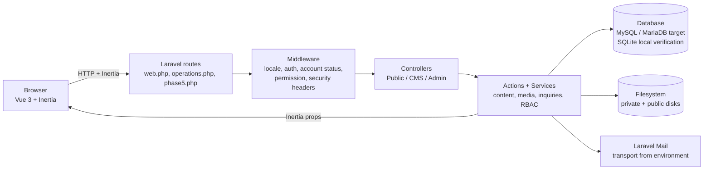

# PCDR — Participatory Community for Disasters Response

## 1. Project Header

| Field | Value |
|---|---|
| Project name | PCDR — Participatory Community for Disasters Response |
| Official Arabic name | جمعية العمل التشاركي في الأزمات والكوارث الخيرية – قطاع غزة |
| Abbreviation | PCDR |
| Strategic slogan | من الاستجابة الإنسانية إلى التعافي والتنمية المستدامة |
| Classification | Institutional Website + Custom CMS + Administrative Dashboard |
| Repository state | Implemented local technical delivery; no production deployment verified |
| Technical verdict | `PASS WITH DOCUMENTED LIMITATIONS` |
| Institutional verdict | `NOT CLEARED — RESTRICTED TECHNICAL WORK ONLY` |
| Planned Phase 6 | `NOT STARTED / NOT AUTHORIZED` |

PCDR is a single Laravel application that delivers a bilingual public website, an editorial content management system, and a permission-gated administrative dashboard. It is an institutional communication and content platform, not a SaaS product.

## 2. About PCDR

The repository implements the technical website and management surfaces for PCDR. The public side presents the organization's vision, mission, strategic areas, programmes, projects, news, publications, and contact routes in Arabic and English. The private side gives technical administrators and content editors tools to manage that public information, media, inquiries, email templates, users, roles, and permissions.

The strategic slogan is **من الاستجابة الإنسانية إلى التعافي والتنمية المستدامة** — “From humanitarian response to recovery and sustainable development.”

This README describes repository contents and documented technical status only. It does not establish legal registration, founding facts, staffing, partnerships, institutional approval, or operational authority. Those items remain subject to the governance records described in [Section 17](#17-institutional-governance-disclaimer).

## 3. Key Features

### Public Website

- Arabic and English routes under `/ar` and `/en`; `/` redirects to the configured default language.
- Right-to-left and left-to-right presentation with locale-aware document direction.
- Public pages for home, about, strategic areas, programmes, projects, news, publications, transparency, partnerships, get involved, and contact.
- Detail views for pillars, programmes, projects, news articles, publications, and managed pages.
- Structured navigation menus and footer content managed through the CMS.
- Contact, volunteer, and partnership inquiry forms that persist records for authorized staff.
- Public media and publication download routes.
- Canonical and `hreflang` metadata, `robots.txt`, and `sitemap.xml`.
- Responsive public layouts with reduced-motion styles and a skip-to-content link.

### Content Management

- CRUD management for pages, strategic pillars, programmes, projects, news, and publications.
- Arabic and English translations stored in per-entity translation tables.
- Editorial statuses: `draft`, `pending_review`, `approved`, `published`, and `archived`.
- Content revisions and status transitions recorded for review.
- Media library with localized metadata, upload/update/delete permissions, and signed media access routes.
- Navigation and homepage section management.
- Public site settings limited to an allowlist of website keys.
- Inquiry review with status changes, assignment, internal notes, and email replies.
- Bilingual email templates with safe preview.
- CMS dashboard showing website-oriented counters and recent activity.

### Administrative Dashboard

- Locale-prefixed dashboard at `/{locale}/dashboard`.
- Server-resolved navigation for overview, access, content, audit logs, and platform settings.
- User, role, and permission administration with server-side checks.
- CMS entry point and content-management navigation for authorized users.
- Inquiry management under the CMS engagement area.
- Audit log viewing and export where permission permits.
- Preserved Operations and Phase 5 modules remain in code and routes but are hidden from ordinary dashboard use by the central feature registry.

Only the features above are presented as delivered website/CMS scope. Hidden, reserved, or historically preserved modules are not represented as part of that scope.

## 4. Technology Stack

| Area | Technology | Verified version / constraint |
|---|---|---|
| Backend | Laravel | `^13.17` constraint; `13.43.0` installed |
| Language | PHP | `^8.3` constraint; `8.5.12` verified locally |
| Frontend | Vue | `3.5.46` |
| Integration | Inertia Laravel adapter | `3.7.0` |
| Frontend Inertia client | `@inertiajs/vue3` | `3.11.0` |
| Build tool | Vite | `8.3.8` |
| Vite Laravel plugin | `laravel-vite-plugin` | `3.2.1` |
| Vue Vite plugin | `@vitejs/plugin-vue` | `6.0.11` |
| CSS | Tailwind CSS and `@tailwindcss/vite` | `4.3.5` |
| Package managers | Composer, npm | npm `10.9.9` verified locally |
| Runtime tooling | Node.js | `22.23.3` verified locally; no `engines` constraint declared |
| Database | MySQL / MariaDB target; SQLite local verification | MySQL 8+ or MariaDB 10.6+ per deployment documentation; `sqlite`, `mysql`, `mariadb`, `pgsql`, and `sqlsrv` connections are configured |
| Authentication | Laravel session guard with custom controllers | Application-owned login, reset, verification, and CMS login |
| Authorization | Custom RBAC | `roles`, `permissions`, pivots, role scopes, policies, form requests, and middleware |
| Testing | PHPUnit | `12.5.45` |
| Formatting | Laravel Pint | `1.32.3` |
| Quality scripts | Composer audit, npm audit, translation checker | Available as documented in [Section 13](#13-testing-and-code-quality) |

## 5. System Architecture

The browser loads a Laravel-rendered Inertia page. Laravel routes resolve a locale prefix, apply middleware, enforce authentication and permissions, and pass explicit props to Vue page components. Controllers use application services and Eloquent models for content, media, settings, inquiries, and access control. File storage uses Laravel's filesystem abstraction; mail uses Laravel Mail with transport selected through environment configuration.



Request flow:

1. `/` redirects to the configured public language; subsequent public and administrative URLs use `/ar` or `/en`.
2. `SetLocale` and `SetWebsiteLocale` establish locale and direction.
3. `EnsureDashboardFeatureAvailable` blocks hidden module surfaces for ordinary dashboard users.
4. Authentication, account-status, throttle, CSRF, and permission middleware protect private routes.
5. Vue components render Inertia responses; frontend visibility is not treated as authorization.
6. Eloquent models and per-entity translation tables persist localized content.

Authorization boundaries are enforced on the server. CMS routes use the `cms` middleware alias and `CmsAccess`; administration routes use `auth`, `account.active`, and `permission` middleware. The preserved `operations` and `operations/phase5` route groups are gated by `EnsureDashboardFeatureAvailable` and `config/dashboard_features.php`.

## 6. Project Structure

| Path | Purpose |
|---|---|
| `app/Http/Controllers/Public/` | Public website controllers. |
| `app/Http/Controllers/Cms/` | CMS dashboard, content, media, inquiry, navigation, settings, and email-template controllers. |
| `app/Http/Controllers/Admin/` | User, role, permission, audit-log, and platform-setting controllers. |
| `app/Http/Controllers/Auth/` | Session login, logout, password reset, and email verification. |
| `app/Http/Controllers/Operations/`, `app/Http/Controllers/Phase5/` | Preserved hidden module controllers. |
| `app/Http/Middleware/` | Locale, account-status, CMS permission, dashboard-feature, and security-header middleware. |
| `app/Http/Requests/` | Server-side validation and authorization requests. |
| `app/Actions/`, `app/Services/`, `app/Policies/` | Business operations, shared services, and authorization policies. |
| `app/Models/` | Eloquent models, including localized content and access-control models. |
| `bootstrap/app.php` | Middleware stack, aliases, redirects, CSRF exception, and exception rendering. |
| `config/` | Application, database, website, CMS, permissions, navigation, workflow, and feature-registry configuration. |
| `database/migrations/` | Schema migrations. |
| `database/seeders/` | Permissions, website structure, CMS roles, and email-template seeders. |
| `database/factories/` | Model factories used by tests. |
| `resources/js/Pages/Public/`, `Pages/Cms/`, `Pages/Admin/`, `Pages/Auth/` | Inertia page components. |
| `resources/js/Components/`, `resources/js/Layouts/`, `resources/js/composables/` | Reusable public, CMS, and UI building blocks. |
| `resources/js/Pages/Operations/`, `Pages/Phase5/` | Preserved hidden module pages. |
| `resources/css/`, `resources/views/app.blade.php` | Styles and root Blade document with locale direction and SEO metadata. |
| `routes/web.php` | Public, CMS, authentication, and administration routes. |
| `routes/operations.php`, `routes/phase5.php` | Preserved hidden module routes. |
| `lang/ar/`, `lang/en/` | Static UI and validation translations. |
| `tests/Feature/`, `tests/Unit/` | PHPUnit test suites. |
| `tests/e2e/` | Playwright configuration and spec files; not currently runnable as installed. |
| `scripts/` | Icon generation and translation-check scripts. |
| `docs/architecture/`, `docs/design/`, `docs/phases/`, `docs/reports/`, `docs/strategy/` | Project documentation. |

## 7. Requirements

- PHP `^8.3`; PHP 8.3–8.5 is the target range documented for Laravel 13 and the deployment design.
- Composer and the PHP extensions listed by the deployment design: `mbstring`, `xml`, `curl`, `pdo_mysql`, `zip`, `fileinfo`, `tokenizer`, `openssl`, `bcmath`, and `intl`. `gd` is optional only if approved image processing is introduced.
- Node.js and npm for asset builds. Node `22.23.3` and npm `10.9.9` were verified locally; the repository does not declare an `engines` constraint.
- A database. The deployment design targets MySQL 8+ or MariaDB 10.6+ with InnoDB, `utf8mb4`, and strict mode. Laravel configuration also defines SQLite, PostgreSQL, and SQL Server connections.
- A web server configured with `public/` as the document root; application code and `.env` must not be publicly readable.
- Writable `storage/` and `bootstrap/cache/` directories for the runtime user.
- A mail transport for production inquiry replies and account-security messages. Local defaults use the `log` mailer.

## 8. Installation and Local Development

The reviewed checkout has no configured Git remote, so replace `<repository-url>` with the approved repository URL.

```bash
git clone <repository-url> pcdr
cd pcdr

composer install
npm install

cp .env.example .env
php artisan key:generate
```

Configure `DB_*` values in `.env`. For a quick local SQLite setup, use an absolute database path:

```bash
touch database/database.sqlite
```

```dotenv
DB_CONNECTION=sqlite
DB_DATABASE=/absolute/path/to/pcdr/database/database.sqlite
```

Run migrations, link public storage, and seed reference data:

```bash
php artisan migrate
php artisan storage:link
php artisan db:seed
```

`DatabaseSeeder` synchronizes the code-owned permission catalogue and calls `WebsiteSeeder`, `CmsRolesSeeder`, and `EmailTemplatesSeeder`. To bootstrap the technical Platform Owner account, use the provided command and follow its secure input flow:

```bash
php artisan pcdr:platform-owner:bootstrap
```

Start Laravel and Vite in separate terminals:

```bash
php artisan serve
```

```bash
npm run dev
```

Alternatively, the repository provides a combined development command:

```bash
composer run dev
```

Build production assets:

```bash
npm ci
npm run build
```

Never place real credentials in `.env.example` or commit the generated `.env` file.

## 9. Environment Configuration

The safe starting point is `.env.example`, which contains placeholders rather than secrets. Important groups are:

| Variable group | Purpose |
|---|---|
| `APP_NAME`, `APP_ENV`, `APP_URL`, `APP_DEBUG` | Application identity, environment, canonical URL, and debug mode. |
| `APP_KEY` | Encryption key generated per environment with `php artisan key:generate`. |
| `APP_LOCALE`, `APP_FALLBACK_LOCALE` | Default and fallback locales. The example uses `ar` and `en`. |
| `DB_CONNECTION`, `DB_HOST`, `DB_PORT`, `DB_DATABASE`, `DB_USERNAME`, `DB_PASSWORD` | Database connection. |
| `SESSION_DRIVER`, `CACHE_STORE`, `QUEUE_CONNECTION` | The example uses the `database` driver for each. |
| `FILESYSTEM_DISK` | Default Laravel filesystem disk. |
| `MAIL_*` | Mail transport and sender settings; the example uses `log`. |
| `EMAIL_INTERNAL_NOTIFICATION_RECIPIENT` | Optional reference-only internal inquiry notification address. |
| `PCDR_HIDDEN_MODULES_ACCESS` | Developer-level override for preserved modules; keep `false`. |
| `AWS_*` | Optional S3-compatible storage settings. |
| `VITE_APP_NAME` | Client-side application name exposed through Vite. |
| `PCDR_OWNER_*` | Optional one-time Platform Owner bootstrap values; never commit passwords. |
| `CMS_BOOTSTRAP_EMAIL`, `CMS_LOCAL_PASSWORD`, `CMS_LOCAL_AUTH` | Local/testing CMS sign-in shim; leave unset outside local development. |

A safe local example based on declared variables:

```dotenv
APP_NAME=PCDR
APP_ENV=local
APP_KEY=
APP_DEBUG=true
APP_URL=http://localhost:8000

APP_LOCALE=ar
APP_FALLBACK_LOCALE=en

DB_CONNECTION=sqlite
DB_DATABASE=/absolute/path/to/pcdr/database/database.sqlite

SESSION_DRIVER=database
CACHE_STORE=database
QUEUE_CONNECTION=database
FILESYSTEM_DISK=local

MAIL_MAILER=log
MAIL_FROM_ADDRESS="hello@example.test"
MAIL_FROM_NAME="${APP_NAME}"

PCDR_HIDDEN_MODULES_ACCESS=false
VITE_APP_NAME="${APP_NAME}"
```

For production, use `APP_ENV=production`, `APP_DEBUG=false`, a real HTTPS `APP_URL`, environment-specific secrets, and a confirmed database/mail/filesystem configuration. Do not enable the local CMS bootstrap variables in production.

## 10. Database and Seeders

`config/database.php` defines `sqlite`, `mysql`, `mariadb`, `pgsql`, and `sqlsrv` connections. The architecture and deployment documentation target MySQL or MariaDB with InnoDB, `utf8mb4`, and strict mode. The latest documented verification used isolated SQLite because the target MySQL/MariaDB engine was unavailable; final target-engine compatibility remains unverified.

Migration workflow:

```bash
php artisan migrate
php artisan migrate:status
```

For a deliberately approved non-local environment, `php artisan migrate --force` is available only after backup, review, and authorization.

Seeder behaviour:

- `DatabaseSeeder` calls `pcdr:permissions:sync`, then `WebsiteSeeder`, `CmsRolesSeeder`, and `EmailTemplatesSeeder`.
- `WebsiteSeeder` creates structural public content: navigation menus, strategic pillars, and homepage sections. It does not invent people, partners, projects, results, or contact details.
- `CmsRolesSeeder` defines functional website-management roles without assigning people or offices.
- `EmailTemplatesSeeder` creates default bilingual email-template records.
- A local/testing CMS shim can create a test account only when `CMS_LOCAL_AUTH` is enabled and the environment is `local` or `testing`. Never enable these variables in production.
- Bootstrap the Platform Owner with `php artisan pcdr:platform-owner:bootstrap`; do not commit bootstrap passwords.

Run seeders in production only after reviewing exactly which records they create for that environment.

## 11. Authentication and Authorization

Authentication is implemented with Laravel's session guard and application-owned controllers rather than a starter kit. Routes cover CMS login/logout, standard login/logout, forgot-password, reset-password, and email verification. CMS login is rate-limited, and invalid CMS access redirects guests to the localized standard login when the local shim is disabled.

Authorization is server-side and permission-based:

- The code-owned permission catalogue is synchronized with `php artisan pcdr:permissions:sync`.
- Users may hold multiple roles; permissions are resolved through role and scope data with cache invalidation.
- Middleware aliases include `cms`, `permission`, `account.active`, and `locale`.
- Form requests, policies, controllers, and services enforce access; Vue helpers may only affect UI visibility.
- Protected routes require the exact capability, and audit entries record sensitive administrative actions.
- No institutional `approve` permission or approval role is part of the delivered CMS.

The Platform Owner is a technical bootstrap and administration authority. It is not an institutional approval delegation and does not authorize content, policies, phase transitions, or public claims on behalf of PCDR.

## 12. Localization and Accessibility

- Public and administrative routes are prefixed with `ar` or `en`; the root URL redirects to the configured default language.
- `SetLocale` and `SetWebsiteLocale` resolve locale from the route and website settings.
- Static UI strings and validation messages live in `lang/ar/` and `lang/en/`.
- Editorial content uses per-entity translation tables such as page, article, programme, project, publication, pillar, media, and setting translations.
- `resources/views/app.blade.php` emits `lang` and `dir` attributes; Vue layouts propagate locale and direction for Inertia navigation.
- Public pages emit canonical and `hreflang` links for Arabic and English.
- The interface includes a skip-to-content link, semantic landmarks, ARIA state attributes in interactive components, and `prefers-reduced-motion` handling.

The implementation includes accessibility-oriented patterns, but no complete WCAG conformance audit or screen-reader certification is documented. Automated accessibility tooling and browser-based verification are not currently installed.

## 13. Testing and Code Quality

| Check | Command | Status |
|---|---|---|
| Laravel test suite | `php artisan test --compact` | Primary documented test command. The Phase 6 acceptance document reports `165` passing tests and `3,481` assertions; those results were not re-executed during this documentation review. |
| Direct PHPUnit runner | `vendor/bin/phpunit` | Installed and available. |
| Pint formatter | `vendor/bin/pint --dirty --format agent` | Documented project formatting command. |
| Frontend build | `npm run build` | Verified build command; the Phase 6 record notes non-fatal build warnings. |
| Composer audit | `composer audit` | Available; the Phase 6 record reports no advisories. Re-run before relying on the result. |
| npm audit | `npm audit` | Available; the Phase 6 record reports zero vulnerabilities. Re-run before relying on the result. |
| Translation keys | `node scripts/check-translations.mjs` | Script exists; the Phase 6 record reports `413` files and `653` keys. |
| E2E | No configured npm script | `tests/e2e/playwright.config.mjs` and a spec exist, but `@playwright/test` is not installed and the suite is not runnable as configured. |

Tests are organized under `tests/Feature/` and `tests/Unit/`. No `.github/` CI workflow is present. The gap between existing test files, historically documented results, and checks re-run in any given review should be stated explicitly.

## 14. Deployment

No production deployment, deployment URL, hosting provider, or go-live authorization is verified. The provider remains unselected, and the canonical production gate is defined in `docs/architecture/DEPLOYMENT_ARCHITECTURE.md` §8.

Deployment considerations supported by the current architecture:

- Set `APP_ENV=production`, `APP_DEBUG=false`, a canonical HTTPS `APP_URL`, and generated per-environment secrets.
- Serve only `public/`; keep `.env`, application code, and private storage outside the public document root.
- Install production PHP dependencies, for example `composer install --no-dev --optimize-autoloader`.
- Build assets before release with `npm ci && npm run build`; Node is not required on the production host if assets are prebuilt.
- Run reviewed migrations with backup and rollback planning; use `--force` only in an explicitly approved non-local environment.
- Configure `storage:link` or an approved signed-delivery strategy for public media.
- Use database cache and sessions as the portable starting configuration; confirm the target engine and schema.
- Choose and test a queue execution strategy. The `jobs` table provides storage, not execution; a worker or bounded scheduled strategy must be confirmed.
- Configure a supported mail transport and verify delivery of account-security messages and inquiry replies.
- Enable HTTPS everywhere, validate forwarded headers before configuring trusted proxies, and keep security headers active.
- Resolve the governance, privacy, provider, staging, mail, backup, and content-owner items in the canonical gate before production use.

## 15. Security

- Keep secrets in environment variables or an approved secret store; never commit `.env` or bootstrap passwords.
- Enforce authentication, account status, and permissions on the server; treat frontend permission state as UI-only.
- Use rate limiting on authentication, password reset, CMS login, and public inquiry routes.
- Validate input through form requests and use an allowlist for rich-text tags and attributes.
- Restrict uploads through configured MIME types and a 10 MB maximum file size; use private and public disks deliberately.
- Use authorization-checked and signed routes for private media access.
- Preserve audit records for sensitive changes and restrict audit viewing/export by permission.
- Keep production debug mode off, file permissions restrictive, and dependencies patched.
- Run `composer audit` and `npm audit` as part of release review; resolve or document high and critical advisories.
- Follow the documented deployment gate before exposing the application or accepting real institutional data.

Security practices are described here as responsibilities and implemented controls, not as a certification or penetration-test result.

## 16. Project Scope and Limitations

**In scope:** a bilingual institutional public website, a custom CMS for public content and engagement, and a permission-gated administrative dashboard with user and access management.

**Not provided by this repository:**

- A SaaS platform, ERP system, complete NGO management solution, or humanitarian operations management platform.
- Beneficiary registration, beneficiary management, distribution management, accounting, or field-operations delivery.
- Institutional approval, delegation, appointment, or formal workflow authority.
- Legal registration evidence, verified founding facts, named officeholders, funding sources, or partnerships.
- A verified production deployment, deployment URL, or target hosting provider.
- Confirmed WCAG compliance, browser/E2E verification, or CI enforcement.
- Final MySQL/MariaDB production-engine compatibility; verification was performed on isolated SQLite.
- Planned newsletter, push notification, or other unapproved future capabilities.

Operations and Phase 5 code, routes, migrations, and data are preserved but hidden from ordinary dashboard users. Their presence must not be read as delivery of those modules within the website/CMS scope.

## 17. Institutional Governance Disclaimer

Current documented statuses are reproduced verbatim:

- **OQ-49:** `PARTIALLY RESOLVED — PENDING FORMAL APPROVAL`
- **ADR-001 through ADR-017:** `PROPOSED — pending human approval`
- **OQ-24 through OQ-29:** `DECISION REQUIRED`

Technical implementation, passing tests, successful builds, or documentation completion do not constitute institutional approval. They do not close an open question, accept an ADR, name an officeholder, grant delegation authority, authorize a phase transition, or open a production deployment gate. CMS inquiry states and content workflow labels are technical handling states only. Proposed workflows and role definitions must not be presented as formally approved institutional processes.

## 18. Documentation

Existing, non-protected documents appropriate for technical readers:

- [System Architecture](docs/architecture/SYSTEM_ARCHITECTURE.md)
- [Backend Architecture](docs/architecture/BACKEND_ARCHITECTURE.md)
- [Frontend Architecture](docs/architecture/FRONTEND_ARCHITECTURE.md)
- [Database Architecture](docs/architecture/DATABASE_ARCHITECTURE.md)
- [Authorization Architecture](docs/architecture/AUTHORIZATION_ARCHITECTURE.md)
- [Localization Architecture](docs/architecture/LOCALIZATION_ARCHITECTURE.md)
- [Design System](docs/architecture/DESIGN_SYSTEM.md)
- [Security Architecture](docs/architecture/SECURITY_ARCHITECTURE.md)
- [Deployment Architecture and production gate](docs/architecture/DEPLOYMENT_ARCHITECTURE.md)
- [Testing Strategy](docs/architecture/TESTING_STRATEGY.md)
- [Open Questions](docs/architecture/OPEN_QUESTIONS.md)
- [Architecture Decisions](docs/architecture/ARCHITECTURE_DECISIONS.md)
- [Website CMS Scope](docs/architecture/WEBSITE_CMS_SCOPE.md)
- [Website CMS Admin Guide](docs/architecture/WEBSITE_CMS_ADMIN_GUIDE.md)
- [Website CMS Permissions](docs/architecture/WEBSITE_CMS_PERMISSIONS.md)
- [Website CMS Email](docs/architecture/WEBSITE_CMS_EMAIL.md)
- [Phase 6 CMS User Guide](docs/architecture/PHASE_6_CMS_USER_GUIDE.md)
- [Phase 6 Final Acceptance](docs/architecture/PHASE_6_FINAL_ACCEPTANCE.md)
- [Final Acceptance and Remaining Gates](docs/architecture/FINAL_ACCEPTANCE_AND_REMAINING_GATES.md)

Some documents are Arabic and some record historical phase decisions. They are reference material, not approval records.

## 19. Contributing and Development Guidelines

No formal contribution policy or CI workflow was found in the repository. The following practical expectations are derived from the project's scripts and documentation:

- Keep changes focused on the public website, CMS, dashboard, tests, or documentation as appropriate.
- Run `php artisan test --compact`, `vendor/bin/pint --dirty --format agent`, and `npm run build` before proposing changes.
- Add or update feature tests for authentication, permissions, validation, workflow, and public/private boundaries.
- Update relevant documentation when behaviour, configuration, or architecture changes.
- Never commit `.env`, credentials, secrets, private data, generated build output, or protected files.
- Do not change the framework stack or add dependencies without explicit review and approval.
- Preserve unrelated working-tree changes; use focused commits and avoid broad staging commands.
- Obtain human review and keep institutional approval separate from technical review.

## 20. License

No `LICENSE` file exists in the repository, and project-specific licensing information has not been specified. The `composer.json` skeleton retains `"license": "MIT"`, but that field alone is not a project license grant. Do not assume the project is open-source under MIT or any other license until the authorized owner provides one.

## 21. Acknowledgments

This implementation uses Laravel, Vue.js, Inertia.js, Vite, Tailwind CSS, PHPUnit, and Laravel Pint. No verified donors, funding sources, partners, or institutional endorsements are listed in the repository.
