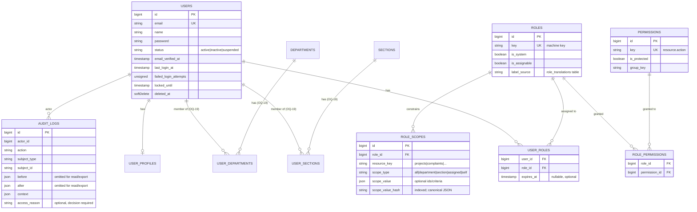
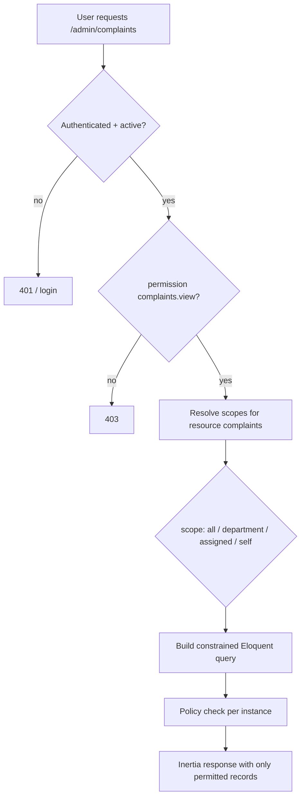
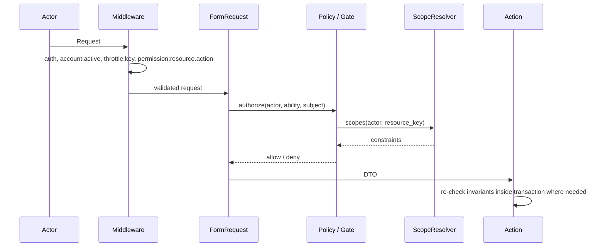

# PCDR — Authorization Architecture (Custom RBAC)

**Status:** Design only. No tables, classes, roles, permissions, or assignments are created or seeded by this phase. **OQ-49 is PARTIALLY RESOLVED — PENDING FORMAL APPROVAL** (see §11.1); approval permissions remain pending until formal authorization is issued.

---

## 1. Principles

**[RECOMMENDATION]**

1. **No Spatie package** (ADR-004). The requirement is a custom, understandable model with data scopes; an external permission package would add a dependency and a second authorization vocabulary to learn.
2. **Deny by default.** A user with no role can authenticate but can access nothing beyond their own account surface. A user with a role receives only that role's explicit permissions.
3. **Backend is the sole authority.** Policies, Gates, Form Requests, and middleware enforce every decision. Frontend `can()` checks only shape the UI (ADR-005).
4. **Actions and data scopes are separate.** A permission answers "may this actor perform this action?"; a scope answers "on which records?". Both must pass.
5. **Code defines the permission vocabulary; database stores assignments.** Unknown or removed DB permission rows are ignored at evaluation time.
6. **Protected system roles/permissions cannot be modified through the UI.** Role templates are proposed configuration, not existing staff (see §10).
7. **Self-escalation is impossible through normal flows.** A user cannot grant themselves a role/permission, elevate their own role, or remove the last system administrator.
8. **Every authorization-sensitive change is audited** with before/after state where state exists; restricted reads and exports use a read/export entry without before/after (ADR-017).

---

## 2. Conceptual ERD



**[RECOMMENDATION] Table responsibilities**

| Table | Responsibility | Key constraints |
|---|---|---|
| `users` | Identity, credentials, lifecycle state | `email` unique; existing skeleton table extended by future migration |
| `roles` | Named permission bundles | `key` unique; `is_system` flag; `is_assignable` flag |
| `role_translations` | Sole storage for AR/EN role display name and description | unique (`role_id`, `locale`); no JSON label column on `roles` |
| `permissions` | Canonical permission catalog mirrored from code | `key` unique; `is_protected` flag |
| `role_permissions` | Role ↔ permission assignment | unique (`role_id`, `permission_id`) |
| `user_roles` | User ↔ role assignment | unique (`user_id`, `role_id`); optional `expires_at` |
| `role_scopes` | Per-role, per-resource record visibility rule | unique (`role_id`, `resource_key`, `scope_type`, `scope_value_hash`); `scope_value_hash` indexed; canonical-JSON rule below |
| `departments`, `sections` | Conditional organizational dimensions; excluded from the initial IAM migration unless OQ-19 is affirmative | unique machine keys; names translated |
| `user_departments`, `user_sections` | Conditional membership dimensions (same OQ-19 gate) | unique pairs |
| `audit_logs` | Unified, append-only change and access history | no application-level updates/deletes; read/export entries omit before/after |

**Canonical hashing (`scope_value`):** uniqueness uses `scope_value_hash`, computed from the canonical JSON form of `scope_value`: UTF-8 encoding, object keys sorted lexicographically, no insignificant whitespace, scalar types preserved, array order preserved. The JSON value and the hash are stored in separate columns; the hash column is indexed. **[DECISION REQUIRED]** confirmation of hash algorithm and column name; no implementation is claimed.

**[DECISION REQUIRED]** Whether departments/sections reflect a real organizational structure (OQ-19). **[VERIFIED]** No structure is documented or verified. Creation of `departments`, `sections`, `user_departments`, `user_sections` and use of scope types `department`/`section` are conditional on that answer; the preferred sequencing is a separate deferred migration, not `create_iam_schema.php`. These tables are optional infrastructure and must not be populated with invented teams. If the organization has no such structure, the scope types remain unused.

---

## 3. Accounts and lifecycle

**[RECOMMENDATION]**

| Concern | Design |
|---|---|
| Account states | `active`, `inactive`, `suspended`. Only `active` accounts may authenticate. `inactive` covers not-yet-activated; `suspended` is a disciplinary/security hold. |
| Registration | Self-registration is **not** assumed. Accounts are created by authorized administrators or through an approved invitation flow. **[DECISION REQUIRED]** |
| Email verification | Required for administrative accounts via Laravel's signed verification flow; exempt only service/system accounts approved explicitly. |
| Password reset | Laravel's password broker; token table already exists **[VERIFIED]**. Rate-limited; tokens single-use; no password hints. |
| Critical delivery dependency | Verification and password-reset messages follow the critical-email rules in `COMMUNICATION_ARCHITECTURE.md` §3/§5/§9: code-owned `lang/` fallback on missing DB translation and no dependency on an unconfirmed worker. **[DECISION REQUIRED]** delivery path before account-security flows go live (OQ-10/OQ-11/OQ-15/OQ-40). |
| Last login | `last_login_at` updated on successful authentication; `previous_login_at` optional for security display. |
| Lockout | Progressive throttle keyed by email + IP; temporary lock (`locked_until`) after a configurable threshold. Unlock via admin action or expiry. Avoid permanent lockouts that create support burden. |
| Account revocation | Deactivating/suspending a user dispatches `AccountDeactivated`, whose listener invalidates that user's sessions and revokes pending invitations. Middleware `EnsureAccountActive` re-checks status on each request. |
| Deletion | Prefer deactivation. Hard deletion only through an approved retention/erasure workflow, with audit redaction rules. |
| Impersonation | **Not proposed.** It creates accountability ambiguity; if required later, it needs explicit approval, narrow permissions, and prominent audit/UI markers. |

---

## 4. Permission catalog

**[RECOMMENDATION] Format:** `{resource}.{action}` in lowercase dot notation.

**Canonical catalog sketch** (illustrative examples, not an exhaustive or final list):

```text
users.view, users.create, users.update, users.delete, users.restore, users.assign_roles
roles.view, roles.create, roles.update, roles.delete, roles.assign, roles.grant_protected
permissions.view
pages.view, pages.create, pages.update, pages.delete, pages.review, pages.publish, pages.archive
projects.view, projects.create, projects.update, projects.delete,
projects.submit, projects.review, projects.publish, projects.archive
activities.view, activities.create, activities.update, activities.publish
beneficiary_applications.view, beneficiary_applications.review,
beneficiary_applications.approve, beneficiary_applications.export
complaints.view, complaints.create, complaints.assign, complaints.respond, complaints.resolve
tenders.view, tenders.create, tenders.publish, tenders.applications.view
careers.view, careers.create, careers.publish, careers.applications.view
volunteers.view, volunteers.review, volunteers.assign
news.view, news.create, news.review, news.publish, news.archive
publications.view, publications.create, publications.publish
partners.view, partners.create, partners.update, partners.publish
media.view, media.upload, media.update, media.delete
navigation.view, navigation.update
homepage.view, homepage.update
settings.view, settings.update
email.templates.view, email.templates.create, email.templates.update, email.templates.delete,
email.send, email.send.bulk, email.logs.view
notifications.send, notifications.view
audit_logs.view, audit_logs.export
reports.view, reports.export
```

**[RECOMMENDATION] Catalog governance**

- `config/permissions.php` is the source of truth: key, group, label key, protected flag.
- An artisan command in a later phase synchronizes the catalog into `permissions` (insert new, mark missing as retired; never silently delete rows referenced by audit history).
- Runtime authorization reads cached assignments but **ignores permission keys not present in the code catalog**.
- `*` (super permission) exists only as a bootstrap capability for the system installer context. It is not assignable through the dashboard UI and never appears in role-management forms.

---

## 5. Roles

**[RECOMMENDATION]**

- Roles are named bundles with machine keys and translated labels (e.g. `administrator`, `content_editor`, `reviewer`, `complaints_officer`, `program_officer`). These are **proposed templates only** — **[VERIFIED]** no roles or staff structure exist.
- `is_system` roles are created by migrations/installers, cannot be deleted, and have a protected subset of permissions. Their labels/content remain editable; their capability core does not.
- `is_assignable = false` marks roles used only by the system/installer.
- Custom roles may be created by administrators holding `roles.create`; they cannot contain protected permissions unless the administrator also holds a dedicated `roles.grant_protected` capability (itself protected, intended only for top-level administration).
- Role deletion safety: refuse deletion if users are assigned, if the role is protected, or if it would leave zero active holders of a required administrative capability.
- Multiple roles per user are supported. Effective permissions are the **union** of all active, non-expired role permissions.

---

## 6. Data scopes

**[RECOMMENDATION] Scope types**

| Scope type | Meaning | Example use |
|---|---|---|
| `all` | Unrestricted access to the resource | System administrators, published public content |
| `department` | Records whose `department_id` is in the actor's departments; available only if OQ-19 is affirmative | Program officers |
| `section` | Records whose `section_id` is in the actor's sections; available only if OQ-19 is affirmative | Content sections |
| `assigned` | Records where `assigned_to_id = actor.id` | Complaints officers |
| `self` | Records created by or belonging to the actor | Own applications, own notifications |

**Resolution rules**

- A scope applies per `resource_key`, not globally. A user may have `all` for `news` and `assigned` for `complaints`.
- Multiple roles → **union of scopes** for the same resource (most permissive wins). Deny rules are not introduced in Phase 1; OQ-21 remains **[DECISION REQUIRED]** and any later explicit deny must be added to the resolver and tested comprehensively.
- If no scope row exists for a resource, the default is **no record access** (not `all`).
- Scope constraints are composed into Eloquent queries by a `ScopeResolver` Service used by Policies and query classes. No raw SQL is assembled from user input.
- Scopes do not replace Policies: a Policy first checks the permission, then the scope, then instance-specific rules.
- Public website queries never rely on scopes; they filter strictly on `status = published` and `published_at <= now()`.



---

## 7. Authorization flow



**[RECOMMENDATION] Enforcement points**

| Point | Use |
|---|---|
| Route middleware | Coarse capability + authentication + account state + throttle |
| Form Request `authorize()` | Operation-level check before validation results are trusted |
| Policy | Instance-level check and scope application |
| Gate | Capability not tied to a model (`access dashboard`, `send bulk email`) |
| Action | Re-check critical invariants (e.g. "actor may publish this specific state") so the Action is safe when called from a Job/Listener |
| Frontend `can()` | UI only; never a control |

---

## 8. Permission cache and invalidation

**[RECOMMENDATION]**

- Cache effective permissions and scopes per user under a versioned key (e.g. `rbac.user.{id}.v{version}`) using the configured cache store.
- Any change to roles, permissions, role assignments, scope rows, user status, or membership dispatches `RbacChanged` (carrying affected user IDs where practical).
- Listener increments a global RBAC version and forgets affected user keys. A global version bump is acceptable on shared hosting because writes are infrequent.
- Cache must never be the only authority: on cache miss, recompute from database.
- On logout/suspension, forget the user key immediately.
- No permission decisions are persisted in the frontend beyond the current Inertia response.
- Internal scope values (`scope_value` JSON, department/section ids) are never serialized into Inertia props; a test must assert that `auth.scopes` contains `scope_type` only.

---

## 9. Auditability

**[RECOMMENDATION] Every one of the following writes an audit entry:**

- role/permission creation, update, deletion, assignment changes;
- user status changes and password resets by administrators;
- workflow transitions (submit, approve, publish, archive, reject);
- access to beneficiary application details and exports (read auditing, not just writes);
- complaint assignment/resolution;
- settings changes in the unified `audit_logs` with `subject_type = settings.*` (old value → new value, with secret references redacted);
- email template changes, bulk sends, and notification broadcasts;
- media deletion and publication changes.

**Entry fields** (see ADR-017): actor, action, subject type/key + id, before/after JSON (omitted for read/export entries), context (IP, user agent, route, locale, request ID), timestamp; optional `access_reason` **[DECISION REQUIRED]**. Entries are append-only inside the application; correction is a new compensating entry, never an edit; expiry is by approved archive/export with a compensating entry, not deletion. Retention periods remain **[DECISION REQUIRED]**.

**Read/export entries:** an access to a restricted record (including beneficiary application details and exports) is recorded as an `audit_logs` entry with action `read` or `export`, actor, subject type/key + id, `context`, and an optional `access_reason`; `before`/`after` are not applicable and are omitted. No entry is dropped for lacking before/after state.

**[RECOMMENDATION] Redaction:** never record passwords, tokens, raw file contents, beneficiary identifiers beyond an internal opaque reference, or provider credentials.

---

## 10. Separation of duties

**[RECOMMENDATION]**

| Capability | Held by (proposed, not existing staff) | Note |
|---|---|---|
| `settings.update` | Top-level administration only | Includes security and email provider references |
| `roles.grant_protected` | Top-level administration only | Prevents mid-level privilege escalation |
| `email.send.bulk` | Explicitly authorized communicators | Rate-limited and audited |
| `beneficiary_applications.export` | Narrowly granted roles; two-person rule for bulk export is OQ-24 **[DECISION REQUIRED]** and must be answered before export design | Sensitive personal data |
| `audit_logs.view` | Independent of content editing roles | Auditors should not be able to alter audited content |
| `users.assign_roles` | Administration only | Never combined with self-assignment |

**[VERIFIED]** None of these roles or capabilities exist today. No staff, team, or org chart is asserted.

---

## 11. Approval governance, positions, delegation, and approval records

**Status:** Documentation model only. OQ-49 is **PARTIALLY RESOLVED — PENDING FORMAL APPROVAL**. No approval authority is active by default; no approval rights are granted to the developer.

### 11.1 OQ-49 governance distinctions (must remain explicit)

| Category | Status | Meaning |
|---|---|---|
| Board of Directors approves institutional policies, regulations, plans, and budgets; Executive Director handles daily execution and implementation of Board decisions | **CONFIRMED BY STRATEGIC PLAN** | Authority framework confirmed at plan level only; not a recorded formal execution authorization. |
| Executive Director approves ordinary public content; Media and Communication, MEAL, and relevant Program Unit review content | **PROPOSED, NOT FORMALLY APPROVED** | Proposed workflow only; must not be implemented as active approval authority without formal approval. |
| Named officeholders; formal content approval procedure; formal review committee; written delegation decisions; actual user assignments | **NOT YET ESTABLISHED** | Must not be invented, seeded, or hard-coded. |

Approval permissions remain pending until formal authorization is issued and recorded.

### 11.2 Separation of concerns

| Concept | Owns | Must not own |
|---|---|---|
| **Organizational position** | Named organizational seat/post (not a person), optional unit linkage, active/inactive metadata | Permissions, login, scope, workflow decision by itself |
| **System role** | RBAC permission bundle | Org chart truth, person identity, approval authority by itself |
| **Permission** | Atomic `resource.action` capability (code-owned catalog) | Data scope, workflow definition, authority identity |
| **User-role assignment** | User↔role, optional expiry, assigner, audit | Position, delegation, approval decision |
| **Delegation** | Time-bounded transfer of a specific approval authority; delegator/delegate/authority/scope/reason/revocation; audited | Permanent role/permission grant, scope bypass |
| **Approval authority** | Who may make a formal approval decision for a workflow/resource/scope; required permission/position/policy; separation-of-duties rules | Content editing, RBAC administration, audit mutation |
| **Approval workflow** | States/transitions/guards/timestamps/required records (`config/workflows.php`) | User identity, role membership storage |
| **Scope / data visibility** | Which records a user can act on (`all/department/section/assigned/self`) | Approval authority or permission grant |
| **Audit record** | Immutable application event log, including approval record create/read/export/compensation references | Mutable business decision record |

### 11.3 Granular permissions and default-disabled approval capabilities

Permission catalog additions (code-owned, pending owner approval): `*.submit`, `*.review`, `*.request_changes`, `*.approve`, `*.reject`, `*.publish`, `*.archive`, `*.export`, `*.assign`, plus `approval_records.view/export`, `approval_authorities.view/create/update/delete`, `delegations.view/create/update/revoke`, and conditional `positions.*`.

**Disabled by default / protected:** all `*.approve`, `*.reject`, approval-gated `*.publish`, `*.approve_override` (if ever approved), mutating `approval_authorities.*`, `delegations.create/update/revoke`, `positions.assign/create/update/delete`, and `approval_records.export`. These permissions must not be assigned by seed/demo/default role templates. Enabling requires protected capability, audited change, and formal authorization.

### 11.4 Approval record model (immutable)

Minimum approval-record fields: `id`, `approval_record_reference`, `approver_user_id`, `approver_position_id` (nullable until position model established; required when position-based authority is used), `approval_authority_id`, `delegation_id` (nullable), `approval_type`, `subject_type`, `subject_id`, `subject_version`, `workflow_state_from`, `workflow_state_to`, `decision` (`approved|rejected|changes_requested|revoked|voided_by_compensation`), `decision_reason`, `decided_at`, `formal_decision_reference` (nullable; required where external formal record exists), `context` (request/IP/UA/locale/route), `audit_event_id`, `created_at`.

**Immutability rules:** append-only; no application UPDATE/DELETE. Corrections are compensating records linked by `supersedes_approval_record_id`/reference; original remains readable. Re-approval after content change requires a new `subject_version` and new record. Approval record creation, workflow transition, timestamps, and audit log entry occur in the same transaction. Historical approvals are preserved per approved retention/legal policy (OQ-26/OQ-27).

### 11.5 Workflow alignment

- Strategic plan: `Draft → Pending Review → Approved → Published → Archived`.
- Architecture canonical: `draft, submitted, in_review, changes_requested, pending_approval, approved, published, archived, rejected`.
- Crosswalk: `Pending Review` maps to `pending_approval` (formal decision queue), not to `submitted` or `in_review`. Not every workflow uses every state; publishable/approval-gated workflows must not skip required approval.

## 12. Frontend permission awareness

**[RECOMMENDATION]**

- `HandleInertiaRequests::share()` exposes `auth.user` (id, name, locale, roles summary), `auth.permissions` (flat string list), `auth.scopes` (resource → `scope_type` only; never `scope_value`, internal ids, or criteria), `flash`, `locale`, `direction`, `availableLocales`, and an explicitly allowlisted `settings.public`.
- A `usePermission()` composable provides `can('projects.publish')` and `canOn('complaints', 'assign')`. It hides/disables controls only.
- Every server action re-authorizes. A manipulated client cannot gain access.
- The dashboard shows effective permissions read-only; administrators see which role grants each permission.

---

## 13. Threat considerations

| Threat | Control |
|---|---|
| Self-privilege escalation | Form Request forbids acting on own role assignment; protected capabilities; audit |
| Role deletion leaving orphaned access | Deletion guards and dependency checks |
| Multi-role privilege accumulation | Union is intentional and tested; no accidental deny-by-last-role |
| Stale cached permissions after demotion | Versioned invalidation + account status middleware |
| Privilege lingering after suspension | Session invalidation listener + per-request status check |
| Enumeration of restricted records | Uniform 403/404 behavior; Policy before lookup where feasible |
| Authorization bypass in queued jobs | Actions re-check invariants; jobs receive actor context and validate it |
| Frontend-only protection | Backend enforcement everywhere; tests assert 403 responses |
| Protected permission modification via UI | `is_protected` server-side, ignored if posted |

---

## 14. Implementation sequencing

**[RECOMMENDATION]** Authorization lands in Roadmap Phase 2a, before any protected module:

1. Permission catalog config + sync command (no seed content beyond catalog).
2. RBAC tables + models + relationships.
3. Role/permission management Actions, Form Requests, Policies, tests.
4. ScopeResolver + Policies for the first protected resource.
5. Account lifecycle middleware/session invalidation.
6. Audit integration.
7. Frontend `usePermission` + permission-aware navigation (UI only).

Authorization tests are mandatory for every step; see `TESTING_STRATEGY.md`.
