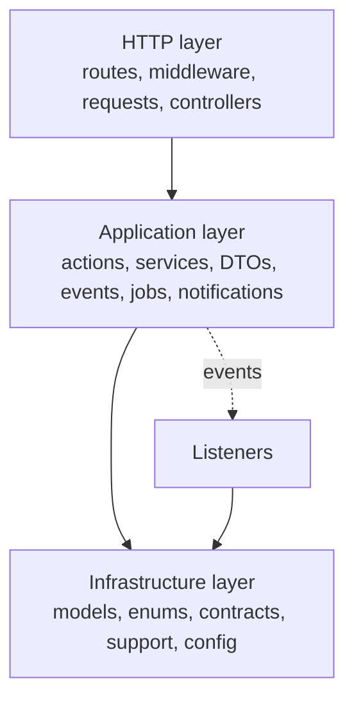

# PCDR — Backend Architecture

**Status:** Design only. No directory, class, contract, or configuration file described here has been created.

---

## 1. Purpose and scope

This document defines Laravel 13 layering, naming, dependency flow, conventions for every application layer, error handling, and logging. It complements `SYSTEM_ARCHITECTURE.md` (system-level decisions) and `AUTHORIZATION_ARCHITECTURE.md` (RBAC details).

**[VERIFIED]** Current backend consists of `app/Http/Controllers/Controller.php` (empty abstract base), `app/Http/Middleware/HandleInertiaRequests.php`, `app/Models/User.php`, `app/Providers/AppServiceProvider.php`, and two route files. No other application classes exist.

---

## 2. Proposed directory structure (evaluation)

```text
app/
  Actions/          # Single-purpose, reusable business operations
  Contracts/        # Interfaces owned by the application (small, purposeful set)
  DTOs/             # Immutable data carriers crossing layer boundaries
  Enums/            # Backed enums for statuses, types, channels, scopes
  Events/           # Facts that already happened
  Exceptions/       # Domain exceptions with explicit HTTP mapping
  Http/
    Controllers/    # Thin HTTP adapters
    Middleware/     # Cross-cutting request concerns
    Requests/       # Validation + per-action authorization
    Resources/      # Explicit API/Web JSON shaping (only if needed)
  Jobs/             # Queued work units
  Listeners/        # Reactions to domain events
  Models/           # Eloquent persistence mappings
  Notifications/    # Laravel Notification classes
  Policies/         # Per-model authorization
  Providers/        # DI and event registration
  Services/         # Cohesive domain coordination and external integrations
  Support/          # Pure helpers, formatters, value utilities
config/             # Framework + explicit config catalogs (permissions, workflows, settings)
```

**[RECOMMENDATION] Rules for directories**

- Create a directory only when it will contain at least one purposeful class in the phase that introduces it. Do not pre-create empty folders.
- Group by **capability**, then by domain only where a domain has enough classes to justify a sub-namespace (e.g. `app/Actions/Complaints/AssignComplaint.php`). Avoid three-level nesting until the second level is crowded.
- `Http/Resources` is **not** required for Inertia responses when props are built explicitly in controllers; introduce it only for a real JSON/API surface.
- `Support/` is for pure functions and formatters, never a home for orphan business rules.

---

## 3. Layer responsibilities

| Layer | Responsibility | Explicitly NOT responsible for |
|---|---|---|
| **Routes** (`routes/web.php`, `routes/auth.php`, domain route files) | Map URL + HTTP verb + middleware to a controller; express resource shape | Business logic, validation, queries |
| **Middleware** | Cross-cutting request concerns: locale resolution, account status, throttling, security headers, request IDs | Business decisions about a specific resource |
| **Form Requests** | Authorize the specific operation and validate/normalize input into a safe shape | Calling services, performing writes, returning domain data |
| **Controllers** | Receive validated input, call exactly one Action/Service, build Inertia props or redirect | Validation rules, business rules, raw query building, Eloquent writes |
| **Actions** | One focused business operation; orchestrates models, transactions, events | HTTP concerns, rendering, authorization policy decisions (those happen earlier) |
| **Services** | Stateful-free coordination of a cohesive domain or an external integration (mail, settings, scope resolution, audit) | Becoming a "god class"; duplicating Actions |
| **DTOs** | Typed, immutable structured data crossing boundaries (request → action, action → notifier) | Behavior beyond normalization and small derived values |
| **Models** | Table mapping, relationships, casts, scopes for simple reusable filters | Complex workflows, authorization, cross-aggregate orchestration |
| **Policies** | Per-model, per-instance authorization (`view`, `update`, `publish`, `delete`) | Validation, business side effects |
| **Gates** | Capability checks not tied to a model (`view dashboard`, `send bulk email`) | Per-instance record decisions that belong in Policies |
| **Events** | Immutable facts (`ProjectPublished`, `ComplaintAssigned`) | Side effects, queries, notifications |
| **Listeners** | Side effects: audit entries, notifications, cache invalidation, email dispatch | Core business validation (should have happened before the event) |
| **Notifications** | Channel-specific message construction (database, mail, optional push) | Choosing recipients based on unrequested business rules |
| **Jobs** | Deferred/retryable **non-critical** work: bulk email, report export, push delivery | Critical synchronous validation that must fail the request; critical account-security mail unless a worker path is confirmed (§6, `COMMUNICATION_ARCHITECTURE.md` §3.1) |
| **Enums** | Closed sets: statuses, types, channels, scope kinds | Database rows for user-editable taxonomies (those are models) |
| **Exceptions** | Domain failure types carrying context and an explicit presentation contract | Generic `Exception` throws with string-only messages |
| **Contracts** | Small interfaces where an implementation is genuinely replaceable (mail template renderer, push channel, scope resolver) | Interfaces with a single implementation "just in case" |
| **Providers** | Bind contracts, register event/listener maps, publish config | Business logic |

---

## 4. Dependency direction



**[RECOMMENDATION] Enforcement rules**

- An Action may depend on Models, other Actions/Services, DTOs, Contracts, Events, and the database transaction abstraction.
- A Model must not depend on an Action, a Form Request, or a Controller.
- A Listener may depend on Services (audit, notification, cache) but must not re-run core validation.
- Constructor injection is the default. Facades are acceptable in providers, routes, middleware, and the framework edge; they are avoided inside Actions/Services unless no injectable contract exists.
- Static analysis (**[RECOMMENDATION]**: Larastan) enforces these boundaries over time via baseline rules; see `TESTING_STRATEGY.md`.

---

## 5. Request-to-response conventions

**[RECOMMENDATION] Example flow (illustrative, not implemented)**

```text
routes/web.php
  Route::post('/{locale}/admin/projects', [ProjectController::class, 'store'])
      ->middleware(['auth', 'verified', 'account.active', 'permission:projects.create']);

StoreProjectRequest
  authorize(): Gate/Policy check for create on Project
  rules(): title.ar, title.en, program_id, location_ids, ... (locale-aware)
  prepareForValidation(): normalize empty strings, trim, canonicalize locale

ProjectController::store(StoreProjectRequest $request, CreateProject $action)
  $project = $action->handle($request->toDTO(), $request->user());
  return to_route('admin.projects.show', $project)->with('flash', ...);

CreateProject::handle(ProjectInput $dto, User $actor): Project
  DB::transaction(...)
  event(new ProjectCreated($project, $actor));
  return $project;
```

**Rules illustrated**

- One controller action → one Action call. If a controller needs three Actions, extract a coordinating Service.
- Authorization appears in **two** compatible places: route middleware for coarse capability and Form Request/Policy for instance-level decisions. This is deliberate defense in depth, not duplication of business rules.
- Inertia props are explicit arrays built in the controller: `['project' => ..., 'permissions' => ..., 'locale' => ...]`. No implicit model serialization of entire tables.

---

## 6. Transactions, events, and side effects

**[RECOMMENDATION]**

- Wrap any write that touches more than one table (entity + translations + pivots + audit) in `DB::transaction()`. Rollback must leave no partial translation set.
- Dispatch domain events **inside** the transaction only when listeners must observe atomic state; otherwise dispatch after commit where the platform supports it. **[DECISION REQUIRED]** After-commit hook compatibility on the selected runtime must be confirmed before Phase 2a audit/notification wiring; if unavailable, listeners must be idempotent and side effects recorded in the same transaction. The open-question register is fixed at OQ-01…OQ-49, so this item is not assigned a new OQ number; it is governed by OQ-49 governance (PARTIALLY RESOLVED — PENDING FORMAL APPROVAL; formal execution authorization not recorded) like other unresolved decisions and must be recorded in change control before it is relied upon.
- Listeners that send **non-critical** email or push notifications are queued; a mail-provider outage must not roll back a database transaction. Critical account-security mail follows `COMMUNICATION_ARCHITECTURE.md` §3.1/§5 and is never silently skipped or left waiting on an unconfirmed worker.
- Audit records are written in the same transaction as the change whenever possible, except for failures, which are logged separately.
- Idempotency: events carry a stable `event_id`/ULID; notification/message deduplication uses that value (see `COMMUNICATION_ARCHITECTURE.md`).

**[RECOMMENDATION] Decision timing for this section:** the after-commit and critical-mail path decisions are gates on Phase 2a/2b wiring, not on Phase 1 approval. No such mechanism is implemented today.

---

## 7. DTO policy

**[RECOMMENDATION]**

Use a readonly DTO when:

- input crosses from HTTP into an Action (`ProjectInput`, `ComplaintFilter`);
- structured data is passed to a mail/notification (`ComplaintNotificationData`);
- a query needs a typed set of filters (`BeneficiaryApplicationQuery`).

Use plain arrays when:

- data stays within one layer for one call;
- Laravel APIs require arrays (validation rules, mail view data with simple scalar values).

No DTO package is proposed. PHP readonly classes are sufficient and dependency-free. DTOs include only data plus normalization helpers; they do not query the database.

---

## 8. Repository pattern evaluation

**[RECOMMENDATION] Do not introduce repositories by default.**

Justification:

- Eloquent already provides an active-record abstraction, query scopes, and relationship handling.
- Repositories would add interfaces and indirection without changing behavior for a single MySQL database.
- Testability is achieved through Actions, factories, and database-backed feature tests, not repository mocking.

**Genuine future justifications** (revisit only if they occur):

- A domain must read from two data sources (e.g. an external reporting warehouse).
- Complex, reusable query construction is needed by multiple Actions and deserves a named query object/service (prefer query classes over generic repositories).
- A third-party integration must be swappable behind a contract (that is a Service with a Contract, not a repository).

---

## 9. Workflow convention

**[RECOMMENDATION — pending owner approval; OQ-49 PARTIALLY RESOLVED — PENDING FORMAL APPROVAL]**

- `App\Enums\WorkflowStatus`: `draft`, `submitted`, `in_review`, `changes_requested`, `pending_approval`, `approved`, `published`, `archived`, `rejected`.
- **H-01 status crosswalk (documentation):** Strategic plan `Draft → Pending Review → Approved → Published → Archived` maps to `draft → pending_approval → approved → published → archived`. `submitted`, `in_review`, and `changes_requested` are optional operational pre-approval states; `rejected` is an optional terminal negative state. Not every workflow uses every state.
- Availability is declared per entity in `config/workflows.php`. Transitions are declared as `from => [allowed actions => to]`, with required permissions, guard class references, and required approval authority where applicable.
- A single `TransitionWorkflow` Action validates the transition, applies it, stamps timestamps (`submitted_at`, `in_review_at`, `pending_approval_at`, `approved_at`, `published_at`, `archived_at`, `rejected_at` as applicable), records an audit entry, and dispatches `WorkflowTransitioned`. Where formal approval is required, the transition also requires an immutable approval record in the same transaction.
- Publication requires an `approved` state and an actor with `{resource}.publish`; archiving is non-destructive. Approval permissions remain disabled by default until formal authorization is configured.
- **[DECISION REQUIRED]** Which modules need review/approval (likely all public-facing content; possibly not internal submissions). Default: publishable content uses the full workflow including `pending_approval`; operational records use a simpler status set.

---

## 10. Error handling

**[RECOMMENDATION]**

| Failure | Handling |
|---|---|
| Validation failure | Form Request → 422 with field errors; Inertia form preserves input and highlights fields. |
| Authorization failure | Policy/Gate → 403 with a localized generic message; never reveal existence of a restricted record through distinct messages. |
| Missing resource | 404 with a neutral page; avoid leaking whether an ID exists to unauthorized users (authorize before 404 where practical). |
| Invalid workflow transition | Domain exception `InvalidWorkflowTransition` → 409 with localized explanation. |
| Optimistic concurrency conflict | `StaleState` domain exception → 409 with a refresh prompt. |
| External provider failure | Queue retry with backoff; log structured context; surface a generic failure to the user, never provider credentials or raw responses. |
| Unexpected exception | Central renderer in `bootstrap/app.php` logs with request ID and returns localized error page/JSON; `APP_DEBUG=false` in production. |

- Domain exceptions extend a small base `DomainException` carrying `context` (safe, redacted) and a translation key.
- `withExceptions()` in `bootstrap/app.php` maps exception families to responses and JSON conditions; no `try/catch` scattering in controllers.
- Every logged event includes a request ID, actor ID (if authenticated), locale, route, and sanitized context.

---

## 11. Logging conventions

**[RECOMMENDATION]**

- Channel: `stack` → `single` in local, daily rotation in production (file-based logging is shared-hosting-friendly).
- Levels: `error` for failures needing attention, `warning` for degraded integrations, `info` for significant business events already mirrored to `audit_logs`, `debug` only in local.
- Never log: passwords, tokens, session IDs, full request bodies for beneficiary/complaint endpoints, email addresses or phone numbers of applicants, provider credentials, `APP_KEY`, internal `scope_value` contents, or department/section identifiers.
- Inbox addresses are masked by default in delivery logs; OQ-45 **[DECISION REQUIRED]** governs any audited reveal. No reveal path is assumed.
- Structured context arrays with stable keys (`actor_id`, `subject_type`, `subject_id`, `event_id`, `locale`).
- Application log and the unified `audit_logs` are distinct: `audit_logs` is the compliance artifact for state changes **and** restricted reads/exports, including `subject_type = settings.*`; the application log is operational. Read/export entries omit `before`/`after` (ADR-017).

---

## 12. Naming and code style

**[RECOMMENDATION]**

- PSR-12 via Laravel Pint; English identifiers, English comments/PHPDoc.
- Actions: verb-first (`PublishProject`, `AssignComplaint`, `RecordAuditEntry`).
- Services: noun describing responsibility (`SettingsService`, `ScopeResolver`, `TemplateRenderer`).
- DTOs: noun + `Input`/`Data`/`Query`.
- Events: past tense (`ProjectPublished`); Listeners: verb phrase (`NotifyWatchers`, `RecordProjectAudit`).
- Enums: singular noun (`WorkflowStatus`, `NotificationChannel`).
- Migrations: descriptive, one concern per file, timestamped; no destructive changes without a reviewed plan.
- PHPDoc documents public contracts, complex business rules, and non-obvious decisions. Redundant comments such as `// set the name` are prohibited.
- Arabic strings live in language files or translation tables, never inline in PHP logic.

---

## 13. Alignment with other documents

- Authorization mechanics: `AUTHORIZATION_ARCHITECTURE.md`.
- Table names and relationships used by Models: `DATABASE_ARCHITECTURE.md`.
- Props and shared data: `FRONTEND_ARCHITECTURE.md`.
- Mail/queue mechanics: `COMMUNICATION_ARCHITECTURE.md`.
- Tooling and gates: `TESTING_STRATEGY.md`.
