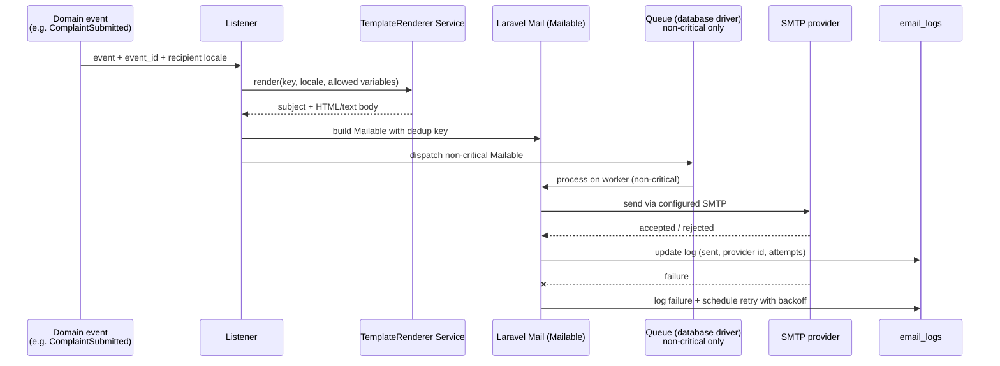
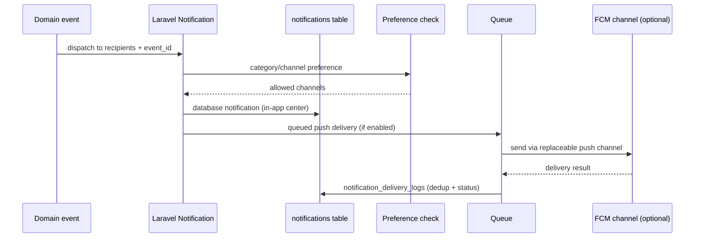

# PCDR — Communication Architecture (Email & Notifications)

**Status:** Design only. No mail class, notification, queue worker configuration, template, or provider integration is created in this phase.

---

## 1. Overview and principles

**[RECOMMENDATION]**

- **Laravel Mail** is the application-level email abstraction; **Laravel Notifications** is the application-level notification abstraction. External providers sit behind those abstractions and remain replaceable (ADR-011, ADR-012).
- No paid provider is assumed. The default target is provider-agnostic SMTP, selectable through environment configuration.
- Everything non-critical that can be delayed is queued; a provider outage must never fail a business transaction. **Critical account-security mail is the explicit exception** governed by §3, §5, and §9.
- Every message is localized at dispatch time using an explicitly resolved recipient locale (see `LOCALIZATION_ARCHITECTURE.md` §8).
- Every outbound message is deduplicated by a stable event/message key and logged.
- Secrets stay in environment configuration; DB settings hold only a **reference name** to a credential set, never the credential (ADR-010).

**[VERIFIED]** `config/mail.php` has default mailer `smtp` and `MAIL_*` environment keys. `QUEUE_CONNECTION=database` and the `jobs`/`failed_jobs` framework tables exist. No mail classes, notifications, templates, worker, or scheduler configuration exists. No provider is configured.

---

## 2. Email flow

**[RECOMMENDATION] Rules**

- Business Actions dispatch domain events only; they do not send mail directly.
- Listeners resolve recipients, locale, and template; they never make authorization decisions beyond recipient eligibility.
- **Non-critical** Mailables are thin, accept rendered content plus metadata, and implement `ShouldQueue`. **Critical** Mailables do **not** implement `ShouldQueue` unless a worker path has been confirmed under §5; the critical delivery path is an explicit decision before account-security flows go live (OQ-10/OQ-11/OQ-15/OQ-40).
- Bulk sends are chunked jobs with rate limiting, never a single request that can time out.
- Provider message IDs are stored when available for troubleshooting.
- Failures after retry exhaustion remain in `failed_jobs` with a redacted payload.
- Preview uses the same renderer as delivery; no separate preview code path.
- Critical messages never depend on an unconfirmed worker or on an editor-managed DB translation existing.

---

## 3. Email templates

**[RECOMMENDATION]**

**Entity:** `email_templates` + `email_template_translations` (see `DATABASE_ARCHITECTURE.md` §4.12).

| Field | Purpose |
|---|---|
| `key` | Stable machine key used by code, e.g. `complaint.received`, `user.invited` |
| `locale` | `ar` / `en` |
| `subject` | Localized subject |
| `html_body`, `text_body` | Localized content |
| `variables` | JSON allowlist of permitted variable names per template |
| `is_system` | System templates cannot be deleted; content is editable |
| `status` | `draft` / `active` / `archived` |

**Rules**

- Dynamic variables use a simple, documented syntax (e.g. `{{ complaint_reference }}`). The renderer replaces **only** allowlisted variables and leaves/escapes everything else safely.
- No user-authored HTML is injected into templates. Values are escaped before insertion.
- **Non-critical templates:** missing translation → fallback to Arabic → English → log an error and skip that send; never send an untranslated or invented body.
- **Critical templates** (see §3.1): a missing DB translation never skips the send. The renderer falls back to the code-owned `lang/` key, logs the missing translation for correction, and still delivers the message.
- Every code-referenced template key must exist in `config/email.php`; an artisan command in a later phase validates presence and reports missing templates.
- Attachments are created from approved media references with signed access; never from arbitrary paths.
- Non-critical transactional templates may be Laravel defaults initially; custom templates are introduced per module.

### 3.1 Critical account-security mail (F-04)

**[RECOMMENDATION] Definition of "critical":** a message whose absence would block account access or weaken account security. Initially `user.verification` and `password.reset`; any future account-security message is added to this class by an ADR update, not silently by a template key.

| Rule | Requirement |
|---|---|
| Delivery | Must not be silently skipped, dropped, or left waiting on an unconfirmed worker. |
| Missing translation | Use the code-owned `lang/ar` / `lang/en` key as fallback; log the missing DB translation; deliver anyway. |
| Queueing | `ShouldQueue` only when the worker path is confirmed under §5; otherwise send synchronously in the request that triggered the event. |
| Templates | The DB template is optional customization; the `lang/` fallback is mandatory and code-owned (ADR-007). |
| Logging | Every critical send writes an `email_logs` entry with dedup key, template key, locale, fallback-used flag, and redacted recipient reference. |
| Testing | Missing-translation, worker-unavailable, and dedup paths are covered before account-security flows go live. |

**[DECISION REQUIRED]** Critical delivery path (synchronous or confirmed worker) and its owner are recorded before Phase 2b (OQ-10/OQ-11/OQ-15/OQ-40, governed by OQ-49 governance; OQ-49 is PARTIALLY RESOLVED — PENDING FORMAL APPROVAL). This is a design gate, not an implemented control.

**Use case catalog (planned, not implemented)**

| Key | Trigger | Audience | Class |
|---|---|---|---|
| `user.invited` | Admin creates account | Invited user | Non-critical |
| `user.verification` | Registration/verification required | User | **Critical** |
| `password.reset` | Reset requested | User | **Critical** |
| `beneficiary_application.received` | Application stored | Applicant | Non-critical |
| `beneficiary_application.status_changed` | Workflow transition | Applicant | Non-critical |
| `complaint.received` | Complaint stored | Complainant (if contact provided) | Non-critical |
| `complaint.status_changed` | Status transition | Complainant / assigned officer | Non-critical |
| `job_application.received` | Application stored | Applicant | Non-critical |
| `volunteer_application.received` | Application stored | Applicant | Non-critical |
| `tender.published` | Tender published | Subscribed recipients **[DECISION REQUIRED]** consent basis | Non-critical |
| `newsletter.dispatched` | Admin bulk send | Opted-in subscribers only | Non-critical |
| `email.custom` | Administrative message | Explicit recipients | Non-critical |

**[DECISION REQUIRED]** Whether a newsletter/subscription feature is approved (OQ-41); it implies consent records and unsubscribe handling. No subscriber table is included until approved.

---

## 4. Sender configuration and providers

**[RECOMMENDATION]**

- `MAIL_MAILER`, `MAIL_HOST`, `MAIL_PORT`, `MAIL_USERNAME`, `MAIL_PASSWORD`, `MAIL_ENCRYPTION`, `MAIL_FROM_ADDRESS`, `MAIL_FROM_NAME` remain environment-level secrets/config (ADR-010).
- DB setting `email.sender_identity` holds only a **display** name/address for public-facing text; the actual envelope sender is validated against the configured domain. If it differs, the send falls back to the configured sender to prevent spoofing.
- `email.provider_reference` in DB is a non-secret label (e.g. `smtp-primary`) used for logging; it does not contain credentials.
- Provider replacement requires changing environment configuration and, if needed, a small Mail transport adaptation — no business code changes.
- No paid transactional provider, API key, or webhook endpoint is assumed. Webhooks for bounces are a later enhancement **[DECISION REQUIRED]** (OQ-43).

---

## 5. Queue, retries, and failure handling

**[RECOMMENDATION]**

- Database queue driver is the compatible baseline with the current configuration. The `jobs` and `failed_jobs` framework tables already exist **[VERIFIED]**; the table is storage, not execution capability.
- Retry policy: limited attempts with exponential backoff for transient SMTP failures; no infinite retry. Permanent errors (invalid recipient) are logged and marked failed.
- Worker execution alternatives are provider-dependent: a dedicated `queue:work` daemon where long-running processes are supported, a bounded scheduled `queue:work --stop-when-empty --max-time=...` via cron where only scheduled commands are available, or synchronous processing for explicitly approved short operations. **[ASSUMPTION]** No target provider capability is confirmed (OQ-10/OQ-11; `DEPLOYMENT_ARCHITECTURE.md` §7).
- Scheduler: one cron entry running `schedule:run` per minute if the platform supports it; otherwise queue-only design must avoid scheduler dependence. See `DEPLOYMENT_ARCHITECTURE.md` §7.
- **Critical-mail path (F-04):** the chosen path — synchronous or confirmed worker — is recorded before Phase 2b. Until it is recorded, account-security flows do not go live. Critical mail is never silently skipped for a missing translation (§3.1) and is never assumed to work merely because a `jobs` table exists.
- Dedup: `email_logs.unique_message_key` (event/message ULID) prevents double-send when listeners fire twice or jobs retry after partial success.
- Monitoring: failed job count and email failure rate reviewed; alerting mechanism **[DECISION REQUIRED]** (OQ-30/OQ-49 for ownership; OQ-49 formal authorization pending).

---

## 6. Delivery logs and privacy

**[RECOMMENDATION]**

| Log field | Notes |
|---|---|
| `template_key`, `locale` | For auditing and troubleshooting |
| `recipient_reference` | Opaque internal id/hash, not full address in searchable logs |
| `recipient_domain` | Optional, non-identifying domain for provider diagnostics |
| `status`, `attempts`, `provider_message_id`, `error_code` | Redacted error text; no full provider payload |
| `sent_at`, `created_at` | Timestamps |
| `unique_message_key` | Dedup |
| `fallback_used` | For critical mail: indicates the code-owned `lang/` fallback was used |

**Rules**

- Never store full email bodies containing restricted personal data in logs; store template key + variable reference.
- Full recipient addresses are held only where operationally needed and protected by `email.logs.view`; OQ-45 **[DECISION REQUIRED]** asks whether inbox addresses are masked by default and revealed only through an audited action. The provisional default is masking, but no answer is assumed.
- Log retention per approved policy; no indefinite retention by default (OQ-26).

---

## 7. Permission requirements

**[RECOMMENDATION]**

| Capability | Purpose |
|---|---|
| `email.templates.view` | List/preview templates |
| `email.templates.create` / `update` / `delete` | Manage templates (system templates: content only, no delete) |
| `email.send` | Send individual administrative messages |
| `email.send.bulk` | Bulk/newsletter sends (rate-limited, audited) |
| `email.logs.view` | View delivery logs (restricted, redacted by default) |

- Template variable allowlists are defined in code; a UI cannot introduce an undeclared variable.
- Bulk send requires confirmation of recipient count and source/consent basis before queueing.
- All sends are audited with actor, template, recipient count, and dedup key; restricted reads and exports use a read/export audit entry without `before`/`after` (ADR-017).

---

## 8. Notification flow

**[RECOMMENDATION]**

- Laravel Notifications remain the abstraction. A `NotificationChannel` contract (or Laravel's own channel contract) wraps any external push provider so FCM can be replaced.
- **FCM is a candidate only.** It is not configured, no `firebase.php` config, no service account, no SDK package is added now. **[DECISION REQUIRED]** whether web/mobile push is in scope and who owns Firebase credentials/project (OQ-42).
- Database notifications power the in-app notification center: unread count, mark read / mark all read, history, category filters, deep links to authorized routes.
- Notification categories (planned): `system`, `workflow`, `assignment`, `complaint`, `application`, `tender`, `news`, `security`.
- Preferences: per user, per category, per channel, stored in `notification_preferences` with unique (`user_id`, `category`, `channel`); defaults come from config and are opt-in for non-essential categories.
- Content: short localized summary + deep link only. Never embed restricted personal data in notification payloads; the link target performs authorization.
- Dedup: (`user_id`, `event_id`, `channel`) unique in `notification_delivery_logs`; duplicate events do not produce duplicate deliveries.
- Retry: bounded attempts with backoff; permanent failures recorded. **[DECISION REQUIRED]** the essential/non-essential channel classification must be declared in the notification catalog before "delivery unavailable" is shown for an essential channel.
- Mark-all-read is a scoped update constrained to the authenticated user; it cannot affect other users' notifications.
- Notification reads do not bypass record-level authorization — clicking a link still hits the Policy.

---

## 9. Availability and degradation behavior

| Situation | Behavior |
|---|---|
| Mail provider down | Business action succeeds; non-critical email queued and retried; user sees "message queued" not "sent". Critical mail uses the recorded fallback path and is never silently dropped. |
| Queue worker down | Non-critical jobs accumulate in the `jobs` table; notification center still works for synchronous database notifications. Critical mail follows its §5 recorded path (synchronous or confirmed worker). |
| Push provider not configured | Channel skipped silently; no UI error for optional categories |
| Non-critical template missing | Send skipped, error logged, administrator alerted through operational log |
| **Critical template missing (DB)** | Send proceeds with code-owned `lang/` fallback; missing translation is logged for correction; account access is not blocked |
| Duplicate event | Dedup key prevents second delivery |

---

## 10. Explicit non-claims

**[VERIFIED]** No email template, mailable, notification, push provider, worker schedule, or delivery log exists today. `config/mail.php` and the database queue tables are framework defaults only. The critical-mail class, fallback, and delivery path are **design requirements**, not implemented controls; their decisions remain open/pending formal authorization under OQ-10/OQ-11/OQ-15/OQ-40 and OQ-49 (PARTIALLY RESOLVED — PENDING FORMAL APPROVAL).
