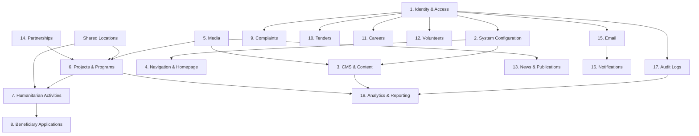

# PCDR — Database Architecture

**Status:** Conceptual design only. No migration, table, column, or seeder is created in this phase.

---

## 1. Verified baseline and conventions

**[VERIFIED]**

- Laravel `mysql` connection, locally MariaDB 12.3.2; InnoDB; `utf8mb4` / `utf8mb4_unicode_ci`; strict mode enabled.
- Existing tables: `users`, `password_reset_tokens`, `sessions`, `cache`, `cache_locks`, `jobs`, `job_batches`, `failed_jobs`, `migrations`. All framework-owned.
- `users.email` unique; `sessions.user_id` indexed; framework tables have appropriate indexes.
- No prefix is configured. No domain tables exist.

**[RECOMMENDATION] Global conventions**

| Topic | Convention |
|---|---|
| Engine/charset | InnoDB, `utf8mb4`, `utf8mb4_unicode_ci` consistently in migrations and production |
| Primary keys | `bigint unsigned` auto-increment (`$table->id()`) for internal keys |
| Public references | ULID `reference` on externally exposed submissions (complaints, applications, tenders applications) — avoids enumeration without a new dependency (`Str::ulid()`) |
| Foreign keys | Explicit `foreignId()->constrained()->cascadeOnUpdate()`, with `restrictOnDelete()` for reference data and `nullOnDelete()` for optional links; `cascadeOnDelete()` only for owned child rows such as translations |
| Naming | Snake_case tables (plural), snake_case columns, `*_translations` for localized content, explicit pivots (`project_media`) |
| Timestamps | `created_at`, `updated_at` (UTC); domain-specific `published_at`, `approved_at`, `archived_at` where needed |
| Soft deletes | Selective, never universal (see §6) |
| Money | `decimal(15,2)` with explicit currency code; never floating point |
| Booleans | `boolean` tinyint; explicit defaults |
| Enums | Store as `string` with a PHP backed enum validation layer; avoid native MySQL ENUM for easier evolution |
| JSON | Use sparingly for settings values and audit snapshots; not for relational content |
| Indexes | Foreign keys indexed; unique constraints for natural keys; composite indexes aligned to actual query order |
| Migrations | One aggregate per bounded context; reversible `down()`; no destructive production changes without a reviewed plan |

---

## 2. Domain map



**[RECOMMENDATION]** "Shared Locations" (`locations`, `location_translations`) is a single reusable entity for project/activity geography. No separate location table per module.

---

## 3. Shared cross-domain entities

### 3.1 Identity and access (IAM)

**Entities:** `users`, `roles`, `role_translations`, `permissions`, `role_permissions`, `user_roles`, `role_scopes`, `user_profiles` (optional), plus existing `sessions`, `password_reset_tokens`. `departments`, `sections`, `user_departments`, `user_sections` are conditional on OQ-19 **[DECISION REQUIRED]** and are excluded from the initial IAM migration.

**Responsibilities:** identity, credentials, lifecycle state, permission bundles, data-scope rules, and organizational dimensions only if OQ-19 is answered affirmatively. Details in `AUTHORIZATION_ARCHITECTURE.md`.

**Keys/indexes:** unique `roles.key`, `permissions.key`, `users.email`; unique pivots; `user_roles.expires_at` indexed if used; `role_scopes(resource_key, scope_type)` composite index; unique (`role_id`, `resource_key`, `scope_type`, `scope_value_hash`) with the hash column indexed. **Canonical JSON for `scope_value_hash`:** UTF-8, object keys sorted lexicographically, no insignificant whitespace, scalar types preserved, array order preserved. Hash algorithm and column name remain **[DECISION REQUIRED]**; see `AUTHORIZATION_ARCHITECTURE.md` §2.

**Sensitive:** passwords hashed; `last_login_at`, lockout fields, profile data restricted. **Retention:** deactivation preferred; erasure workflow required before physical deletion (OQ-27/OQ-28).

### 3.2 System configuration

**Entities:** `settings`, `setting_translations`. Setting changes are recorded only in the unified `audit_logs` with `subject_type = settings.*` (ADR-017). No separate `settings_audit` table is proposed; **[DECISION REQUIRED]** owner confirmation of the unified-log choice.

**Responsibilities:** DB-backed public/protected configuration only. Secrets remain in environment configuration (ADR-010).

| Column group | Notes |
|---|---|
| `group`, `key` | Unique composite; groups: `general`, `website`, `seo`, `localization`, `modules`, `email`, `notifications`, `security`, `files`, `system` |
| `type` | `string`, `boolean`, `integer`, `json`, `media_reference`, `secret_reference` |
| `is_localized` | If true, values live in `setting_translations(locale, value)` |
| `is_public` | Whether safe to expose to the frontend |
| `is_secret_reference` | If true, the value is a **name** pointing to an env variable; credential values are never stored here |

**Constraints:** unique (`group`, `key`), unique (`setting_id`, `locale`). **Sensitivity:** high for security/module settings; strict admin permission `settings.update`; audit every change to the unified `audit_logs`. **Retention:** current value plus full audit history; no secret values in audit snapshots.

### 3.3 Workflow and states

**Entities:** No generic workflow tables initially. Each workflow-enabled entity has `status` (string), and as applicable `submitted_at`, `in_review_at`, `pending_approval_at`, `approved_at`, `published_at`, `archived_at`, `rejected_at`, `changes_requested_at`, plus `workflow_transition` audit entries.

**Responsibility:** Workflow is enforced by `config/workflows.php` and the `TransitionWorkflow` Action (ADR-008). Canonical states: `draft, submitted, in_review, changes_requested, pending_approval, approved, published, archived, rejected`. Strategic crosswalk: `Draft → Pending Review → Approved → Published → Archived` maps to `draft → pending_approval → approved → published → archived`; `submitted/in_review/changes_requested/rejected` are optional internal states. Not every workflow uses every state.

**Approval records (conceptual, pending owner approval):** approval-gated workflows require immutable `approval_records` capturing approver user, approver position reference/snapshot, approval authority, delegation reference, approval type, subject type/id, subject version, from/to state, decision, timestamp, formal decision reference, context, and audit correlation. Approval records are append-only; corrections are compensating records, never updates/deletes. Supporting conceptual entities: `approval_authorities`, `delegations`, and conditional `organizational_positions`/`user_positions` (no named officeholders, no active assignments by default).

**Indexing:** composite index on (`status`, `published_at`) for every publicly listed entity; approval records indexed by subject, approver, authority, and decided_at. **Retention:** archived rows remain queryable; approval/audit retention follows approved policy (OQ-26/OQ-27), no casual deletion.

### 3.4 Media

**Entities:** `media`, `media_translations`; explicit pivots for public/reused media: `page_media`, `news_media`, `project_media`, `activity_media`, `publication_media`, `partner_media`, `tender_media`, `job_media`, `setting_media` (only those actually used are created); dedicated restricted-attachment tables are listed in §4.5–§4.8 and §4.12.

**Responsibilities:** single file registry (path, disk, mime, size, dimensions, checksum, uploader, created_at), localized alt text/title/caption, usage metadata at each pivot (`sort_order`, `usage` such as `cover|gallery|attachment`), and an explicit `media_id` in every restricted-attachment table.

**Decision:** no polymorphic `mediable` table (ADR-009). One model is used throughout: explicit pivots for public/reused media and dedicated restricted-attachment tables (`beneficiary_application_documents`, `complaint_attachments`, `job_application_documents`, `tender_documents`, `tender_application_documents`, `email_attachments`) with relation metadata. No domain table stores a raw file path. Every restricted read goes through an authorization-checked controller using a signed, expiring URL. **[DECISION REQUIRED]** owner confirmation of this split; if pivots are used instead, the same signed-URL and authorization rule applies.

**Constraints:** unique file checksum per disk (dedupe candidate, not enforced until policy confirmed); unique (`media_id`, `locale`) in translations; pivot unique (`entity_id`, `media_id`, `usage`); dedicated attachment rows carry `media_id` and their owning entity key.

**Sensitivity:** uploader and original filename are internal; served files must not expose private paths. **Retention:** orphan cleanup checks all explicit pivots and every dedicated attachment reference before deletion; attached media is never deleted automatically.

### 3.5 Locations

**Entities:** `locations`, `location_translations`, `project_locations`, `activity_locations`.

**Responsibilities:** reusable geography for projects and activities. Fields: type (governorate/district/camp/other **[DECISION REQUIRED]**), parent_id (nullable self-reference), coordinates optional.

**Constraints:** unique machine key; composite index (`project_id`, `location_id`). **Sensitivity:** location granularity can be sensitive for beneficiaries; operational locations are less sensitive. **[DECISION REQUIRED]** publishing precision for activity locations.

### 3.6 Audit logs

**Entity:** `audit_logs` (unified for all domains, append-only inside the application).

**Columns:** actor_id (nullable for system), action (including `read`/`export` for restricted-data access), subject_type (string key, not Eloquent morph), subject_id (string), before/after JSON (redacted; omitted for read/export entries), context JSON (ip, user_agent, route, locale, request_id), created_at; optional `access_reason` **[DECISION REQUIRED]**.

**Indexes:** (`subject_type`, `subject_id`), (`actor_id`, `created_at`), `action`, `created_at`. **Append-only/expiry:** no application-level update or delete; end-of-life is handled only by approved archive/export plus a compensating entry recorded in the log, never by editing entries. Retention periods remain **[DECISION REQUIRED]**; no value or legal basis is assumed. **Sensitivity:** high; access via `audit_logs.view`, separate from content roles.

---

## 4. Domain-by-domain design

### 4.1 Website content / CMS (3)

**Entities:** `pages`, `page_translations`, `news_articles`, `news_article_translations`, `publications`, `publication_translations`, `page_media`, `news_media`, `publication_media`.

**Responsibilities:** public-facing authored content with workflow, locale-specific titles/slugs/bodies/meta, scheduled publication.

**Relationships:** translation tables belong to the parent (`belongsTo`); media via explicit pivots; `author_id`/`reviewer_id` → users (nullable on deletion via `nullOnDelete`).

**Constraints:** unique (`page_id`, `locale`), unique (`locale`, `slug`) per content type; composite index (`status`, `published_at`). Search mode follows OQ-39 **[DECISION REQUIRED]**: default candidate is basic escaped `LIKE` over published translations with pagination; MySQL `FULLTEXT` requires confirmed engine/version support and AR/EN tokenization review; an external search service requires a separate decision and is not assumed.

**Soft delete:** yes for content (draft recovery). **Retention:** archived content retained; publication history via audit. **Sensitivity:** low, but *unpublished drafts are private* — never queryable by public routes.

> News/publications also appear in domain 13; this table set is the canonical implementation.

### 4.2 Navigation and homepage (4)

**Entities:** `navigation_menus` (header/footer), `navigation_items`, `navigation_item_translations`, `homepage_sections`, `homepage_section_translations`.

**Responsibilities:** admin-ordered menus and configurable homepage blocks (enabled, order, visibility, content references). Each item stores either a route key, a page reference, or an explicit URL — validated server-side; no free-form JavaScript URLs.

**Constraints:** unique menu `key`; composite index (`menu_id`, `parent_id`, `sort_order`); unique (`section_key`, `locale`).

**Soft delete:** menus/items yes; homepage sections soft-delete or disable (prefer `is_enabled`). **Sensitivity:** low. **Warning:** hiding a menu item is never access control (ADR-010).

### 4.3 Projects and programs (6)

**Entities:** `programs`, `program_translations`, `projects`, `project_translations`, `project_categories`, `project_category_translations`, `project_category_pivot`, `project_locations`, `project_media`, `project_updates` (+ translations if needed).

**Responsibilities:** programs are optional umbrellas; projects carry workflow status, dates, budget reference, responsible department, and geography. `project_updates` records progress notes without rewriting history.

**Relationships:** `projects.program_id` nullable → programs (`restrictOnDelete`); category pivot; locations/media pivots; `department_id` for scopes only if OQ-19 is answered affirmatively.

**Constraints:** unique translation pairs; unique category slug; index (`department_id`, `status`), (`status`, `published_at`) — the `department_id` index is conditional on OQ-19.

**Soft delete:** yes. **Retention:** historical projects archived, not deleted; financial/budget fields retained per reporting rules **[DECISION REQUIRED]**. **Sensitivity:** low for public content, medium for internal budget fields.

### 4.4 Humanitarian activities (7)

**Entities:** `activities`, `activity_translations`, `activity_locations`, `activity_media`, `activity_beneficiaries` (count-only aggregates, not personal records).

**Responsibilities:** interventions/activities linked to projects, with type enum, dates, status, geography, and aggregate reach figures. **[RECOMMENDATION]** Store only aggregate numbers; individual beneficiary links belong to domain 8 under strict control.

**Constraints:** index (`project_id`, `status`), (`date_from`, `date_to`). **Soft delete:** yes. **Retention:** activity records are institutional history; archive rather than delete.

**Sensitivity:** medium — aggregated reach figures can still be sensitive if combined with small geographic areas. **[DECISION REQUIRED]** publication granularity.

### 4.5 Beneficiary applications (8)

**Entities:** `beneficiary_applications`, `beneficiary_application_documents`, `beneficiary_application_events` (status history), optional `beneficiary_application_reviews`.

**Responsibilities:** intake, review, approval/rejection, and document handling for support requests.

**Fields:** ULID `reference`, `locale` of submission, status, and only applicant contact fields justified by an approved data-minimization decision (OQ-25) **[DECISION REQUIRED]**; never infer or store identity attributes not required by an approved workflow. Column types, lengths, and any field-encryption approach (OQ-28) must be decided before the beneficiary schema migration is written.

**Relationships:** `assigned_to_id` → users; `reviewer_id` → users; documents via the dedicated `beneficiary_application_documents` table referencing `media.id`, accessed only through an authorization-checked controller with a signed, expiring URL; events append-only.

**Constraints:** unique `reference`; index (`status`, `created_at`), (`assigned_to_id`, `status`). **Soft delete:** no for restricted personal data; use `withdrawn`/`erased` statuses and a formal erasure workflow that clears identifying fields while retaining an anonymized statistical record, conditional on the approved process under OQ-27.

**Retention:** defined by approved policy **[DECISION REQUIRED]**; no indefinite retention by default. **Sensitivity: highest in the system.** Field-level encryption at rest (OQ-28) **[DECISION REQUIRED]** must be decided before column type/length definition; if required, a reviewed design must also state `APP_KEY` rotation, custody, and recovery ownership (OQ-28/OQ-30). Never include in public analytics; audit all reads and exports.

**[DECISION REQUIRED] Gate — sensitive schema:** OQ-24 → OQ-29 must be answered and recorded before any beneficiary or complaint personal-data migration is authored, not merely before release. No field set, retention period, erasure behavior, export-approval rule, anonymity behavior, or encryption approach is assumed here.

### 4.6 Complaints and accountability (9)

**Entities:** `complaints`, `complaint_messages`, `complaint_attachments`, `complaint_status_events`.

**Responsibilities:** intake (public form), triage, assignment, response thread, resolution, and full status history.

**Fields:** ULID `reference`, category enum, severity enum, status, `locale`, `assigned_to_id`, `resolved_at`, and an optional anonymous flag only if OQ-29 is answered affirmatively **[DECISION REQUIRED]**; no critical follow-up template is assumed before that answer.

**Constraints:** unique `reference`; index (`status`, `severity`), (`assigned_to_id`, `status`); messages indexed by `complaint_id`. **Soft delete:** no; use restricted statuses. **Retention:** policy required under OQ-26; anonymize after closure + approved retention window. **Sensitivity:** high; whistleblower/complainant identity must be protectable; audit assignment, reads, and exports.

### 4.7 Tenders and procurement (10)

**Entities:** `tenders`, `tender_translations`, `tender_documents`, `tender_applications`, `tender_application_documents`.

**Responsibilities:** publish calls for tenders with translated documents; receive sealed applications (private) with workflow status.

**Constraints:** unique translation pairs; unique application `reference`; index (`status`, `closing_at`). **Soft delete:** tenders yes; applications no (use withdrawn/rejected). **Retention:** procurement records retained for accountability **[DECISION REQUIRED]**. **Sensitivity:** application contents private until an approved disclosure point; bidders must not see each other's submissions.

### 4.8 Careers and recruitment (11)

**Entities:** `job_postings`, `job_posting_translations`, `job_applications`, `job_application_documents`, optional `job_categories`.

**Responsibilities:** publish vacancies, accept applications, review workflow.

**Constraints:** unique translation pairs; unique application `reference`; index (`status`, `closing_at`). **Soft delete:** postings yes; applications no. **Retention:** HR policy required **[DECISION REQUIRED]**. **Sensitivity:** high (CVs); strict scope `assigned`/`department`, audited access.

### 4.9 Volunteers (12)

**Entities:** `volunteer_opportunities`, `volunteer_opportunity_translations`, `volunteer_applications`, `volunteer_assignments`.

**Responsibilities:** publish opportunities, capture interest, record approved assignments (not invented teams).

**Constraints:** unique translation pairs; unique application reference; index (`status`, `opportunity_id`). **Soft delete:** opportunities yes; applications no. **Retention:** policy required. **Sensitivity:** medium-high (contact details, availability).

### 4.10 News and publications (13)

Covered in §4.1 — canonical tables `news_articles*`, `publications*`. Relationship to media and categories uses the same explicit-pivot convention. **[DECISION REQUIRED]** Whether a separate `authors` entity is needed; default is `author_id` referencing users plus a translated free-text byline only if approved.

### 4.11 Partnerships (14)

**Entities:** `partners`, `partner_translations`, `partner_media`, optional `partnership_records`.

**Responsibilities:** store partner organizations and relationship metadata **as configurable content**. No partner is presented as actual until published by an authorized administrator; initial state is empty.

**Constraints:** unique translation pairs; unique partner `key`; index (`is_published`, `sort_order`). **Soft delete:** yes. **Retention:** institutional history retained. **Sensitivity:** low-medium; avoid implying endorsement through UI copy.

### 4.12 Email templates and delivery (15)

**Entities:** `email_templates`, `email_template_translations`, `email_logs`, `email_attachments` (dedicated table referencing `media.id`), optional `email_suppressions`.

**Responsibilities:** localized templates with a whitelist of variable tokens, delivery status, provider message id, attempts, failure reason, and queued send tracking. Critical account-security templates also have a code-owned `lang/` fallback; no new table is implied by that fallback.

**Constraints:** unique (`template_key`, `locale`); index (`status`, `created_at`) on logs; unique provider message id where available. **Soft delete:** templates yes; logs no. **Retention:** logs per policy; never store message bodies containing restricted personal data beyond what is necessary. **Sensitivity:** medium-high. Details in `COMMUNICATION_ARCHITECTURE.md`.

### 4.13 Notifications (16)

**Entities:** Laravel `notifications` table (database channel), `notification_preferences`, `notification_delivery_logs`, optional `notification_templates`.

**Responsibilities:** in-app center, per-user/channel/category preferences, external delivery outcomes, deduplication keys.

**Constraints:** unique (`user_id`, `category`, `channel`) for preferences; unique dedup key (`user_id`, `event_id`, `channel`) in delivery logs. **Soft delete:** no; history retained per policy. **Sensitivity:** medium; notifications must not leak restricted record contents — store summaries and deep links, not raw personal data.

### 4.14 Audit logs (17)

Covered in §3.6.

### 4.15 Analytics and reporting (18)

**Entities:** `report_exports` (requester, definition key, parameters JSON, status, file reference, expiry), optional `metric_snapshots` (aggregated, non-identifying).

**Responsibilities:** queued report generation and downloadable exports with expiry. No raw PII in analytics tables; all metrics derived from source tables at query time where feasible.

**Constraints:** index (`requester_id`, `created_at`), unique export token. **Soft delete:** no; expire files by job. **Sensitivity:** medium; exports of beneficiary/complaint data require explicit permission and audit.

---

## 5. Translation ownership strategy

**[RECOMMENDATION]**

| Content type | Storage | Reason |
|---|---|---|
| UI labels, validation messages, mail subject keys | Laravel lang files (`lang/ar`, `lang/en`) | Static, developer-owned, version-controlled |
| Authored content (pages, news, projects, partners, etc.) | `*_translations` tables with `locale`, unique (`owner_id`, `locale`) | Editors own translations independently; partial translation must be possible |
| Role display names/descriptions | `role_translations` with unique (`role_id`, `locale`) | Code owns `roles.key`; editors own translated labels/descriptions |
| Settings with localized values | `setting_translations` | Same reason as content |
| User-submitted text (complaints, applications) | Single column + `locale` of submission | No invented translation; stored exactly as submitted |
| Email templates | `email_template_translations` | Editor-owned, localized |
| Media alt/caption | `media_translations` | Accessibility and locale parity |
| Dropdown taxonomies (categories, activity types) | `*_translations` where editor-managed; enum + lang file where code-owned | Avoid needless tables for closed sets |

**Fallback rule:** requested locale → default Arabic → English → empty placeholder (never invented text). Public routes must indicate when a translation is missing in an editorial preview, but public output must never fabricate content.

---

## 6. Soft deletes and retention matrix

| Domain | Soft delete | Rationale / retention |
|---|---|---|
| CMS content, programs, projects, activities, publications | Yes | Draft recovery and archival; archive instead of physical deletion |
| Navigation/homepage/settings/media | Yes or `is_enabled` | Reversible configuration changes |
| Users | Yes (deactivation is primary) | Preserve audit attribution; erasure workflow for personal data |
| Beneficiary applications, complaints, job/tender/volunteer applications | No | Use status transitions; formal anonymization/erasure only after OQ-24 → OQ-29 and an approved retention policy |
| Email logs, notification logs, audit logs, report exports | No | Append-only inside the application; expire/export per approved policy with a compensating entry, never casual delete |
| Framework tables | N/A | Managed by Laravel |

**[DECISION REQUIRED] Gate:** OQ-24 → OQ-29 must be answered before any sensitive schema is designed or migrated and before release. Retention periods for every restricted-data domain and whether a formal data protection/DSAR process exists remain unanswered; no value or legal basis is assumed.

---

## 7. Indexing strategy

**[RECOMMENDATION]**

- Index every foreign key; use composite indexes matching frequent filters: (`status`, `published_at`), (`department_id`, `status` — conditional on OQ-19), (`assigned_to_id`, `status`), (`locale`, `slug`).
- Keep index count moderate: provider I/O characteristics are unconfirmed; each index slows writes.
- Avoid indexing long text; use full-text indexes only if OQ-39 is resolved in their favour, the target engine/version and plan support them, and AR/EN tokenization is reviewed. No external search index or service is assumed.
- Use `EXPLAIN` during feature implementation, not speculation, to add indexes.
- Unique constraints are correctness controls, not just indexes: email, role key, permission key, translation pairs, public references.

---

## 8. Migration organization (future phases)

```text
database/migrations/
  0001_01_01_000000... (existing framework migrations — unchanged)
  2027_01_01_000100_create_iam_schema.php   # excludes OQ-19 conditional departments/sections
  2027_01_01_000200_create_settings_schema.php
  2027_01_01_000300_create_media_and_locations_schema.php
  2027_01_01_000400_create_cms_schema.php   # requires OQ-39 search decision
  2027_01_01_000500_create_projects_and_activities_schema.php
  # [GATE] OQ-24 -> OQ-29 recorded before the next restricted-data migration
  2027_01_01_000600_create_accountability_schema.php
  2027_01_01_000700_create_procurement_and_people_schema.php
  2027_01_01_000800_create_communication_schema.php
  2027_01_01_000900_create_reporting_schema.php
```

**[RECOMMENDATION]**

- Aggregate related tables per bounded context; one migration can create several tightly coupled tables.
- Every migration is reversible; destructive changes require an explicit reviewed migration and backup.
- **[DECISION REQUIRED]** No migration for beneficiary, complaint, career, volunteer, or tender personal data may be added until the OQ-24 → OQ-29 gate in §4.5/§6 is recorded.
- No migration creates institutional content. Reference data (lists of locales, status keys, permission catalog) may be created by a dedicated installer command, not by demo seeders.
- `DatabaseSeeder` currently creates a demo user **[VERIFIED]**; it must be replaced or guarded in Phase 2a, before any non-local use, not only at go-live.

---

## 9. Reporting readiness

**[RECOMMENDATION]**

- Keep stable foreign keys and timestamps on all workflow entities so reports can join without scraping content tables.
- Store monetary values with currency; store dates in UTC; expose locale-formatted values only at presentation time.
- Never build reports by reading raw beneficiary identifiers; use aggregated queries and approved export permissions.
- Deduplication keys on applications/complaints prevent double counting.
- Audit-log subject keys are stable strings so reporting code does not depend on Eloquent class names.
