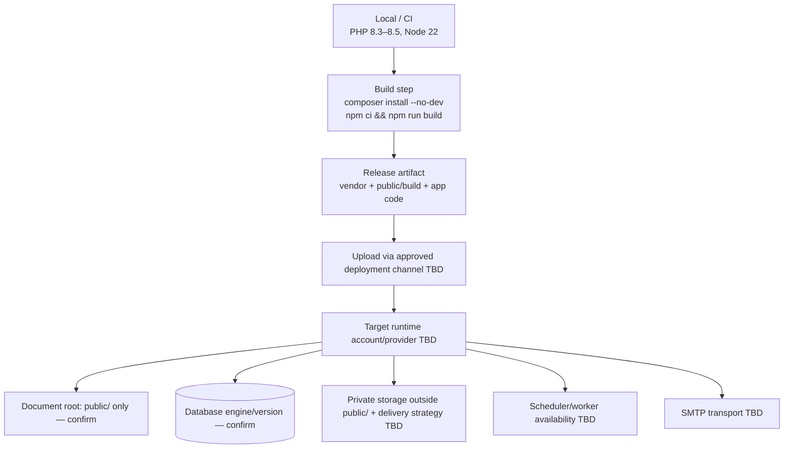

# PCDR — Deployment Architecture (Provider-Neutral)

**Status:** Design and decision register only. No environment file, configuration value, cron entry, deploy script, infrastructure, or server change is made in this phase.

**Owner-confirmed constraint:** The hosting provider has **not** been selected. Hostinger is a candidate only. PCDR must remain hosting-agnostic; provider selection is an open owner decision. If a provider cannot meet the requirements in this document, select another provider rather than downgrading Laravel.

---

## 1. Verified facts and uncertainty

**[VERIFIED] Locally**

- Laravel 13.43.0 / PHP 8.5.12 CLI; Composer 2.10.1; Node 22.23.3; npm 10.9.9; MariaDB 12.3.2 local server.
- `npm run build` succeeds and produces hashed assets under `public/build`.
- `.env` exists with local values; credentials are deliberately not read or reproduced here.
- `database` queue and cache stores are configured; framework tables for jobs/cache exist.
- Git repository at commit `c371e8e` with the initial Laravel + Vue + Inertia setup.
- From the Phase 0 audit: `composer audit` and `npm audit` timed out; current vulnerability status is **unverified** (install-time npm result was 0).

**[ASSUMPTION] Target runtime**

- No provider is selected. Capabilities such as exact plan, PHP version selector, control panel, Composer/SSH/Node availability, cron support, document-root control, storage-link support, database version, TLS/forwarded headers, backup scope, SMTP egress, and SLA are unconfirmed.
- Earlier attempts to fetch Hostinger documentation during Phase 0 are historical context only. No capability is asserted from them and no provider is treated as selected.
- No claim is made that any deployment profile supports long-running queue daemons, custom document roots, symlinks, Redis, or provider-specific APIs.

**[DECISION REQUIRED]** Provider compatibility is validated only through the canonical gate in §8 and before enabling features that depend on a specific capability (OQ-07–OQ-16, OQ-40, OQ-48). **Do not downgrade Laravel to accommodate an unverified provider (ADR-001).**

---

## 2. Infrastructure-neutral requirements

These are application requirements, not claims about any provider.

| Area | Minimum / required | Recommended / verified locally | Notes |
|---|---|---|---|
| PHP | 8.3–8.5 for Laravel 13 | 8.5.12 local | No downgrade. Target the whole supported range in quality gates. |
| PHP extensions | `mbstring`, `xml`, `curl`, `pdo_mysql`, `zip`, `fileinfo`, `tokenizer`, `openssl`, `bcmath`, `intl` | All verified locally | `gd` is optional and only needed if image processing is approved. |
| Laravel | Laravel 13 compatibility | 13.43.0 local | Do not change framework to suit a provider. |
| Database | MySQL 8+ or MariaDB 10.6+ with InnoDB, `utf8mb4`, strict mode | MariaDB 12.3.2 local | Avoid version-specific SQL; validate the selected engine before production migration. |
| Web server | Apache/nginx or equivalent with document root configurable to `public/` | Standard `public/index.php` + `.htaccess` present | Application code and `.env` must not be web-readable. |
| HTTPS | TLS on all public and administrative routes | Provider-specific termination not assumed | Configure trusted proxies only from confirmed forwarded headers. |
| Writable storage | Writable `storage/` and `bootstrap/cache/` for the runtime user | Local baseline | Application code and `.env` must not be writable by the web user. |
| Public file access | Laravel public disk + `storage:link`, or signed delivery through a controller | Not configured in Phase 1 | Choose per provider capability; business logic must not care which. |
| Queue execution | At least one documented strategy: dedicated worker, bounded scheduled worker, or explicitly approved synchronous path | `database` queue configured locally | The `jobs` table alone does not execute jobs. |
| Scheduler | Cron or platform scheduler able to invoke `php artisan schedule:run` where scheduled work is enabled | Not configured in Phase 1 | Needed for scheduled cleanup, retries, and bounded workers. |
| Mail transport | Laravel Mail with SMTP or another supported transport configured via environment | `config/mail.php` default `smtp` | No provider SDK or business-logic coupling. |
| Backups | Encrypted DB dump + private file backup, with tested restore | Not configured in Phase 1 | Retention and ownership are **[DECISION REQUIRED]**. |
| Logging/monitoring | Central application logs, failed-job visibility, security/audit access | Framework defaults only | Alerting owner is **[DECISION REQUIRED]**. |
| File upload limits | `upload_max_filesize`, `post_max_size`, request body limits, and timeout settings sized to the approved media policy | Not configured in Phase 1 | Decide before media uploads are enabled. |
| Resources | CPU, RAM, disk, and I/O sized by rehearsal/load test | No numeric target asserted | Record measured sizing before go-live; do not invent a capacity claim. |
| Deployment/rollback | Repeatable build, release directory or equivalent, previous release retained | Prebuilt asset workflow planned | Rollback must be rehearsed before go-live. |

---

## 3. Deployment capability profiles

These are **profiles, not mandatory architecture choices**. The selected provider may fit one or a hybrid.

| Profile | Capabilities that may be available | Capabilities that may vary | Architecture response |
|---|---|---|---|
| Standard shared hosting | PHP, MySQL, HTTPS, cron in some plans | SSH/Composer/Node, document-root control, symlinks, long-running workers, file ownership, SMTP egress | Prebuild assets and upload `vendor/` if needed; use bounded scheduled work; require confirmed document-root isolation. |
| Managed application hosting | Git/deploy hooks, managed PHP/DB, HTTPS, environment variables | Worker processes, cron semantics, filesystem write access, storage add-ons | Keep build and runtime commands standard; isolate provider hooks outside application code. |
| VPS or dedicated server | Full PHP/Composer/Node control, cron, daemons, firewall, filesystem control | Operational responsibility, backup tooling, monitoring stack | Dedicated workers and supervisor are possible; same application code, no module rewrite. |
| Container-based hosting | Reproducible images, horizontal scaling, managed secrets/object storage | Platform-specific routing, ephemeral local disk, queue/scheduler sidecars | Store uploads through Laravel filesystem abstraction; keep queue/scheduler as separate processes. |

No profile is assumed to satisfy the requirements until validated against the selected provider.

---

## 4. Deployment topology

**[RECOMMENDATION] Portable release flow**

1. Build assets locally or in CI with the same Node major version used in development.
2. Install production PHP dependencies with `composer install --no-dev --optimize-autoloader`.
3. Upload a release directory containing application code, `vendor/`, and prebuilt `public/build/`.
4. Configure the web server so only `public/` is served. Use the provider's supported mechanism; never expose the project root.
5. Set environment values through the approved secret store or a protected `.env` outside the document root; verify file permissions.
6. Run one-time release tasks (`migrate --force`, cache commands, storage link or chosen alternative) only after backup and confirmation.
7. Keep the previous release available for immediate rollback.

Node.js is **not required on the production host** if assets are prebuilt. Composer presence on the host is convenient but not mandatory if `vendor/` is uploaded. This reduces dependence on unconfirmed provider capabilities (ADR-016).

---

## 5. Storage abstraction

**[RECOMMENDATION]**

- Business logic uses Laravel's filesystem API and named disks only. No domain class knows whether files are local, S3-compatible, or provided by a future service.
- `local` private disk: files outside the public document root; restricted files delivered only through an authorization-checked controller with signed, expiring URLs.
- `public` disk: suitable for approved public media; `storage:link` is a deployment convenience, not an architectural requirement. If symlinks are unavailable, use the provider-supported public exposure method or signed delivery without changing business logic (OQ-09).
- S3-compatible object storage: optional future disk behind the same abstraction; requires separate owner approval and credential ownership. No provider SDK is embedded in domain code.
- Orphan cleanup must check all explicit media pivots and all dedicated attachment-table references before deletion.

---

## 6. Runtime configuration requirements

**[RECOMMENDATION]**

| Setting | Requirement |
|---|---|
| `APP_ENV=production`, `APP_DEBUG=false` | Mandatory |
| `APP_KEY` | Generated once per environment; rotate only with a documented session/data re-encryption plan (OQ-28/OQ-30) |
| `APP_URL` | Exact canonical HTTPS URL used for signed routes and sitemap/canonical links |
| `APP_LOCALE=ar`, `APP_FALLBACK_LOCALE=en` | Per OQ-31; implementation-phase change |
| `DB_*` | Credentials via approved secret store/env, never committed; verify `utf8mb4`, collation, strict mode |
| `CACHE_STORE=database`, `SESSION_DRIVER=database`, `QUEUE_CONNECTION=database` | Portable starting defaults; revisit only with evidence |
| `MAIL_*` | SMTP or supported transport credentials in environment; DB settings hold only non-secret references |
| `FILESYSTEM_DISK` | Private/public disk selection per §5 |
| `TRUSTED_PROXIES` | Only after confirming the actual provider's forwarded headers (OQ-13; `SECURITY_ARCHITECTURE.md` §8) |

- Never commit `.env`. Keep `.env.example` with placeholder keys only.
- Secrets are never returned through settings APIs or Inertia props (ADR-010).
- Environment changes are deployment changes and require the same review as code.

---

## 7. Queues, scheduler, and mail

**[RECOMMENDATION]**

- **Critical operations** (currently account verification, password reset, and any future account-security message) must not be silently lost or skipped. A synchronous path or a confirmed worker path is chosen before Phase 2b (OQ-10/OQ-11/OQ-15/OQ-40). Missing translation falls back to code-owned `lang/` content; see `COMMUNICATION_ARCHITECTURE.md` §3/§5/§9.
- **Non-critical operations** (bulk notifications, report generation, cleanup) may be delayed and queued. They must have bounded retries and visible failure logs.
- Queue execution alternatives:
  - Dedicated `queue:work` daemon where the profile supports long-running processes.
  - Cron-driven bounded `queue:work --stop-when-empty --max-time=...` with an overlap lock where only scheduled commands are available.
  - Synchronous processing only for explicitly approved, short operations; never assumed for mail until the critical-mail decision is recorded.
- The `jobs` table is storage, not execution. Do not claim queue capability from its presence.
- If a scheduler exists: one entry `* * * * * php artisan schedule:run >> /dev/null 2>&1` using the correct PHP binary and working directory.
- Scheduler tasks (planned): prune expired report exports, retry/fail stale notifications, cleanup orphan temporary uploads, send scheduled emails, generate approved metric snapshots.
- Never run `queue:restart` or destructive cleanup without a deployment runbook.

---

## 8. Canonical production deployment gate

This is the **single authoritative definition** of production readiness. `IMPLEMENTATION_ROADMAP.md` §7 and `OPEN_QUESTIONS.md` reference this section instead of maintaining separate lists.

No production deployment, go-live, or enabling of a dependent feature is permitted until every applicable item below is answered, owned, dated, and approved by the formally authorized authority recorded under OQ-49. OQ-49 is **PARTIALLY RESOLVED — PENDING FORMAL APPROVAL**: the strategic plan confirms the general authority framework, but formal execution approval/delegation, named officeholders, and written authorization are not recorded. Provider-neutral requirements in §2 may be documented and implemented earlier; provider-specific checks are required only before deployment or before enabling features that depend on them. This gate does **not** block Phase 2a or unrelated development.

### 8.1 Governance and change control

- [ ] Phase 1 documentation has been reviewed and explicitly approved by the formally authorized authority recorded under OQ-49 (PARTIALLY RESOLVED — PENDING FORMAL APPROVAL; formal authorization pending; no developer approval rights). This finalization report is not approval.
- [ ] ADR-001–ADR-017 statuses, owners, and approval dates are recorded; unapproved choices remain pending.
- [ ] Every production change has a recorded owner, rollback path, and approval.

### 8.2 Security, IAM, and account protection

- [ ] Authentication approach resolved (OQ-17); MFA scope resolved (OQ-18).
- [ ] Protected-capability holders named (OQ-23); admin route prefix resolved (OQ-20).
- [ ] Organizational structure decision recorded before department/section scopes are used (OQ-19).
- [ ] Security/incident owner named; incident runbook and session-revocation procedure approved (OQ-30).
- [ ] TLS, forwarded headers, and trusted-proxy configuration validated on the selected provider (OQ-13).
- [ ] Document root isolation confirmed so only `public/` is served (OQ-08).
- [ ] Dependency audits (`composer audit`, `npm audit`) completed with high/critical advisories resolved or documented.

### 8.3 Privacy, retention, encryption, and audit

- [ ] Data-minimization, purpose limitation, sensitive-field classification, access restrictions, retention periods, deletion/anonymization, export controls, audit requirements, and encryption requirements for restricted data are approved (OQ-24–OQ-29).
- [ ] Retention periods and backup periods are recorded; no indefinite default is assumed (OQ-26, OQ-14).
- [ ] Field-encryption decision (OQ-28), including `APP_KEY` custody, rotation, backup, and recovery implications, is resolved before any affected schema and before release.
- [ ] Unified `audit_logs` design, read/export entries, append-only-with-retention behavior, and restricted audit access are accepted.
- [ ] No beneficiary, complaint, CV, volunteer, or tender personal-data migration is authored before the privacy gate is recorded.

### 8.4 Infrastructure and deployment

- [ ] Selected provider and plan recorded (OQ-07). If Hostinger is chosen, its capabilities are verified; it is not assumed.
- [ ] PHP version and required extensions verified (§2, OQ-07).
- [ ] Database engine/version, InnoDB, `utf8mb4`, and strict mode verified (OQ-12).
- [ ] Composer/vendor strategy, Node/build strategy, upload/deployment channel, and file ownership constraints verified (OQ-07).
- [ ] Storage-link or signed-delivery strategy selected and tested (OQ-09).
- [ ] Scheduler and queue execution strategy selected and tested (OQ-10, OQ-11).
- [ ] Staging or rehearsal environment available and used for migration/deployment/CSP rehearsal (OQ-16; OQ-48 is an alias, not a second gate).
- [ ] File upload limits, resource sizing, and monitoring/logging ownership recorded.
- [ ] Deployment rehearsal and rollback rehearsal passed.

### 8.5 Backup and recovery

- [ ] Backup scope includes database and private files; backups encrypted and access-limited (OQ-14).
- [ ] Restore test completed with named owner and recorded result.
- [ ] Backup retention matches the approved retention policy.
- [ ] Recovery of any encrypted fields has a documented procedure if OQ-28 requires encryption.

### 8.6 Email and notifications

- [ ] Mail transport/provider and credential owner named (OQ-40); outbound SMTP/transport restrictions verified (OQ-15).
- [ ] Critical mail delivery path (synchronous or confirmed worker) selected and tested.
- [ ] Critical templates have code-owned `lang/` fallback; missing translations are logged, never silently skip account-security mail.
- [ ] Delivery logs, retries, redaction, and failure alerting owner approved (OQ-45).

### 8.7 Public content, localization, and design assets

- [ ] Verified institutional content owner named (OQ-06); OQ-01–OQ-06 answers attached to public claims or fields omitted.
- [ ] Arabic default and locale route behavior resolved (OQ-31); numbering, partial publication, and formatting rules resolved where used (OQ-32, OQ-38).
- [ ] Fonts licensed and self-hosting method recorded (OQ-33); where actual institutional photography or rights-bearing illustration is used, OQ-34 consent/publication rights and OQ-06 content-owner approval are recorded; logo/brand motion remains conditional on OQ-35. Neutral design assets do not require an OQ-34 answer.
- [ ] Search mode resolved before CMS schema is frozen (OQ-39); maps/provider resolved before location schema (OQ-36).
- [ ] Accessibility, responsive, and reduced-motion acceptance checks pass on representative public and dashboard pages.

---

## 9. Environments and promotion

**[RECOMMENDATION]**

| Environment | Purpose | Data |
|---|---|---|
| Local | Development | Synthetic test data only; no production copy |
| Staging (if available; OQ-16/OQ-48) | Deployment rehearsal, migration dry-run, CSP report-only | Anonymized or synthetic only |
| Production | Live platform | Real data, strict change control |

- Promotion path: local → staging → production with the same build command and lockfiles.
- Migrations are reviewed and backed up before execution; no destructive migration without a tested rollback.
- Feature flags via settings (`modules.*`) allow gradual enablement; flags are not authorization (ADR-010).

---

## 10. Portability commitment

**[RECOMMENDATION]** The application must not depend on provider-specific paths, headers, scripts, storage mechanisms, queue implementations, or deployment APIs. Host-dependent behavior is isolated in deployment configuration, trusted-proxy settings, filesystem disks, and queue strategy. Moving between shared hosting, managed hosting, VPS, or containers changes the runtime and operational tooling, not application modules (ADR-016). No Laravel downgrade is acceptable to accommodate an unverified provider (ADR-001).
