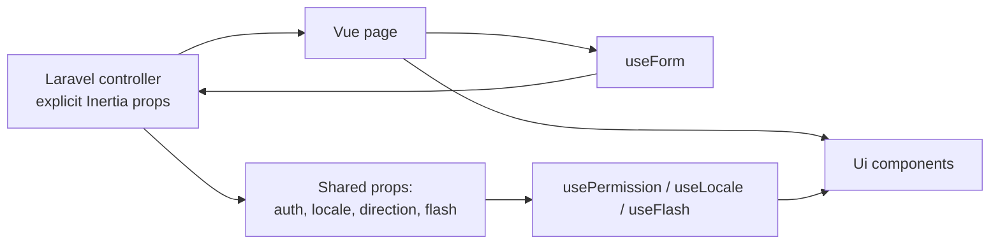

# PCDR — Frontend Architecture

**Status:** Design only. No component, layout, composable, type, or configuration change is created in this phase.

---

## 1. Verified baseline

**[VERIFIED]**

- Vue **3.5.46**, `@inertiajs/vue3` **3.11.0**, Vite **8.3.8**, Tailwind **4.3.5**, `@vitejs/plugin-vue` **6.0.11**.
- `resources/js/app.js` uses `createInertiaApp` with `import.meta.glob('./Pages/**/*.vue', { eager: true })` and mounts with `createApp(...).use(plugin).mount(el)`. This matches the installed adapter's documented `setup({ el, App, props, plugin })` contract.
- Only `resources/js/Pages/Welcome.vue` exists (a single `<div>`). No layouts, components, composables, TypeScript, or client store.
- `resources/views/app.blade.php` is the Inertia root view with `@vite`, `@inertiaHead`, `@inertia`.
- `npm run build` succeeds; one non-blocking `fontaine` warning from the Laravel font helper.
- `resources/css/app.css` imports Tailwind v4 and defines an Instrument Sans theme.

**[DECISION REQUIRED]** Typography changes from Instrument Sans to the candidate pairing in `DESIGN_SYSTEM.md` (IBM Plex Sans Arabic + Inter) are gated by OQ-33: font licensing and self-hosting method must be approved, and the Vite/fontaine impact checked, before any typography change in Phase 3. No files are changed now.

---

## 2. Proposed structure

```text
resources/js/
  app.js                       # Inertia bootstrap (existing; extended later)
  Pages/
    Auth/                      # Login, forgot password, reset, verification
    Public/                    # Home, About, Projects, News, Tenders, Careers, ...
    Admin/                     # Dashboards and management screens by domain
  Layouts/
    PublicLayout.vue           # Public site chrome (header, footer, language switch)
    DashboardLayout.vue        # Institutional back-office chrome (sidebar, topbar)
    AuthLayout.vue             # Focused authentication shell
  Components/
    Ui/                        # Buttons, inputs, dialogs, alerts, skeletons, badges
    Forms/                     # Field wrappers, repeaters, localized inputs
    Content/                   # Article cards, media figures, breadcrumbs, pagination
    Domain/                    # Domain-specific composites, e.g. Complaints/StatusPill.vue
  Composables/
    usePermission.js           # UI-only permission and scope checks
    useLocale.js               # locale, direction, formatting helpers
    useFlash.js                # flash messages
    useReducedMotion.js        # respects prefers-reduced-motion
    useMotionReveal.js         # shared IntersectionObserver-based reveal
  Types/                       # Shared TypeScript declarations (incremental)
  Utils/                       # Pure formatting/URL helpers
  Constants/                   # Status labels, channel keys, route keys
resources/css/
  app.css                      # Tailwind import + token definitions
  tokens.css                   # Color, spacing, typography, motion tokens (planned)
  motion.css                   # Keyframes and reduced-motion overrides (planned)
```

**[RECOMMENDATION] Directory rules**

- Pages map 1:1 to Inertia render names; nested folders mirror URL/domain structure (`Admin/Projects/Index.vue`).
- Layouts own chrome and visual identity; pages own content and never duplicate headers/footers.
- `Ui/` components are presentational, accessible, and token-driven; no business logic, no direct HTTP calls.
- `Domain/` components may accept domain DTO-shaped props but still emit events rather than mutate state directly.
- Create directories only when their first real component arrives.

---

## 3. Naming conventions

| Artifact | Convention | Example |
|---|---|---|
| Vue components | PascalCase filename and component name | `ProjectStatusPill.vue` |
| Composables | camelCase `useX` | `usePermission.js` |
| Types | PascalCase | `Project.ts` |
| Constants | SCREAMING_SNAKE_CASE | `WORKFLOW_STATUSES` |
| Pages | Domain/Resource/Action | `Admin/Complaints/Show.vue` |
| Props/emits | camelCase props, kebab-case in templates, explicit `defineEmits` | `projectId`, `@status-change` |
| CSS classes | Tailwind utilities + token-based component classes | `bg-surface`, `text-ink` |

---

## 4. Layout systems

**[RECOMMENDATION]**

| Layout | Audience | Visual identity | Notes |
|---|---|---|---|
| `PublicLayout` | General public, AR/EN | Editorial, generous whitespace, navy/teal/sand palette, strong typography | Language switch, accessible skip link, no admin chrome |
| `DashboardLayout` | Authenticated staff | Denser, task-oriented, compact tables, restrained motion | Permission-aware navigation, notification center, account menu |
| `AuthLayout` | Authentication flows | Calm, focused, single-panel | Localized, no public-site navigation |

- Public and dashboard layouts share **tokens and primitives** (`Ui/`) but not shell structure (ADR-014).
- `dir="rtl"` / `dir="ltr"` comes from the Inertia shared `direction` prop and is applied to `<html>` in `app.blade.php` on first load, then maintained on client navigation.
- All spacing uses logical properties/classes (`ps-*`, `pe-*`, `ms-*`, `me-*`) so RTL mirroring works without duplicated components.

---

## 5. Data flow and state

**[RECOMMENDATION]**

- **Server-driven state is the default.** Inertia props are the source of truth for page data, permissions, locale, and workflow state.
- Forms use Inertia's `useForm` with server-side validation errors; no duplicate client validation rules that can drift from Form Requests.
- Navigation uses Inertia `Link`/`router`, preserving the locale prefix automatically via a helper (`localePath()`).
- Flash messages and validation errors arrive as shared props from `HandleInertiaRequests`.
- **Pinia is not introduced initially.** Introduce it only for genuinely cross-page client state (e.g. a multi-step wizard that must survive navigation without server round-trips). Most workflows are server-driven and need no global store.
- Never cache restricted data in browser storage; no beneficiary or complaint content in localStorage/sessionStorage.



---

## 6. Shared props contract

**[RECOMMENDATION] `HandleInertiaRequests::share()` should expose:**

| Prop | Shape | Purpose |
|---|---|---|
| `auth.user` | `{ id, name, locale, status, roles: string[] }` | Identity display only; no sensitive profile fields |
| `auth.permissions` | `string[]` | UI control visibility (never security) |
| `auth.scopes` | `Record<string, { scope_type: string }>` | Resource → **`scope_type` only**, for display/enablement hints; never `scope_value` |
| `locale` | `'ar' \| 'en'` | Active locale |
| `direction` | `'rtl' \| 'ltr'` | Document direction |
| `availableLocales` | `string[]` | Language switch |
| `flash` | `{ success?, error?, warning? }` | Notices |
| `settings.public` | limited, explicitly allowlisted keys | Brand name, logo URL, SEO defaults |

**[RECOMMENDATION] Constraint:** only `is_public` settings reach props. Secret references, provider configuration, and internal flags are never serialized to the client (ADR-010).

**[RECOMMENDATION] Explicit prohibition (F-12):** `auth.scopes` carries only the `scope_type` string. `scope_value` JSON, internal department/section ids, and scope criteria are **never** serialized into Inertia props, even for display. Both `HandleInertiaRequests::share()` and `AUTHORIZATION_ARCHITECTURE.md` §11 state this rule. A feature test must assert that the serialized `auth.scopes` payload contains no `scope_value` key and no internal ids; that test is a Phase 2a acceptance criterion in `IMPLEMENTATION_ROADMAP.md` §3.

---

## 7. TypeScript adoption

**[RECOMMENDATION] Incremental, no build rewrite:**

1. Phase 2: add TS declarations for shared props, enums/status values, and API DTO shapes; keep existing JS entry point working.
2. New composables and utilities written in `.ts`; existing `.js` migrated opportunistically.
3. New complex components use `<script setup lang="ts">`; simple presentational components may remain JS until touched.
4. Add type-checking to CI when TS files exist; do not block the initial foundation on a full migration. **[DECISION REQUIRED]** the type-check command and CI owner must be recorded before the Phase 3 frontend quality gate is enforceable (OQ-47; `TESTING_STRATEGY.md` §2/§6). No tool or package is added in Phase 1.

**Rule:** TypeScript describes server contracts; it never becomes a second source of validation truth.

---

## 8. Accessibility requirements

**[RECOMMENDATION]**

- Semantic HTML in layouts (`header`, `nav`, `main`, `footer`, correct heading order), skip links, visible focus rings using design tokens.
- All interactive components keyboard operable; dialogs trap focus and restore it on close; no keyboard traps.
- Form fields have persistent labels, described errors, and `aria-invalid`; errors announced via live regions.
- Color contrast governed by `DESIGN_SYSTEM.md` (WCAG 2.2 AA target).
- Motion respects `prefers-reduced-motion` via `useReducedMotion` and CSS overrides (see `MOTION_DESIGN_SYSTEM.md`).
- RTL parity: logical properties, mirrored icons where meaningful, correct bidirectional text handling for mixed AR/EN strings.
- Automated accessibility checks in CI for key routes, plus manual keyboard/screen-reader review before release.
- Verification criteria before Phase 3 acceptance: responsive parity at declared breakpoints (640/768/1024/1280/1536px), 200% zoom without loss of content or function, 44×44px minimum touch targets, and `prefers-reduced-motion` disabling non-essential movement. `prefers-reduced-motion` is tested with both the CSS override and the `useReducedMotion` composable.

---

## 9. Motion integration

**[RECOMMENDATION]**

- Motion tokens live in CSS (`tokens.css`) and Tailwind theme extension; components never hardcode durations/easings.
- `useMotionReveal` uses one shared `IntersectionObserver` for scroll reveals; `useReducedMotion` disables non-essential motion.
- Critical content is visible without JavaScript animation completing; no animation gates information.
- Detailed rules: `MOTION_DESIGN_SYSTEM.md`.

---

## 10. Build and performance

**[RECOMMENDATION]**

- Keep the existing Vite plugin chain (`laravel`, `tailwindcss`, `vue`); add no animation or UI library in Phase 1.
- Page components are eager-globbed (current behavior, small app). If the page count grows substantially, evaluate lazy resolution per page — not now.
- Assets remain hashed in `public/build`; production serves prebuilt assets (ADR-016).
- Avoid large client-side data serialization; paginate tables server-side.
- Audit bundle size when the first real dashboard ships; no speculative optimization today.

---

## 11. Frontend testing (planned)

**[RECOMMENDATION]** See `TESTING_STRATEGY.md`: component tests for `Ui/` primitives, composable tests for `usePermission`/`useLocale`, and a11y smoke checks on key pages. Tool selection (e.g. Vitest + Vue Test Utils) is a later decision; no packages are installed now. The tool must be recorded before the Phase 3 quality gate 4 (`npm run build`) and component tests are treated as enforceable; an unselected tool is not a gate. `usePermission` tests must assert UI-only semantics and must verify that no restricted data is cached in browser storage.
