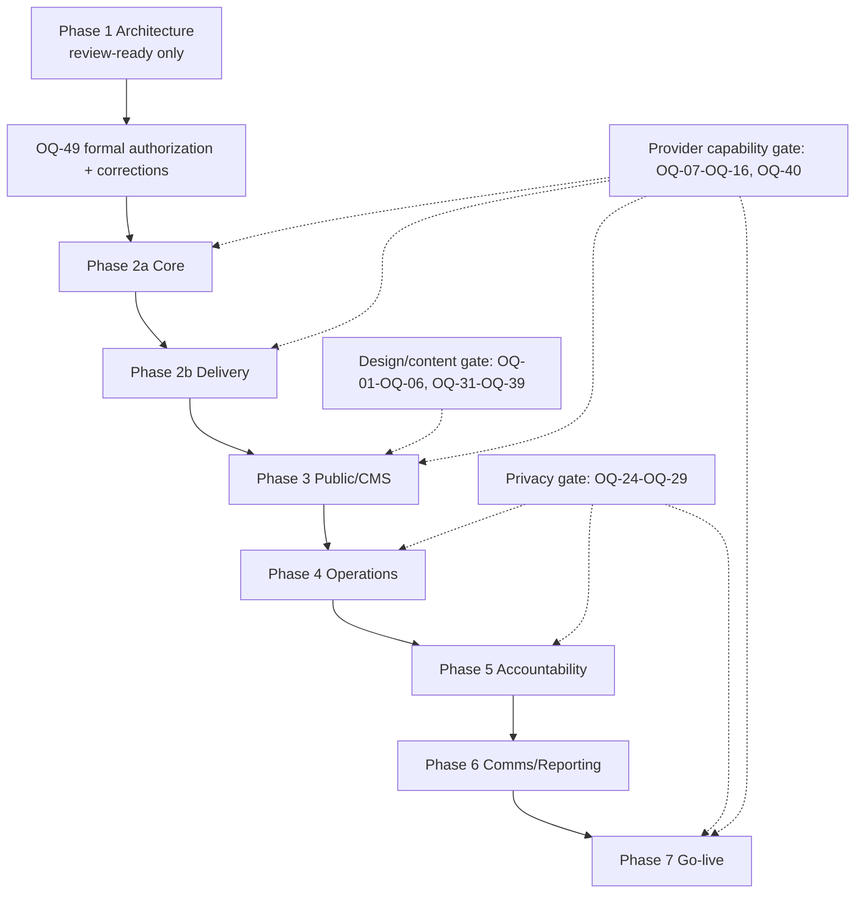

# PCDR — Implementation Roadmap

**Status:** The Phase 1 documentation set is the historical design baseline; the Phase 2a technical foundation below has been implemented under explicit user authorization, **not** institutional approval. Every phase transition still requires recorded formal approval/authorization under OQ-49, which is **PARTIALLY RESOLVED — PENDING FORMAL APPROVAL**. ADR-001–017 remain **PROPOSED**, no approval rights are granted to the developer, and Phase 3 is not authorized.

---

## 1. Sequencing principles

1. **Security foundation before protected data.** Authentication, RBAC, scopes, and audit land before beneficiary/complaint/HR modules.
2. **Public presence before operational complexity.** The institution needs a credible bilingual site early, but only with verified content.
3. **Shared infrastructure once.** Settings, localization, media, workflow, notifications, and audit are built as reusable foundations.
4. **No invented content.** Every phase ships with empty or explicitly synthetic technical data; institutional content is entered by authorized humans.
5. **Provider-neutral design; capability checks at dependency points.** Infrastructure requirements are documented independently of any vendor. Selected-provider checks are completed before the feature that depends on them and before the canonical production gate in `DEPLOYMENT_ARCHITECTURE.md` §8.
6. **Test with the feature.** No phase is complete without its authorization and workflow tests.
7. **No automatic progression.** Completion of documentation or one phase never starts the next phase.

---

## 2. Phase overview

> **Strategic timeline crosswalk (non-equivalent):** Strategic plan 2027 quarters (Q1-Q4) and 2027-2029 maturity stages are institutional timelines, not engineering phases. Engineering phases deliver technical/control capabilities and must not be reported as strategic-quarter completion without an approved domain/capability crosswalk. Phase 7 go-live is not equivalent to strategic Q4 evaluation/sustainability.

| Phase | Name | Outcome | Entry gate / key dependencies |
|---|---|---|---|
| Phase 1 | Architecture foundation | Review-ready documentation submission; **not approved** | Phase 0 audit; OQ-49 formal authorization/delegation required before any transition |
| Phase 2a | Security & platform core | Auth, RBAC, scopes, audit, settings core, localization plumbing; **no production email** | OQ-49 formal authorization (still pending); ADR-001–005, ADR-010, ADR-015, ADR-017; OQ-17, OQ-19, OQ-20, OQ-23, OQ-31 |
| Phase 2b | Delivery enablement | Transactional email, in-app/database notifications, queue/scheduler, delivery health | Phase 2a; OQ-10, OQ-11, OQ-13, OQ-15, OQ-18, OQ-40, OQ-45 |
| Phase 3 | Public presence & CMS | Bilingual layouts, CMS, media, navigation, homepage builder, verified content shell | Phase 2b; ADR-003/007/009/011/013/014; OQ-01–OQ-06, OQ-08, OQ-09, OQ-16, OQ-33–OQ-39 cleared for enabled features |
| Phase 4 | Institutional operations | Programs/projects, activities, partnerships, beneficiary workflow, operational dashboards | Phase 3, ADR-008; **P4 privacy prerequisite:** OQ-24–OQ-29 answered before beneficiary schema |
| Phase 5 | Accountability & participation | Complaints, volunteers, careers, tenders | Phase 4; OQ-26/OQ-29 before restricted schema; privacy decisions |
| Phase 6 | Communications & reporting | Template management UI, bulk email, optional push, report exports, ops health | Phases 2b–5; OQ-41–OQ-44 resolved for enabled features |
| Phase 7 | Hardening & go-live | Security review, deployment rehearsal, backups, monitoring, launch | All above; **canonical production gate** in `DEPLOYMENT_ARCHITECTURE.md` §8 fully answered |

**[RECOMMENDATION]** Do not parallelize business module implementation across agents; phases are sequential and review-gated. Research and owner-decision work may proceed in parallel, but no implementation starts before its entry gate.

---

## 3. Phase 2a — Security & platform core

**Scope**

- Authentication: login, logout, password reset, verification, lockout, account states.
- RBAC: permission catalog config + sync command, roles, role permissions, user roles, scopes, protected rules, cache invalidation.
- Audit log infrastructure + viewer permission.
- Central settings skeleton with env/DB split and `is_public` allowlist.
- Localization plumbing: `lang/ar`, `lang/en`, `SetLocale`, locale route groups, `lang`/`dir` in root view.
- Database notifications + in-app center shell + user locale field.
- Quality tooling: `pint.json`, Larastan baseline, CI commands, PHP 8.3–8.5 compatibility check.
- No production email transport is enabled in Phase 2a.

**Acceptance criteria**

- [ ] A user with no role cannot access any private route.
- [ ] Role/permission management cannot be performed by a non-authorized user; protected permissions cannot be modified through UI or request.
- [ ] Self-role-assignment and last-admin-removal are rejected and audited.
- [ ] Scope resolver returns only permitted records for each scope type; tests cover combinations.
- [ ] `auth.scopes` props contain `scope_type` only; a test asserts that `scope_value` is absent.
- [ ] Demotion/suspension invalidates sessions and cached permissions on the next request.
- [ ] `/ar` and `/en` work; `dir` is correct; root redirects to `/ar`.
- [ ] No secret or protected setting appears in Inertia props.
- [ ] Audit entries exist for RBAC/user/settings changes with redaction; read/export entries omit `before`/`after`.
- [ ] `departments`/`sections` tables and scope types are not created or used unless OQ-19 is answered affirmatively.
- [ ] CI/pre-push quality gates pass; authorization tests present for every protected endpoint; PHP 8.3–8.5 compatibility gate is executable.
- [ ] Existing skeleton commit is preserved; no package added without explicit approval.
- [ ] Demo seeder is protected or replaced before first non-local use.

**Decisions needed before/during:** auth UI approach (OQ-17), default password policy values, admin locale-prefix choice (OQ-20), departments/sections (OQ-19), protected-capability holders (OQ-23), Arabic default (OQ-31).

### 3.1 Phase 2a technical implementation status

The implementation is a technical foundation only. It does not close an open question, approve an ADR, enable Phase 3, or add institutional facts.

| Area | Status | Evidence / boundary |
|---|---|---|
| Authentication and account states | Implemented | Login/logout, verification notice and signed verification, reset tokens, rate limiting, active/inactive/suspended states, temporary lockout, session invalidation. Tests cover the happy paths and rejection cases. |
| Dynamic RBAC | Implemented | Code-owned permission catalog with sync command, custom DB permissions, roles, `role_user`, `permission_role`, `role_scopes`, protected permission rules, cache invalidation. Backend middleware/policies remain the authorization authority. |
| Platform Owner | Implemented | Single account bootstrapped through `pcdr:platform-owner:bootstrap` using environment or interactive secret input; no hardcoded credentials. Last-owner deactivation/deletion is blocked. Only technical authority is granted; no institutional role is implied. |
| Scopes | Partially implemented | `all`, `self`, and `assigned` are implemented with default-deny; public props expose `scope_type` only. `department`/`section` are deliberately absent until OQ-19 is formally answered. |
| Audit | Implemented | Append-only model, recursive redaction, request context, auth/RBAC/user/settings/audit-view/export events. Read/export audit entries carry no `before`/`after`. |
| Settings | Implemented | DB settings with config-declared definitions, public allowlist, cache invalidation, validation, secret references kept only in environment documentation. Demo seeder replaced by permission sync; no demo account is created. |
| Localization | Implemented | Arabic default, English support, locale-prefixed routes, `SetLocale`, `lang`/`dir` on the root view, AR/EN UI and validation messages. |
| Frontend/design foundation | Implemented | Tailwind v4 tokens, motion tokens, shared UI components, layouts, accessible auth/admin shells, RTL/LTR behavior. No UI kit, GSAP, Lottie, or frontend-only authorization. |
| Workflow vocabulary | Implemented as foundation | `config/workflows.php` and `ContentStatus` define the five required states and transitions. No content module is enabled in Phase 2a. |
| CI/static analysis/PHP 8.3 gate | Not implemented | No CI workflow, Larastan, or PHPCompatibility runner was added. These remain Phase 2a quality-tooling tasks and are not claimed as passing gates. |
| Production email/transport | Not implemented | Password reset and verification use framework notifications; no production transport, queue worker, or delivery health path is enabled. This remains Phase 2b scope. |

---

## 4. Phase 2b — Delivery enablement

**Scope**

- Transactional email for auth events via Laravel defaults, with a critical-mail fallback.
- Password reset and verification are critical messages: a missing DB translation uses the code-owned `lang/` fallback and is logged for correction; the message is never silently skipped.
- Queue/scheduler wiring, bounded retries, delivery logs, dedup, and failure visibility.
- Critical-delivery path chosen: synchronous or confirmed worker path before account-security flows go live.

**Acceptance criteria**

- [ ] Critical mail delivery path (synchronous or confirmed worker) is selected and tested; `ShouldQueue` for critical mail is explicitly decided.
- [ ] Missing translation for password reset/verification does not block account access; fallback is code-owned and logged.
- [ ] SMTP/transport egress and credential ownership are confirmed (OQ-15/OQ-40).
- [ ] Queue and scheduler strategy are tested; `jobs` table presence is not treated as execution capability.
- [ ] Delivery logs redact restricted data and inbox addresses per the approved rule (OQ-45).

---

## 5. Phase 3 — Public presence & CMS

**Scope**

- `PublicLayout`, `DashboardLayout`, `AuthLayout` with tokens and motion primitives.
- Pages, news, publications basics with workflow and AR/EN translation tables.
- Media library with explicit pivots, dedicated restricted-attachment tables, and private signed URLs.
- Navigation and homepage builder with module flags.
- SEO canonical/hreflang, sitemap decision implemented if approved.
- Localized email template infrastructure for non-critical templates; critical templates are owned by Phase 2b rules.

**Entry gate**

- [ ] OQ-39 resolved before CMS schema is frozen; the chosen search mode is recorded in `DATABASE_ARCHITECTURE.md` and no search UI ships without that decision.
- [ ] OQ-33 closed: licensed font files and self-hosting method recorded; Vite/fontaine impact checked before typography changes.
- [ ] OQ-34 remains DEFERRED as a conditional use gate: before any actual institutional photograph or rights-bearing illustration is used in Phase 3/4 content, consent, publication rights/license, and OQ-06 content-owner approval must be documented. Neutral surfaces, icons, text-only wordmark, and authored CSS/SVG motifs are the documented fallback and do not require OQ-34; animated logo/brand usage remains conditional on OQ-35.
- [ ] OQ-06 closed: named content owner recorded; every AR/EN public claim traces to a verified source or remains empty in both locales.

**Acceptance criteria**

- [ ] Public pages query only published content; draft IDs return 404, not data.
- [ ] AR/EN content independent; fallback never fabricates text; slugs unique per locale.
- [ ] Homepage sections can be enabled/reordered without code changes.
- [ ] Images have localized alt text; logos preserve original colors.
- [ ] Logo/wordmark source assets and usage permission are supplied before rendering; text-only wordmark is used otherwise.
- [ ] Motion tokens used everywhere; no one-shot animation exceeds 480ms; the labeled loading-skeleton pulse is the only repeating effect and is limited to pending-data states; `prefers-reduced-motion` disables non-essential movement; logo is never animated unless OQ-35 is answered affirmatively.
- [ ] Accessibility smoke checks pass on the public home, one content detail page, and one dashboard list (keyboard, focus, labels, AR/EN RTL/LTR).
- [ ] Responsive parity verified at declared breakpoints (640/768/1024/1280/1536px), 200% zoom, and 44×44px touch targets.
- [ ] All authoring routes enforce permissions and workflow transitions; unauthorized publish rejected.
- [ ] No invented institutional content in migrations, seeders, or views.

---

## 6. Phase 4 — Institutional operations

**Scope**

- Programs/projects, categories, shared locations, project updates.
- Activities with aggregate reach and geography.
- Partnerships as configurable content.
- Beneficiary applications with minimal fields, documents, status events, anonymization path.
- Operational dashboards with aggregated, non-identifying metrics.

**Entry gate — privacy prerequisite**

- [ ] OQ-24 → OQ-29 are answered and recorded before any beneficiary or complaint personal-data migration is authored, not merely before release.
- [ ] OQ-28 field-encryption decision precedes column type/length definition; if required, `APP_KEY` custody, rotation, backup, and recovery ownership are documented.

**Acceptance criteria**

- [ ] Workflow maps declared in config; transitions audited; publish requires approval.
- [ ] Beneficiary records are access-controlled by permission **and** scope; every read/export is audited with a read/export entry that has no `before`/`after`.
- [ ] No personal beneficiary data in dashboards, notifications, analytics tables, or logs.
- [ ] Retention/anonymization behavior matches the approved policy answered under OQ-24 → OQ-29.
- [ ] Projects/activities publish only verified content; empty partner list by default.
- [ ] Data-scope tests cover `all`, `department`, `assigned`, and `self` where applicable; `department`/`section` only if OQ-19 is affirmative.

**Decisions needed before schema:** data minimization field list (OQ-25), export approval rule (OQ-24), retention periods (OQ-26), erasure process (OQ-27), field encryption (OQ-28), activity location precision (OQ-36).

---

## 7. Phase 5 — Accountability & participation

**Scope**

- Complaints intake, triage, assignment, response thread, resolution.
- Volunteers opportunities/applications/assignments.
- Careers postings/applications/documents.
- Tenders and procurement with sealed applications.
- Public forms with rate limiting and receipt emails.

**Acceptance criteria**

- [ ] Public intake stores restricted records but exposes no references to third parties.
- [ ] Complainant identity can be protected; anonymous submissions are supported only as approved under OQ-29.
- [ ] Assignment/response/resolve require exact permissions and scope; all transitions and restricted reads are audited.
- [ ] Bidder applications are mutually private; no public endpoint reveals submission contents.
- [ ] Public forms are rate-limited, validated, and localized with receipt email dedup.
- [ ] Retention/anonymization implemented per the approved policy; no period is invented.

**Decisions needed:** anonymous complaint policy (OQ-29), CV/bid retention (OQ-26), whether tender subscriptions/newsletter are approved (OQ-41).

---

## 8. Phase 6 — Communications & reporting

**Scope**

- Email template management UI, preview, variable allowlist enforcement.
- Individual and authorized bulk sending with chunking, rate limits, consent records if approved.
- Optional push channel (FCM) only after explicit approval and credential ownership.
- Notification preferences and delivery health.
- Report definitions and queued exports with expiring signed downloads.
- Queue/scheduler health tooling and cache management references.

**Acceptance criteria**

- [ ] Template preview uses the same renderer as delivery; missing translation blocks **non-critical** sends only; critical templates use the code-owned fallback.
- [ ] Bulk sends require explicit permission, confirmation, and audit; dedup prevents duplicates.
- [ ] Push disabled cleanly when unconfigured; no error surfaced for optional channels.
- [ ] Exports require source permission + `reports.export`, are queued, expire, and are audited (OQ-44).
- [ ] Failed jobs visible; retry guidance documented.
- [ ] No secrets or provider credentials in DB settings, logs, or frontend props.

---

## 9. Phase 7 — Hardening & go-live

**Scope**

- Production environment review: `APP_DEBUG=false`, HTTPS, trusted proxies, headers, CSP enforcement after report-only.
- Deployment rehearsal: prebuilt assets, vendor strategy, document-root isolation, storage link or signed delivery, migrations with backup.
- Backup + restore test; queue/scheduler verification; monitoring and incident runbook.
- Dependency audits clean; PHP 8.3–8.5 compatibility verified.
- Final accessibility and security review; content verification by authorized humans.

**Acceptance criteria**

- [ ] The **canonical Production Deployment Gate** in `DEPLOYMENT_ARCHITECTURE.md` §8 is fully answered, owned, dated, and approved. No shorter local list replaces it.
- [ ] OQ-48 remains tracked only as an alias of OQ-16; no second staging gate is created.
- [ ] Rollback tested; previous release restorable.
- [ ] No seeder/demo data in production; no invented institutional content published.
- [ ] Audit, backup, and incident ownership assigned.
- [ ] Human go-live approval recorded.

---

## 10. Dependency graph

---

## 11. Change control

- Any change to an ADR, permission name, table strategy, security boundary, or canonical gate requires an updated document and human approval before implementation continues.
- Phase completion is not assumed from documentation; acceptance criteria must be demonstrated.
- **No phase, including Phase 2, starts automatically after this blueprint is delivered.** Each transition requires recorded formal approval/authorization under OQ-49. OQ-49 is PARTIALLY RESOLVED — PENDING FORMAL APPROVAL; no transition is authorized until formal authorization is recorded.
