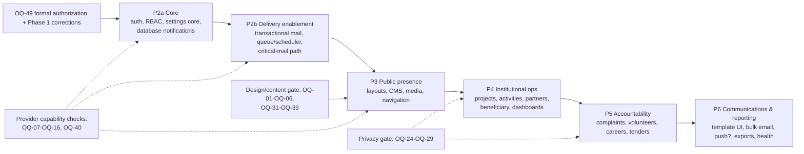

# PCDR — System Module Map

**Status:** Planning map only. No module is implemented, enabled, or populated with institutional content.

---

## 1. How to read this map

**[RECOMMENDATION]** Each module entry states purpose, responsibilities, dependencies, data sensitivity, required permission family, public/private boundary, and a suggested implementation phase. Permission names follow the catalog in `AUTHORIZATION_ARCHITECTURE.md`; they are **planned identifiers**, not existing records.

**Sensitivity legend:** Public (published content only) · Internal (drafts/config) · Confidential (accounts/logs) · Restricted (personal data).

**Phase legend:** P2a = core platform/auth · P2b = delivery enablement (mail/queue) · P3 = public presence/CMS · P4 = institutional operations · P5 = accountability/participation · P6 = communications/reporting. See `IMPLEMENTATION_ROADMAP.md` §2; phases are review-gated and never start automatically.

**Important:** No module is enabled by default simply because it appears here. Module flags in settings are independent of authorization and publication.

---

## 2. Module groups

| Group | Modules |
|---|---|
| A. Public Website | A1 Homepage, A2 About/Institutional, A3 Public project & news browsing, A4 Contact & forms |
| B. CMS | B1 Pages, B2 Navigation, B3 Homepage Builder, B4 News, B5 Publications, B6 Media Library |
| C. Identity & Access | C1 Authentication, C2 Users, C3 Roles & Permissions, C4 Data scopes, C5 Audit log viewer |
| D. Institutional Management | D1 Programs & Projects, D2 Activities, D3 Partnerships, D4 Central Settings |
| E. Humanitarian Operations | E1 Beneficiary applications, E2 Activity reach aggregates |
| F. Accountability & Participation | F1 Complaints, F2 Volunteers, F3 Careers |
| G. Communications | G1 Email templates & logs, G2 Notifications, G3 Tenders & procurement |
| H. System Administration | H1 File management, H2 Queue/scheduler health, H3 Cache & backups (references) |
| I. Analytics & Reporting | I1 Dashboards, I2 Report exports |

---

## 3. Module details

### A. Public Website

**A1 Homepage**
- **Purpose:** First point of contact; editorial, bilingual, trustworthy.
- **Responsibilities:** Render enabled homepage sections, hero, featured content, verified figures only.
- **Dependencies:** D4 settings, B3 homepage builder, B6 media, B4 news, D1 projects, ADR-013/014 tokens.
- **Sensitivity:** Public. **Permissions:** none (published state only). **Boundary:** public. **Phase:** P3.
- **Constraint:** No invented achievements, partners, or figures. Empty sections render as nothing, not placeholder content.

**A2 About / Institutional**
- **Purpose:** Present mission, vision, and identity as configurable content.
- **Responsibilities:** Localized pages, values, legal/institutional information **only if verified**.
- **Dependencies:** B1 pages, D4 settings. **Sensitivity:** Public/Internal for drafts. **Permissions:** none public; `pages.*` to edit. **Boundary:** public. **Phase:** P3.
- **[DECISION REQUIRED]** Legal registration status and founding date must be confirmed or omitted.

**A3 Public browsing (projects, news, publications, tenders, careers, opportunities)**
- **Purpose:** Discover published content with localized routes and SEO.
- **Responsibilities:** List/detail pages, filters, pagination, canonical/hreflang. A search entry is **conditional** on OQ-39.
- **Dependencies:** B4/B5, D1, G3, F3, F2, ADR-003/007. **Sensitivity:** Public. **Permissions:** none. **Boundary:** public only `status=published AND published_at<=now()`. **Phase:** P3–P5 as modules arrive.
- **[GATE]** OQ-39 must be resolved before the Phase 3 CMS schema is frozen and before any search UI or index is designed (F-13). No full-text or external search service is assumed.

**A4 Contact & public forms**
- **Purpose:** Complaint intake, application intake, general contact.
- **Responsibilities:** Validated forms, rate limiting, confirmation messages, receipt emails.
- **Dependencies:** F1, E1, F3, F2, G1. **Sensitivity:** Restricted submissions. **Permissions:** none to submit; staff permissions to view. **Boundary:** public form → restricted storage. **Phase:** P5.

---

### B. CMS

**B1 Pages — admin module removed; public rendering preserved**
- **Responsibilities:** No administrative page CRUD remains. Published page records are still rendered by the public website route and sitemap.
- **Dependencies:** C3/C4 authz, B6 media, D4 settings, ADR-003/007/008. **Sensitivity:** Public (published content only). **Permissions:** none. **Boundary:** public output only. **Phase:** P3 (retired).

**B2 Navigation**
- **Responsibilities:** Header/footer menus, ordering, visibility, internal route validation.
- **Dependencies:** B1, D4. **Sensitivity:** Internal. **Permissions:** `navigation.view/update`. **Boundary:** private config → public render. **Phase:** P3.
- **Rule:** Hiding an item is never access control (ADR-010).

**B3 Homepage Builder**
- **Responsibilities:** Enable/disable/reorder sections, configure section source content.
- **Dependencies:** A1, B1, B4, D1, B6. **Sensitivity:** Internal. **Permissions:** `homepage.view/update`. **Boundary:** private config → public output. **Phase:** P3.
- **Constraint:** Config-driven sections only; no arbitrary HTML from administrators.

**B4 News**
- **Responsibilities:** Localized articles, categories, publishing, featured flags.
- **Dependencies:** B6, C3, G1/G2. **Sensitivity:** Internal/Public. **Permissions:** `news.view/create/review/publish/archive`. **Boundary:** mixed. **Phase:** P3.

**B5 Publications**
- **Responsibilities:** Reports, studies, annual documents with localized metadata and file attachments.
- **Dependencies:** B6, C3. **Sensitivity:** Internal/Public. **Permissions:** `publications.view/create/publish`. **Boundary:** mixed. **Phase:** P4.
- **Constraint:** No fabricated reports or results.

**B6 Media Library**
- **Responsibilities:** Upload, metadata, localized alt/caption, explicit per-entity pivots, signed private file URLs.
- **Dependencies:** C3, H1, D4. **Sensitivity:** Internal/Restricted for private files. **Permissions:** `media.view/upload/update/delete`. **Boundary:** private registry; selective public URLs. **Phase:** P3. **ADR-009.**

---

### C. Identity & Access

**C1 Authentication**
- **Responsibilities:** Login, logout, password reset, verification, lockout, session lifecycle.
- **Dependencies:** C2, C3, G1, G2, ADR-005. **Sensitivity:** Confidential. **Permissions:** none to authenticate; `account.active` guard. **Boundary:** private. **Phase:** P2a.
- **[DECISION REQUIRED]** OQ-17 (Breeze vs Fortify vs hand-built UI) before P2a implementation; OQ-18 (MFA scope) before restricted data. Verification/reset mail uses the critical path in `COMMUNICATION_ARCHITECTURE.md` §3.1 (F-04).

**C2 Users**
- **Responsibilities:** Account lifecycle, profile, status, last login, assignment of roles.
- **Dependencies:** C3, C5, G1. **Sensitivity:** Confidential. **Permissions:** `users.view/create/update/delete/assign_roles`. **Boundary:** private. **Phase:** P2.

**C3 Roles & Permissions**
- **Responsibilities:** Role CRUD, permission catalog sync, protected capabilities, multi-role resolution.
- **Dependencies:** C2, C4, C5, ADR-004. **Sensitivity:** Confidential. **Permissions:** `roles.view/create/update/delete/assign`, `permissions.view`, `roles.grant_protected`. **Boundary:** private. **Phase:** P2.

**C4 Data scopes**
- **Responsibilities:** Resolve per-resource visibility (`all`, `assigned`, `self`, plus `department`/`section` **only if OQ-19 is affirmative**) into queries.
- **Dependencies:** C3, all protected modules, ADR-005. **Sensitivity:** Confidential. **Permissions:** configured via role scopes, not a standalone UI permission. `scope_value` is never sent to the frontend (F-12). **Boundary:** private. **Phase:** P2a.

**C5 Audit log viewer**
- **Responsibilities:** Filter/search append-only history with redaction; export if approved.
- **Dependencies:** C3, C5 storage, I2. **Sensitivity:** Confidential. **Permissions:** `audit_logs.view/export`. **Boundary:** private. **Phase:** P2. **ADR-017.**

---

### D. Institutional Management

**D1 Programs & Projects**
- **Responsibilities:** Programs, projects, categories, locations, updates, workflow, public display.
- **Dependencies:** B6, E2, D4, C3/C4, ADR-003/008/009. **Sensitivity:** Internal/Public; internal budget fields medium. **Permissions:** `projects.view/create/update/delete/submit/review/publish/archive`. **Boundary:** mixed. **Phase:** P4.

**D2 Humanitarian activities**
- **Responsibilities:** Interventions linked to projects, dates, geography, aggregate reach.
- **Dependencies:** D1, shared locations, B6. **Sensitivity:** Internal/Public; aggregate sensitivity medium. **Permissions:** `activities.view/create/update/publish`. **Boundary:** mixed. **Phase:** P4.

**D3 Partnerships**
- **Responsibilities:** Partner organizations as configurable content, relationship metadata, publication control.
- **Dependencies:** B6, C3. **Sensitivity:** Internal/Public. **Permissions:** `partners.view/create/update/publish`. **Boundary:** mixed. **Phase:** P4.
- **Constraint:** Empty by default; no potential partner shown as actual.

**D4 Central Settings**
- **Responsibilities:** General, website, navigation references, module flags, localization, SEO, email references, notification defaults, security policy, file limits, system info.
- **Dependencies:** C3, C5, B6, G1/G2. **Sensitivity:** Internal/Confidential depending on group. **Permissions:** `settings.view/update`. **Boundary:** private; only `is_public` keys to frontend. **Phase:** P2 (core) → P3/P4 (groups). **ADR-010.**

---

### E. Humanitarian Operations

**E1 Beneficiary applications**
- **Responsibilities:** Intake, review, approval/rejection, document handling, status events, anonymization workflow.
- **Dependencies:** C2/C3/C4, C5, B6 (private media), G1, G2, D4. **Sensitivity:** **Restricted — highest.** **Permissions:** `beneficiary_applications.view/review/approve/export`. **Boundary:** private only; never public. **Phase:** P4.
- **Constraints:** **[GATE]** OQ-24 → OQ-29 must be answered and recorded before this schema is designed or its first personal-data migration is authored (F-03/F-05), not merely before release. Minimal fields, audited read/export entries, retention policy, and encryption/`APP_KEY` decision (OQ-28) precede column definition. No public analytics.

**E2 Activity reach aggregates**
- **Responsibilities:** Store aggregate numbers per activity, not personal beneficiary links.
- **Dependencies:** D2, I1. **Sensitivity:** Internal/Public with granularity caution. **Permissions:** follows `activities.*`. **Boundary:** mixed. **Phase:** P4.

---

### F. Accountability & Participation

**F1 Complaints and accountability**
- **Responsibilities:** Public intake, triage, assignment, message thread, resolution, status history.
- **Dependencies:** C2/C3/C4, C5, G1/G2, B6. **Sensitivity:** Restricted. **Permissions:** `complaints.view/create/assign/respond/resolve`. **Boundary:** public intake → private handling. **Phase:** P5.

**F2 Volunteers**
- **Responsibilities:** Opportunities, applications, approved assignments (no invented teams).
- **Dependencies:** C3/C4, G1, D4. **Sensitivity:** Restricted (applications) / Public (opportunities). **Permissions:** `volunteers.view/review/assign`. **Boundary:** mixed. **Phase:** P5.

**F3 Careers**
- **Responsibilities:** Job postings, applications, documents, review workflow.
- **Dependencies:** C3/C4, G1, B6, D4. **Sensitivity:** Restricted (CVs) / Public (postings). **Permissions:** `careers.view/create/publish`, `careers.applications.view`. **Boundary:** mixed. **Phase:** P5.

---

### G. Communications

**G1 Email templates & logs**
- **Responsibilities:** Localized templates, allowed variables, preview, sender identity, queued sends, logs, failures.
- **Dependencies:** C3, D4, queue, ADR-011/010. **Sensitivity:** Confidential/Restricted depending on content. **Permissions:** `email.templates.*`, `email.send`, `email.send.bulk`, `email.logs.view`. **Boundary:** private. **Phase:** P2b (transactional mail, critical-mail path per §3.1) → P6 (templates UI/bulk). P2a has no production mail transport.

**G2 Notifications**
- **Responsibilities:** Database notifications, in-app center, preferences, read state, optional push, delivery logs, dedup.
- **Dependencies:** C2/C3, events from all modules, ADR-012. **Sensitivity:** Confidential. **Permissions:** `notifications.send/view` (broadcast); users manage own preferences. **Boundary:** private. **Phase:** P2a (database notifications) → P2b (delivery/queue) → P6 (push, if OQ-42 approved).

**G3 Tenders & procurement**
- **Responsibilities:** Published calls with translated documents, sealed applications, evaluation status.
- **Dependencies:** C3/C4, B6, G1, D4. **Sensitivity:** Public (tender) / Restricted (bids). **Permissions:** `tenders.view/create/publish`, `tenders.applications.view`. **Boundary:** mixed. **Phase:** P5. Grouped under Communications for document/email workflow only; dependency order follows the accountability modules (F1–F3).

---

### H. System Administration

**H1 File management**
- **Responsibilities:** Disk configuration references, upload limits, allowed types, storage link health, orphan checks.
- **Dependencies:** B6, D4, deployment config. **Sensitivity:** Internal/Confidential. **Permissions:** part of `settings.update` + `media.*`. **Boundary:** private. **Phase:** P3 (basics) → P6 (health tools).

**H2 Queue & scheduler health**
- **Responsibilities:** Failed job visibility, retry guidance, schedule verification.
- **Dependencies:** deployment runtime, C3. **Sensitivity:** Confidential. **Permissions:** `settings.view` or dedicated admin capability **[DECISION REQUIRED]**. **Boundary:** private. **Phase:** P6.

**H3 Cache & backups (references)**
- **Responsibilities:** Cache management actions where safely supported; backup configuration references, never credentials.
- **Dependencies:** D4, deployment. **Sensitivity:** Confidential. **Permissions:** `settings.update`. **Boundary:** private. **Phase:** P6.
- **Rule:** The application does not store backup credentials or secrets (ADR-010).

---

### I. Analytics & Reporting

**I1 Dashboards**
- **Responsibilities:** Role-appropriate operational overviews using aggregated, non-identifying data.
- **Dependencies:** all domains, C3/C4, I2. **Sensitivity:** Internal/Confidential. **Permissions:** `reports.view` plus per-module view. **Boundary:** private. **Phase:** P4 onward.
- **Rule:** Never display beneficiary/complaint personal data in aggregate dashboards.

**I2 Report exports**
- **Responsibilities:** Queued generation, definition keys, parameters, expiring signed downloads, audit.
- **Dependencies:** C3, C5, ADR-015/017, queue. **Sensitivity:** Confidential/Restricted. **Permissions:** `reports.export`, plus source-domain export permission. **Boundary:** private. **Phase:** P6.

---

## 4. Cross-module rules

1. **Workflow is shared, not duplicated:** all publishable modules use the enum/config transition mechanism (ADR-008).
2. **Localization is shared:** all authorable modules get translation tables and AR/EN admin editing (ADR-003/007).
3. **Media is shared:** all modules use `media` + explicit public pivots and dedicated restricted-attachment tables carrying `media_id` (ADR-009). No domain table stores a raw file path; every restricted read is authorized and uses a signed, expiring URL.
4. **Authorization is shared:** every private module declares permissions and scopes before its first controller (ADR-005).
5. **Audit is shared:** sensitive modules emit events consumed by the audit listener (ADR-017).
6. **Settings flags are UI/availability, never authorization or publication** (ADR-010).
7. **Module independence:** no module reads another module's tables directly; cross-domain data flows through Services/Events.

---

## 5. Implementation ordering summary

**[RECOMMENDATION]** No phase begins before the previous phase's acceptance criteria are met and a human reviews the result. No phase, including Phase 2a, starts automatically. The canonical production gate is `DEPLOYMENT_ARCHITECTURE.md` §8; the dependency graph above is not a competing gate list. See `IMPLEMENTATION_ROADMAP.md` §10.

---

## Phase 4 implementation note (2026-11-22)

A bounded Phase 4 technical layer now exists in code: config-declared operational records, translated fields, lifecycle transitions, a transactional inventory ledger, restricted-document links, aggregate reports, and an operations dashboard. It is a **generic operational shell**, not completion of the strategic humanitarian domains and not institutional authorization. Enabled resources, tables, fields, statuses, transitions, permissions, and report sources are defined only in `config/operations.php`.

No beneficiary or household PII tables, identifiable samples, sensitive disaggregation, institutional approvals, delegations, officeholder registry, or inventory valuation were added. The corresponding gates remain disabled. OQ-24–OQ-29 and OQ-49 keep their existing unresolved statuses, and no ADR status changed.
