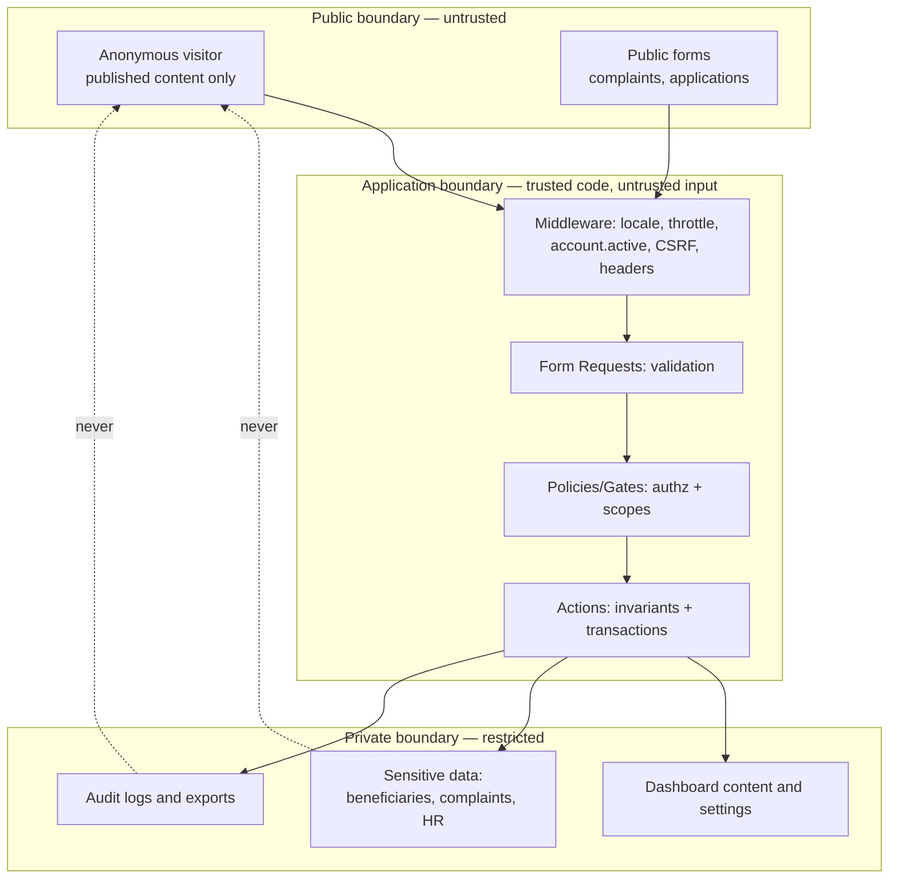

# PCDR — Security Architecture

**Status:** Design only. No configuration, middleware, header, policy, or code change is made in this phase.

---

## 1. Security posture and principles

**[RECOMMENDATION]** PCDR may handle sensitive personal information (beneficiary applications, complaints, job applications, volunteer records). The architecture therefore assumes breach impact is serious even if likelihood is modest.

**Principles**

1. **Deny by default.** All private routes require authentication, an active account, and an explicit permission (ADR-005).
2. **Backend is the only trust boundary.** Client checks are cosmetic.
3. **Data minimization.** Collect only fields justified by a defined business requirement. No speculative personal data.
4. **Defense in depth.** Layer framework controls, application authorization, logging, and operational controls.
5. **Separation of duties.** Content editing, approval, audit review, and settings administration are distinct capabilities.
6. **Never trust stored configuration as secret.** Secrets live in environment configuration or a proper secret manager (ADR-010).
7. **Audit meaningful access, not only writes.** Reading beneficiary/complaint records and exports is audited.
8. **Fail closed.** Misconfiguration disables a feature rather than exposing data.

**[VERIFIED]** The current application has CSRF protection, hashed passwords, and framework session security by default, but no authentication, authorization, rate limiting beyond defaults, custom headers, or upload handling. `APP_DEBUG` and production environment values must be reviewed before deployment (see `DEPLOYMENT_ARCHITECTURE.md`).

---

## 2. Security boundaries

**[RECOMMENDATION]** Manifest rules:

- Public controllers query only `status = published` content; no parameter may escalate a public query to draft/internal state.
- Public form payloads are validated, rate-limited, and stored in restricted tables; no public endpoint returns submission references to third parties.
- Private records are never serialized into Inertia props unless the receiving page has a legitimate, authorized need. In particular, `auth.scopes` carries resource → `scope_type` only; `scope_value`, internal department/section ids, and scope criteria are never exposed to the frontend.
- File URLs for restricted documents use signed, expiring URLs through a controller — never direct public storage paths.

---

## 3. Threat/control matrix

| Threat | Primary control | Supporting control |
|---|---|---|
| Credential stuffing / brute force | Laravel rate limiter keyed by email + IP; temporary lockout | Password policy, MFA scope (OQ-18), audit of admin logins |
| Session hijacking / fixation | Secure, HttpOnly, SameSite=Lax cookies; session regeneration on login; HTTPS only | Idle timeout **[DECISION REQUIRED]**, session invalidation on suspension |
| Privilege escalation | Custom RBAC, protected permissions, deny by default | Authorization tests, audit, protected role rules |
| IDOR / enumeration | Policies with data scopes on every instance lookup | ULID public references, uniform 403/404 responses |
| CSRF | Laravel CSRF middleware on all state-changing web routes | SameSite cookies, Inertia token handling |
| XSS | Vue auto-escaping; Blade escaping; no `v-html` on user content unless sanitized | Strict CSP, Trusted Types where feasible **[DECISION REQUIRED]** |
| SQL injection | Eloquent query builder / parameter binding; no raw SQL from input | Static analysis, code review |
| Mass assignment | Explicit `$fillable` (or guarded DTO mapping); never `request()->all()` into models | Form Requests as the only input source |
| Malicious file upload | Extension + MIME + size validation; store outside document root; regenerate filename; scan if available | Dedicated disk, signed URLs, no execution permissions |
| Path traversal | Storage abstraction; never join user input into filesystem paths | Validated media IDs |
| Sensitive data leakage in logs | Redaction rules in `BACKEND_ARCHITECTURE.md` §11 | Structured context allowlist |
| Provider/message interception | TLS for SMTP; no credentials in DB or frontend | BCC/suppression handling, audited bulk sends |
| Authorization bypass via queue/job | Actions re-check invariants with actor context | Dedup keys, audit events |
| Data retention violation | Status-based erasure workflow, retention policy | Export expiry, scheduled cleanup job |
| Insider misuse | Separation of duties, audit logs inaccessible to content editors | Anomaly review, restricted exports |
| Supply-chain compromise | Pinned lockfiles, dependency audits in CI | Minimal dependency policy, no unattended updates to production |
| Clickjacking | `X-Frame-Options: SAMEORIGIN` / CSP `frame-ancestors` | Frame-busting not relied upon |
| MIME sniffing | `X-Content-Type-Options: nosniff` | Correct response headers for uploaded files |
| Referrer leakage | `Referrer-Policy: strict-origin-when-cross-origin` | Avoid tokens in URLs except short-lived signed links |

---

## 4. Authentication controls

**[RECOMMENDATION]**

- Use Laravel's session guard and password broker; no custom cryptography.
- Password policy: minimum 12 characters, unique, hashed with the framework default (bcrypt/Argon per config), no composition rules that harm usability. Breached-password check is a future consideration requiring an external service — **[DECISION REQUIRED]**, not assumed.
- Email verification for administrative accounts; unverified accounts receive only a narrow verification surface.
- Login throttle: progressive delay + temporary lock after a configurable threshold; unlock by expiry or administrator action, never by self-service email alone without verification.
- MFA: **[RECOMMENDATION]** strongly recommended for privileged roles, but OQ-18 is **[DECISION REQUIRED]** on scope and method (TOTP vs email code). No package is selected now.
- `last_login_at`, `previous_login_at`, and failed-attempt counters are recorded and shown to the user.
- Account deactivation/suspension dispatches an event that invalidates sessions and pending invitations; `EnsureAccountActive` middleware re-checks each request.
- Password reset tokens are single-use, short-lived, rate-limited, and never logged.
- Account-security mail (verification, reset) is critical delivery: it must not be skipped for a missing DB translation and must not depend on an unconfirmed queue worker; see `COMMUNICATION_ARCHITECTURE.md` §3/§5/§9. **[DECISION REQUIRED]** delivery path and fallback ownership (OQ-10/OQ-11/OQ-15/OQ-40).
- No impersonation in the initial design (see `AUTHORIZATION_ARCHITECTURE.md` §3).

---

## 5. Authorization controls

**[RECOMMENDATION]**

- Every private route passes through `auth`, `account.active`, and a permission or Gate middleware where applicable.
- Form Requests authorize before validation results are used; Policies perform instance-level and scope checks.
- Public references (ULIDs) are opaque but **not** authorization. Never accept a reference alone as proof of ownership.
- Beneficiary and complaint detail views require both a permission and a scope; all reads and exports are audited with a read/export entry that does not require before/after state.
- Bulk export requires a dedicated permission and audit entry; OQ-24 **[DECISION REQUIRED]** whether a two-person approval rule is mandatory for beneficiary exports, before export design.
- See `AUTHORIZATION_ARCHITECTURE.md` for the full model.

---

## 6. Input, output, and injection safety

**[RECOMMENDATION]**

- All input via Form Requests with explicit rule sets; Arabic text accepted with Unicode-aware validation (`string`, `max:*`), no regex that breaks Arabic diacritics.
- Rich text (if approved) must be sanitized server-side with an allowlist; until then, content is plain text or Markdown rendered safely. **[DECISION REQUIRED]** rich-text editor choice.
- No raw HTML from users is rendered with `v-html`. If needed later, sanitize on the server and document the allowlist.
- URL values for navigation items are validated against route keys, approved internal paths, or `https://` external URLs; `javascript:` and `data:` schemes are rejected.
- File names are regenerated; original names are stored as metadata only and escaped on display.
- Query parameters for filters are validated and mapped to allowlisted columns; no dynamic column names from client input.
- JSON settings values are validated against a schema per key before persistence.

---

## 7. File upload and storage security

**[RECOMMENDATION]**

- Private files on a private disk outside the document root; public images on the public disk using the provider-supported exposure method (Laravel `storage:link` where available, or signed delivery). The choice does not change business logic (OQ-09).
- Validation: size limit, extension allowlist **and** MIME sniffing, image dimension limits, reject archives/executables unless a specific approved workflow exists.
- Store checksum, MIME, size, uploader, and timestamp in `media` (see `DATABASE_ARCHITECTURE.md` §3.4).
- Serve restricted documents through an authorization-checked controller with signed, expiring URLs (`URL::temporarySignedRoute`).
- Set storage directory permissions to the minimum required; no execute permission on upload directories.
- Prefer prebuilt assets and avoid writing into `public/` at runtime except the chosen public-storage mechanism **[DECISION REQUIRED]** after provider capability validation.
- Orphan cleanup checks all explicit media pivots and every dedicated attachment table's `media_id` reference before deletion; attached media is never deleted automatically.

---

## 8. Transport, headers, and proxy configuration

**[RECOMMENDATION]**

- Enforce HTTPS everywhere; redirect HTTP → HTTPS at the server or application edge. HSTS after certificate stability is confirmed **[DECISION REQUIRED]**.
- Security headers middleware: `Content-Security-Policy`, `X-Content-Type-Options: nosniff`, `X-Frame-Options: SAMEORIGIN`, `Referrer-Policy`, `Permissions-Policy`.
- **CSP strategy:** start in report-only mode on staging, inventory inline scripts/styles required by Inertia/Vite, then enforce a nonce-based policy. Avoid `'unsafe-inline'` in production where possible. Inertia/Vite compatibility must be verified during implementation, not assumed.
- Trusted proxies: configure `TrustProxies` only with the exact IP ranges or forwarded-header behavior confirmed with the selected provider (OQ-13). Misconfiguration can let an attacker spoof HTTPS/client IP and defeat rate limiting.
- Cookie settings: `secure=true`, `httpOnly=true`, `same_site=lax`, appropriate session lifetime; domain scoped to the deployment host.

**[ASSUMPTION]** The selected provider may terminate TLS upstream; the exact forwarded-header format is unconfirmed. See `DEPLOYMENT_ARCHITECTURE.md` §8.

---

## 9. Sensitive data handling

**[RECOMMENDATION] Data classification**

| Class | Examples | Handling |
|---|---|---|
| Public | Published pages, news, projects | Cached, indexed, no restrictions |
| Internal | Drafts, unpublished media, internal settings notes | Authenticated staff, scopes, no public cache |
| Confidential | User accounts, roles, email logs, notifications, reports | Restricted permissions, audit changes |
| Restricted | Beneficiary applications, complaints, CVs, volunteer records, tender bids | Minimal collection, field-level access control, audited reads/exports, retention, anonymization |

**Rules**

- No restricted fields in analytics tables, notifications, email bodies (beyond a minimum reference and link), or frontend logs.
- Never place applicant/complainant personal data in URLs, flash messages, or audit context.
- Encrypt particularly sensitive fields at rest only if the approved policy requires it (OQ-28) **[DECISION REQUIRED]**; decide before schema definition because it affects column type/length. Otherwise rely on database/server controls plus strict access. Any encryption decision must be accompanied by a documented `APP_KEY` rotation, custody, and recovery plan with a designated owner (OQ-28/OQ-30); no rotation procedure is assumed here.
- Backups containing restricted data inherit the same classification; encrypted and access-limited (see `DEPLOYMENT_ARCHITECTURE.md` §8.5). Recovery of encrypted fields must be tested if OQ-28 requires encryption.
- Test/production data separation: no production data in local or staging environments. The existing demo seeder must be protected or replaced in Phase 2a and must not be used in production.
- **Data minimization is a gate:** OQ-24 → OQ-29 must be answered and recorded before any restricted-data field or schema is designed (beneficiary, complaint, career, volunteer, tender). No field, retention period, erasure process, export rule, or encryption choice is assumed until then.

---

## 10. Audit, monitoring, and incident response

**[RECOMMENDATION]**

- Unified, append-only-inside-the-application `audit_logs` covering identity/RBAC changes, workflow transitions, settings changes (`subject_type = settings.*`), email/bulk sends, media deletion, and restricted-data reads/exports (ADR-017). Read/export entries omit before/after state.
- Application logs: file-based, daily rotation, request IDs, redacted context, no credentials or personal data.
- Alerts (operational, not implemented now): repeated failed logins, privilege changes, bulk export, queue failure spikes.
- Retention: audit and application logs per approved policy **[DECISION REQUIRED]**; append-only inside the application, with expiry only via approved archive/export plus a compensating entry, never an edit or casual delete; never retained indefinitely by default.
- Incident runbook (to be written before production): who can revoke sessions, rotate `APP_KEY`/provider credentials, suspend accounts, and communicate a breach. **[DECISION REQUIRED]** designated security owner (OQ-30); rotation and recovery steps for any field-level encryption are documented only when OQ-28/OQ-30 are answered.

---

## 11. Security testing requirements

**[RECOMMENDATION]** Mandatory before release of sensitive modules:

- Authorization feature tests for every protected endpoint, including cross-role and cross-scope cases (see `TESTING_STRATEGY.md`).
- Tests for self-escalation attempts, protected permission modification, stale-cache access after demotion, and session invalidation after suspension.
- Mass-assignment tests asserting restricted fields cannot be set via requests.
- Upload tests for disallowed MIME/extension, oversized files, and traversal names.
- CSRF and rate-limit tests on public submission forms.
- Dependency audits (`composer audit`, `npm audit`) in CI; current status unverified from Phase 0 timeouts.
- Manual security review of CSP, trusted proxy, and storage permissions before go-live.

---

## 12. Explicit non-claims

**[VERIFIED]** No authentication or authorization implementation, no MFA, no security-header middleware, no CSP, no upload handling, and no audit log exist in the repository today. All controls in this document are design requirements for future phases.
