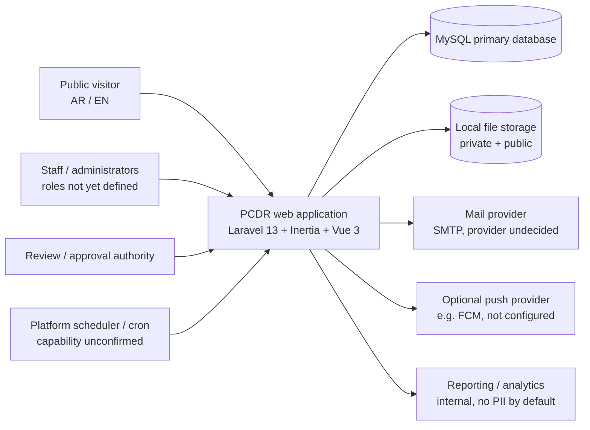
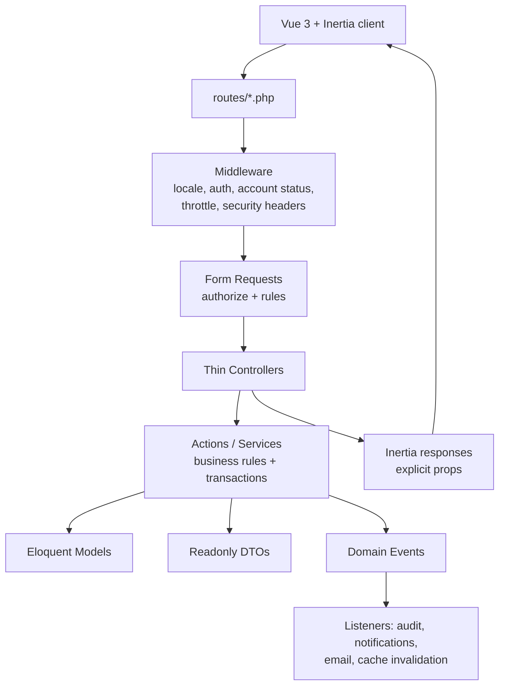
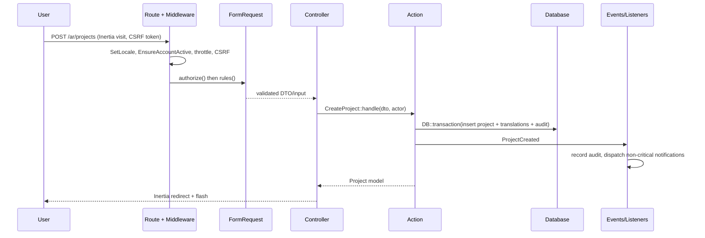

# PCDR — System Architecture

**Phase:** 1 — Architecture Foundation & System Blueprint
**Status:** Design document. Nothing described here is implemented. Phase 1 is a review-ready submission, **not approved**. All 17 ADRs are PROPOSED. **OQ-49 is PARTIALLY RESOLVED — PENDING FORMAL APPROVAL** (general authority framework confirmed by strategic plan; formal execution approval/delegation not recorded); no Phase 2 work is authorized.
**Audience:** Technical lead, backend/frontend engineers, security reviewer, hosting administrator.

---

## 1. Classification legend

| Tag | Meaning |
|---|---|
| **[VERIFIED]** | Observed in the repository, installed packages, or the running environment on 2026-11-21. |
| **[RECOMMENDATION]** | Proposed design; not implemented. |
| **[ASSUMPTION]** | Cannot be verified locally; must be confirmed before it is relied upon. |
| **[DECISION REQUIRED]** | A human decision is needed; the blueprint does not silently choose. |

These tags are used across all documents in `docs/architecture/`. See `OPEN_QUESTIONS.md` for the consolidated register and the four dependency-scope classifications.

---

## 2. Verified baseline

**[VERIFIED]** The Phase 0 report at `/root/PCDR/PCDR_PHASE_0_TECHNICAL_AUDIT.md` was read in full, and the repository was re-inspected before this blueprint was written. No drift was found:

- Laravel **13.43.0**, PHP **8.5.12**, Composer **2.10.1**, Node **22.23.3**, npm **10.9.9**.
- Vue **3.5.46**, `@inertiajs/vue3` **3.11.0**, Inertia Laravel adapter **3.7.0**, Vite **8.3.8**, Tailwind **4.3.5**.
- MySQL connection on MariaDB **12.3.2** locally; InnoDB, `utf8mb4`, strict mode.
- Git working tree clean at commit `c371e8e`; no `docs/` directory existed before this phase.
- Application code consists only of the Laravel 13 skeleton plus the Phase 0 Inertia/Vue wiring: one route, one placeholder page, one middleware, one model, one empty service provider.
- No authentication, authorization, domain models, domain migrations, Form Requests, Policies, tests beyond skeleton placeholders, or frontend layout/component structure.

**[VERIFIED]** Laravel 13's official support window is PHP 8.3–8.5 with security fixes until 2028-03-17. The current environment is inside that window. **No downgrade is required or permitted** (ADR-001).

---

## 3. System context



**[RECOMMENDATION]** The application is a single Laravel deployment serving both the public website and the institutional back office from one codebase and one primary database. Separate subdomains or deployments are explicitly **not** proposed at this stage; they would increase operational cost and duplication without a verified need. **No hosting provider is selected**; Hostinger is a candidate label only. Provider-neutral requirements are in `DEPLOYMENT_ARCHITECTURE.md` §2, and the single production gate is §8 of that document.

---

## 4. Architectural principles

1. **Framework-first.** Follow Laravel 13 and Vue 3 conventions. Do not fight the framework or replace working infrastructure (ADR-001).
2. **Backend is the authority.** Every authorization, validation, workflow, and data-scope decision is enforced server-side. Frontend visibility is a usability affordance, never a security control (ADR-005).
3. **Thin HTTP layer.** Controllers translate HTTP into intent; they contain no business rules (ADR-006).
4. **Explicit over implicit.** Dependencies are constructor-injected; side effects are explicit events/listeners; multi-step writes use transactions.
5. **Minimal dependencies.** Add packages only when the need is proven and the alternative costs more than it saves. No role-permission package, UI kit, animation library, or push SDK in Phase 1 (ADR-004, ADR-013, ADR-014).
6. **Content is configuration until verified.** No registration number, founding date, staff member, partner, project, achievement, or result is invented. All such information is admin-managed content with empty initial state (see `OPEN_QUESTIONS.md` OQ-01–OQ-06).
7. **Bilingual by construction.** Arabic is the initial default; every content model, route, email, notification, and SEO surface has a locale strategy from day one (ADR-003, ADR-007).
8. **Privacy by design.** Data minimization, restricted fields, redacted logs, retention rules, and a clear public/private boundary are designed before beneficiary workflows exist (see `SECURITY_ARCHITECTURE.md`). OQ-24–OQ-29 must be answered before any sensitive schema is authored.
9. **Accessibility and motion are first-class.** WCAG 2.2 AA target, RTL/LTR parity, reduced-motion compliance, and a centralized motion token system are part of the design system, not afterthoughts (ADR-013, ADR-014).
10. **Provider-neutral and portable.** The design targets a single deployment account where feasible while keeping the application portable across shared, managed, VPS, and container hosting without restructuring (ADR-016). Provider capabilities are validated at dependency points and at the canonical gate in `DEPLOYMENT_ARCHITECTURE.md` §8; no Laravel downgrade is accepted to suit an unverified provider (ADR-001).
11. **Everything is testable and auditable.** Actions and Policies are unit-testable; sensitive HTTP paths are feature-tested; meaningful changes are recorded in a unified append-only-inside-the-application audit log (ADR-015, ADR-017).
12. **No automatic progression.** Documentation completion never starts a phase; every transition requires recorded formal approval/authorization under OQ-49. OQ-49 is PARTIALLY RESOLVED — PENDING FORMAL APPROVAL; no transition is authorized until formal written authorization/delegation is recorded.

---

## 5. Layered application architecture



**[RECOMMENDATION] Dependency direction**

```
HTTP (routes, middleware, requests, controllers)
        ↓  depends on
Application (actions, services, DTOs, events, jobs, notifications)
        ↓  depends on
Domain/Infrastructure (models, enums, contracts, support, config)
```

- Dependencies point **inward**. Domain/infrastructure classes never depend on HTTP classes.
- Business classes receive collaborators through **constructor injection**; facades and `app()` are acceptable at the framework edge (routes, middleware, providers) but avoided inside Actions/Services.
- Controllers never call Eloquent for writes and never build validation arrays; Form Requests and Actions own those concerns.
- Repositories are **not** introduced by default (ADR-006).

Detailed conventions: `BACKEND_ARCHITECTURE.md`.

---

## 6. Cross-cutting concerns

| Concern | Decision | Detail |
|---|---|---|
| Authentication | Custom implementation on Laravel's session guard; no auth starter kit chosen yet | `AUTHORIZATION_ARCHITECTURE.md`; OQ-17 **[DECISION REQUIRED]** before Phase 2a; MFA scope OQ-18 before go-live |
| Authorization | Custom RBAC + Policies/Gates + data scopes; no Spatie package | ADR-004, ADR-005; protected-capability holders OQ-23; `department`/`section` scopes conditional on OQ-19 |
| Localization | `/{locale}` prefixed routes, `ar` default, per-entity translation tables | ADR-003, ADR-007, `LOCALIZATION_ARCHITECTURE.md`; OQ-31/OQ-32/OQ-38 gated before Phase 2a/3 |
| Workflows | Enum status + config-driven transition map, not a workflow engine | ADR-008 |
| Settings | Split between environment secrets and DB-backed public/protected settings | ADR-010; secrets never in props; `is_public` allowlist |
| Media | Central `media` registry + explicit public pivots + dedicated restricted-attachment tables with signed URLs | ADR-009, `DATABASE_ARCHITECTURE.md` §3.4 |
| Email | Laravel Mail + templates + queue for non-critical + critical-mail fallback path | ADR-011, `COMMUNICATION_ARCHITECTURE.md` §3.1/§5/§9; OQ-10/OQ-11/OQ-15/OQ-40 |
| Notifications | Laravel Notifications with replaceable channels; FCM optional, not configured | ADR-012; OQ-42 |
| Audit | Unified, append-only-inside-the-application `audit_logs` with read/export entries, redaction, and approved retention | ADR-017; retention OQ-26 |
| Design | Token-driven Tailwind v4 + CSS custom properties; no UI kit | ADR-014, `DESIGN_SYSTEM.md`; assets/content gated by OQ-01–OQ-06, OQ-33–OQ-35 |
| Motion | CSS-first + IntersectionObserver composable; no GSAP/Lottie initially; 480ms one-shot ceiling | ADR-013, `MOTION_DESIGN_SYSTEM.md` §3/§4 |
| Quality | Pint, PHPUnit ^12.4, planned Larastan, PHPCompatibility tool evaluation, mandatory authorization tests | ADR-015, `TESTING_STRATEGY.md`; OQ-46/OQ-47 |
| Deployment | Provider-neutral requirements, prebuilt assets + vendor strategy, canonical production gate | ADR-016, `DEPLOYMENT_ARCHITECTURE.md` §2/§8 |

---

## 7. Request lifecycle (representative authenticated write)



**[RECOMMENDATION]** Inertia visits and ordinary web requests share the same middleware and authorization path. There is no separate "API" trust boundary in Phase 1. If a future mobile client requires tokens, it is added via a dedicated guard (`laravel/sanctum` only then) rather than weakening web authorization.

---

## 8. Quality attributes and targets

| Attribute | Target | Mechanism |
|---|---|---|
| Maintainability | No business logic in controllers; every module has one clear owner | Layering, ADR-006, Pint, Larastan (planned) |
| Security | Deny by default; authorization test for every sensitive endpoint | Policies, FormRequests, ADR-005, ADR-017 |
| Accessibility | WCAG 2.2 AA on public templates and core dashboard flows | Semantic HTML, focus states, contrast tokens, a11y checks |
| Internationalization | Full AR/EN parity for content, UI, email, notifications | Translation tables, lang files, hreflang |
| Performance | Static assets hashed and cached; no N+1 queries; transform/opacity-only motion | Vite build, eager-load rules, motion tokens |
| Operability | Reproducible provider-neutral deploy, backups, queue/scheduler plan, audit trail | `DEPLOYMENT_ARCHITECTURE.md` §2/§8, cron, logs |
| Portability | No provider-only dependency in application code | Capability-neutral decisions, ADR-016 |

**[ASSUMPTION]** Specific numeric performance targets (response time, concurrent users) cannot be set until expected load and the selected runtime are known. No provider capability is asserted.

---

## 9. Explicit non-goals for this phase

- No migration, model, controller, policy, route, or package is created.
- No institutional content, staff, partners, projects, or results are generated.
- No authentication pages or role assignments are built.
- No decision is made that depends on unverified legal status, hosting capabilities, donor requirements, or personal-data obligations.
- No claim is made that a documented feature exists.
- No ADR is accepted, no phase is authorized, and no open question is answered by this document.

---

## 10. Traceability to Phase 0 findings

| Phase 0 item | Addressed by this blueprint |
|---|---|
| C-1 No auth/authz | `AUTHORIZATION_ARCHITECTURE.md`, ADR-004/005, Roadmap Phase 2a |
| C-2 No production env config | `DEPLOYMENT_ARCHITECTURE.md` §6, ADR-010/016, `OPEN_QUESTIONS.md` |
| C-3 Target-provider capabilities unverified | `DEPLOYMENT_ARCHITECTURE.md` §1/§2/§8 (provider-neutral requirements + canonical gate) |
| H-1…H-5 Validation, layering, tests, static analysis, errors | `BACKEND_ARCHITECTURE.md`, `TESTING_STRATEGY.md`, ADR-006/015 |
| H-6 Queue/scheduler | `COMMUNICATION_ARCHITECTURE.md` §5, `DEPLOYMENT_ARCHITECTURE.md` §7 |
| H-7 Storage link | `DEPLOYMENT_ARCHITECTURE.md` §5, `DATABASE_ARCHITECTURE.md` (media domain) |
| H-8 Dependency audits | `TESTING_STRATEGY.md` CI gates; results still unverified |
| H-9 Demo seeder | `DATABASE_ARCHITECTURE.md` §8, Roadmap Phase 2a acceptance criteria |
| M-1…M-9 Frontend, rate limiting, CORS, dead view, locale, permissions | `FRONTEND_ARCHITECTURE.md`, `LOCALIZATION_ARCHITECTURE.md`, `SECURITY_ARCHITECTURE.md`, `MODULE_MAP.md` |

---

## 11. Document index

See `PHASE_1_SUMMARY.md` for the complete list of the 17 architecture documents and their responsibilities. The finalization record is `PHASE_1_FINALIZATION_REPORT.md`; it documents dispositions but does not grant approval.
