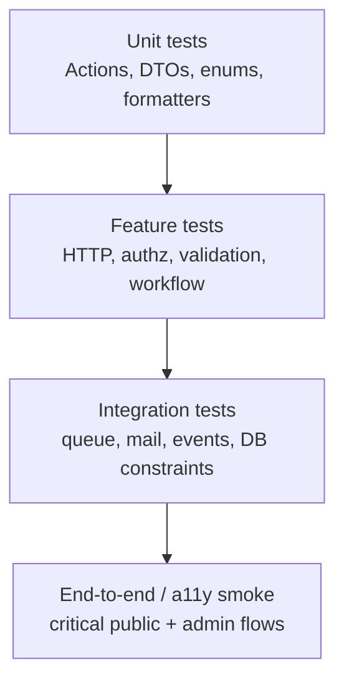
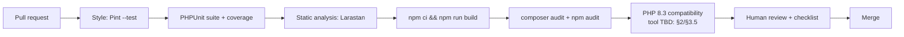

# PCDR — Testing & Code Quality Strategy

**Status:** Strategy baseline plus Phase 2a implementation status. Sections 1–7 are the historical Phase 1 record; Section 8 records the tests actually added for the Phase 2a technical foundation. No CI workflow, Larastan, PHPCompatibility runner, frontend test runner, or browser/a11y suite is installed. OQ-49 remains **PARTIALLY RESOLVED — PENDING FORMAL APPROVAL** and no ADR is approved.

---

## 1. Verified baseline

**[VERIFIED]**

- `composer.json` requires `laravel/framework` and `phpunit/phpunit ^12.4`; Pint is installed as a dev dependency.
- `tests/TestCase.php`, `tests/Feature/ExampleTest.php`, `tests/Unit/ExampleTest.php` exist as skeleton placeholders only.
- No `phpunit.xml` customization beyond Laravel defaults, no `pint.json`, no PHPStan/Larastan config, no CI workflow, no frontend test tool.
- `npm run build` succeeds. `composer audit` and `npm audit` timed out during Phase 0; current status unverified.

---

## 2. Tool evaluation

| Tool | Status | Recommendation |
|---|---|---|
| **PHPUnit** | **[VERIFIED]** installed via `phpunit/phpunit ^12.4` | Keep as the PHP test runner. Laravel 13 works with PHPUnit 12. |
| **Pest** | Not installed | **[RECOMMENDATION]** Optional readability layer on PHPUnit. **[DECISION REQUIRED]** Adopt only if the team prefers its syntax; do not install both runners' configs without need. Default plan uses PHPUnit to avoid an extra dependency. |
| **Laravel Pint** | **[VERIFIED]** installed | Keep. Add a committed `pint.json` later for team-wide consistency (no config exists now). |
| **PHPStan / Larastan** | Not installed | **[RECOMMENDATION]** Add Larastan in a later phase for static analysis of Laravel code; start at a pragmatic level and raise over time. No package now. |
| **Vitest + Vue Test Utils** | Not installed | **[RECOMMENDATION]** Add when real frontend components exist; test primitives and composables, not every page. No package now. |
| **Playwright / browser tests** | Not installed | **[DECISION REQUIRED]** Valuable for critical flows and a11y smoke tests, but heavy for shared hosting CI. Defer until flows stabilize. |
| **axe-core / accessibility checks** | Not installed | **[RECOMMENDATION]** Automated a11y checks on key routes plus manual keyboard/screen-reader review. Tool choice later. |
| **PHPCompatibility (via PHP_CodeSniffer)** | Not installed | **[RECOMMENDATION] (F-11)** Evaluate as the PHP 8.3 compatibility checker required by §3.5 and gate 6. Record the exact command and pinned version in Phase 2a before gate 6 is enforceable; a different tool may be chosen, but the chosen tool and command must be recorded. No package is installed in Phase 1. |
| **Composer/npm audit** | Available commands; results unverified | Run in CI on every PR; treat high/critical advisories as blocking. Results remain unverified from Phase 0 timeouts. |

**[RECOMMENDATION] Dependency rule:** Testing tools are added only in the phase where they are actively used. No speculative installation in Phase 1.

---

## 3. Test pyramid for PCDR

### 3.1 Unit tests

- Actions with collaborators mocked only at true boundaries (e.g. mail renderer); prefer database-backed tests for Actions that touch Eloquent.
- Enum transition maps: every allowed and forbidden transition per entity.
- DTO normalization and formatter behavior (dates, numbers, locale-specific output).
- ScopeResolver logic given synthetic role/scope inputs.
- Template renderer variable substitution and escaping.

### 3.2 Feature tests (highest priority)

**[RECOMMENDATION] Mandatory for every sensitive module:**

| Test category | Required assertions |
|---|---|
| Authentication | login/logout, verification, reset token single-use, lockout, account status middleware |
| Authorization | each protected endpoint returns 403 without the exact permission; role and scope combinations; protected permissions cannot be modified; self-role-assignment rejected; an expired `user_roles.expires_at` role is excluded from every permission/scope union |
| Data scopes | user sees only `all` / `department` / `assigned` / `self` records as configured (department/section only if OQ-19 is affirmative); cross-scope access denied |
| Frontend props (F-12) | serialized `auth.scopes` contains `scope_type` only; assert `scope_value`, internal ids, and criteria are absent |
| Validation | invalid Arabic/English input, oversized fields, bad slugs, disallowed URL schemes, mass-assignment attempts on protected columns |
| Workflow | draft → review → approve → publish → archive; forbidden transitions rejected; unauthorized publish denied |
| Localization | `/ar` and `/en` routes, `dir` attribute, translation fallback, canonical/hreflang output, locale-specific slugs |
| Settings | `is_public` allowlist: no secret/reference keys in Inertia props; non-admin cannot update settings |
| Email | event triggers correct template/locale; dedup key prevents double send; failures logged and retried; **critical mail** (verification/reset) is never skipped for a missing DB translation, uses the code-owned `lang/` fallback, and works on the recorded synchronous-or-confirmed-worker path (F-04) |
| Notifications | preferences honored; mark-all-read scoped to actor; deep links still authorize; dedup |
| Public/private boundary | unpublished content not queryable publicly; restricted submissions never in public responses |
| Uploads | MIME/extension/size rejection; traversal filename rejected; private file requires signed authorized URL |
| Audit | sensitive writes produce entries with redacted before/after; restricted reads and exports produce `read`/`export` entries with `context` and optional `access_reason` and **without** `before`/`after`; settings changes use unified `audit_logs` with `subject_type = settings.*` |

### 3.3 Integration tests

- Database transactions roll back fully on failure (no partial translations/pivots).
- Unique constraints enforced (email, role key, permission key, translation pairs, references).
- Event → listener → audit/notification/email chain with queued jobs faked.
- Queue retry/backoff with a fake failing mailer.
- Cache invalidation: permission change takes effect in the next request; no stale access after demotion.
- Migration up/down on a test database (no production data).

### 3.4 Frontend tests (planned)

- `usePermission` never grants access; it only toggles UI (assert no security semantics).
- `useLocale` direction and formatting helpers.
- `Ui/` primitives: keyboard operation, labels, aria attributes, reduced-motion behavior.
- Inertia page smoke: props render without errors for AR and EN.

### 3.5 Accessibility and build verification

- Automated a11y scan on homepage, one content detail page, login, and one dashboard list.
- Manual keyboard-only walkthrough and screen-reader spot check before release.
- `npm run build` must succeed with no unresolved imports; inspect bundle size baseline at first dashboard.
- PHP 8.3 compatibility check **must be added to CI** even if local is 8.5, because the target runtime PHP version is unconfirmed. **[RECOMMENDATION] (F-11)** Candidate tool: PHPCompatibility via PHP_CodeSniffer (§2). Gate 6 is not enforceable until the tool, command, and pinned version are recorded; recording it is a Phase 2a quality-tooling task, not a Phase 1 change.

---

## 4. Quality gates

**[RECOMMENDATION] Every PR must pass:**

1. `pint --test` (style) — blocking.
2. PHPUnit full suite — blocking; no skipped authorization tests.
3. Larastan at configured level (once introduced) — blocking for new code.
4. `npm run build` when frontend files change — blocking.
5. `composer audit` and `npm audit` — blocking on high/critical advisories; exceptions documented.
6. PHP 8.3 syntax/compatibility check — blocking (target-runtime uncertainty). Run the tool and command recorded in §2/§3.5 (candidate: PHPCompatibility); until recorded, this gate is a documented requirement, not an executable check (F-11).
7. Migration review checklist: reversible, indexed, no data loss, backing up plan noted — blocking for DB PRs.
8. Authorization test presence for new protected endpoints — blocking (review checklist + test names).
9. Documentation update when an ADR or module behavior changes — blocking.
10. Human review approval — blocking; automated checks do not replace review.

**Coverage expectations**

- Critical authz/RBAC/workflow code: aim high coverage ( guideline ≥ 85% line coverage for new code in those areas).
- Other new business code: meaningful tests over raw percentage; no coverage theater.
- Frontend: focus on composables and primitives; do not chase full page coverage.

**[RECOMMENDATION]** Coverage numbers are targets for review discussion, not enforced gates until tooling is configured.

---

## 5. Test data policy

- Use Laravel factories with **synthetic** data only.
- No production data copies in local/staging.
- No fake institutional facts: factories create technical records with obviously synthetic labels, never real-looking organization claims.
- The existing `DatabaseSeeder` demo user **[VERIFIED]** must be guarded or replaced in **Phase 2a**, before first non-local use — not only at go-live (F-19). This is an acceptance criterion in `IMPLEMENTATION_ROADMAP.md` §3 and a blocking checklist item for any non-local environment.
- Translation tests use short synthetic AR/EN strings; no invented institutional content.

---

## 6. CI pipeline (planned shape)

**[ASSUMPTION]** CI runner availability is not confirmed (OQ-47); the pipeline is a design target. If no hosted CI exists, the same commands run locally with a documented pre-push checklist. The CI owner/tooling decision must be recorded before the pipeline is treated as an enforceable gate (OQ-47, governed by OQ-49; PARTIALLY RESOLVED — PENDING FORMAL APPROVAL). PHPUnit remains the runner at `^12.4` **[VERIFIED]**; Pest is not adopted without a separate decision (OQ-46).

---

## 7. Non-goals for Phase 1

- No package installation, no CI file, no test creation, no coverage enforcement today.
- No claim that tests exist beyond the two skeleton examples.
- No browser/e2e suite added before the critical flows are implemented.

---

## 8. Phase 2a implementation coverage

The following PHPUnit coverage was added with the Phase 2a technical foundation. These tests are backend authorization and integration evidence only; they do not approve an ADR, close an open question, or authorize Phase 3.

| Test class | Coverage |
|---|---|
| `AuthenticationTest` | Login/logout audit, failed credentials, suspended/locked/unverified states, signed verification, reset notification/token flow, rate limiting. |
| `RbacTest` | Role permission evaluation, cache invalidation, dynamic custom permissions, retired permissions, Platform Owner universal permissions, scoped summaries without values, default-deny and `all`/`self`/`assigned` scopes, permission sync idempotence, schema uniqueness, session invalidation on suspension. |
| `PlatformOwnerProtectionTest` | Secure interactive bootstrap, no hardcoded credentials, second-owner refusal, last-owner protection, password absent from audit records. |
| `AuditTrailTest` | Recursive redaction, append-only enforcement, viewer/export authorization, view/export entries without `before`/`after`. |
| `SettingsTest` | Public allowlist, persisted updates, audit records, invalid values, unknown-key rejection. |
| `LocalizationTest` | Root/legacy redirects, AR/RTL and EN/LTR document props, locale-aware validation. |
| `AdminAuthorizationTest` | Permission-gated admin pages, user management, password policy validation, self-role-assignment rejection, protected permission and privilege boundaries. |
| `ContentStatusTest` | Five required workflow states and declared transition map. |

Local Phase 2a QA results: PHPUnit `44 tests, 44 passed, 251 assertions, 19.664s`; `vendor/bin/pint --dirty --format agent` passed; `npm run build` completed with 608 modules in 4.75s (non-blocking optional `fontaine` fallback notice); `composer audit` reported no security vulnerability advisories; `npm audit` found 0 vulnerabilities. No Vitest, Vue Test Utils, Playwright, or axe suite was introduced. PHP 8.3 compatibility and Larastan remain unimplemented gates, so no claim is made that they pass.
